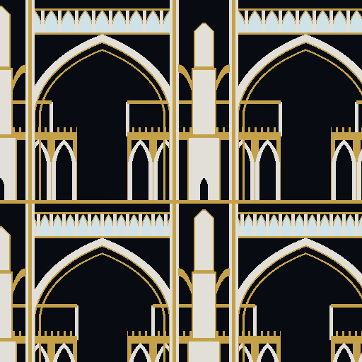

# GENTEK-SHOWCASE-CATHEDRAL-001 — Cathedral Megaframe

**Draft / HOLD research.** This independently owned showcase starts from parent
PR #624 at `615828b28337f85e4663e03ba479616db4ddf764`. Its branch is
`experiment/gentek-showcase-cathedral-001`, targeting
`experiment/gentek-classic-001-20261115`. The parent and the sibling showcases
remain independently reviewable. No merge or Ready promotion is authorized.

The hypothesis is that one immutable coordinate sampler can coordinate four
spatial scales into monumental, readable architecture. This is the existing
GEN-007 schema-4 contract: `cathedral_megaframe` **v1**, an ordinary
`cybersand.architectural-style` preset named **Cathedral Megaframe**, the existing
five-card generator, and ordinary preview/install/save/reopen. It introduces no
new renderer, material, physics, graph editor, neighbour access or assembly system.

## Architectural grammar

Let **B** be `room_size` (native `bay_width`), **L** be `floor_height`, and **w**
be `wall_thickness` (native `wall`). One supercell is **4B × 3L**. The source
names each coordinate level in `CathedralMegaframe` in
`native/src/generation_architecture_classic.inc`:

| Scale | Coordinates and extent | Architectural responsibility |
| --- | --- | --- |
| Superstructure | `cell_x`, `cell_y`, `mx`, `my`; 4B × 3L | A whole monumental frame, seed scope, shared boundaries |
| Primary bays | Centre 2B, half-span 3B/2; crown L/2, spring 7L/4 | Thick pointed arch, tall piers and a large protected nave |
| Secondary architecture | Side aisles B/2–3B/2 from each edge; pitch B/2 | Four subsidiary arcades, triforium at 2L, side gallery at 3L/2 |
| Tertiary detail | Clerestory pitch B/3 or B/4; balustrade pitch B/8 | Framed lancets, narrow inner ribs, ledges and short posts |

The nave occupies the central bay and remains open down to the bottom deck.
Secondary galleries stop at supported arcade piers; no ordinary deck fills the
central volume. The primary piers extend through the supercell ceiling to meet
the preceding supercell's floor. Side buttresses widen in steps toward the base;
curved flying members join their upper mass to the principal piers. These are
geometric load-path cues, not a structural-engineering simulation.

The pointed arch uses a bounded integer lens inequality, rather than a bitmap
or square-root lookup. For horizontal distance `dx`, half-span `r`, rise `h`,
and height `dy` above the spring, the inside condition is
`3*r*r*dy*dy + h*h*(dx+r)*(dx+r) <= 4*r*r*h*h`, with explicit lateral and
vertical bounds. The difference between two nested lenses makes a thick rib;
a smaller pair creates the intermediate order. The inner aperture contracts by
one raster column, ensuring adjacent columns overlap even at the admitted
22-cell-wide / 256-cell-tall limit. Curved flying members similarly cover the
interval through the next column. These are bounded analytic raster rules, not
neighbour-cell reads. All products remain within
signed 64-bit arithmetic for the admitted dimensions. There is no iteration,
allocation, mutable cache or World query inside `sample()`.

## Parameters and material roles

The starting preset uses **72 / 96 / 5** for B / L / w, door width 12, no
service shaft, the existing `ruins` theme, Marble (98), Brass Panel (119), and
Frosted Glass (121). The existing style compiler maps the
floor selection to both native deck and accent roles; this showcase preserves
that schema. Direct schema-4 recipes can still specify the existing separate
`accent_material` native parameter.

The supplied hero projects select Cathedral as the sole 100% style and disable
the existing **Automatic tunnels** control, so the independent global tunnel
carver does not cut the architectural specimen. Their ordinary project JSONs
retain this setting; the standalone style preset keeps the established global
tunnel ownership and does not silently override it.

| Existing control | Cathedral response |
| --- | --- |
| Room size | Changes the four-bay span, side-arcade pitch, pier spacing, glazing and balustrade cadence |
| Floor height | Changes the three-storey period, arch rise, two side datums and high clerestory zone |
| Wall thickness | Changes primary mass, smaller ribs, frame widths and deck thickness |
| Automatic windows | Replaces clerestory glazing with shell when disabled; occupied/empty geometry is identical |
| Automatic doors | Opens or fills pointed portals in the lower boundary buttresses; main nave and primary piers remain intact |
| Service shaft | Retains the existing explicit straight shaft cutout; the showcase preset disables it |

Both B and L must be at least `6*w + 16` cells, within the existing maximum of
256. This protects secondary aperture clearance instead of silently collapsing
the design at small dimensions. The existing project validation reports the
same guard as native admission. The edge campaign exercises B=L=46, w=5,
exactly on this bound. Portal width is bounded by the available buttress mass;
the mandatory nave does not depend on the automatic-door switch.

## Seed scope and determinism

Lane 7301 hashes `(recipe seed, supercell X, supercell Y)` to select a grouped
clerestory rhythm and which side receives the longer upper gallery. Lane 7302
hashes `(recipe seed, boundary X, supercell Y)` to select tower height. Both
neighbours use the same boundary key, so independently sampled halves of a
shared tower agree. The frame's identity, central void, and major pier positions
are invariant under those choices. There is no per-cell random noise.

Signed floor division and positive modulo derive all local coordinates from the
module origin. A chunk merely asks for coordinates; it supplies no architectural
state. Sampling order, work slices and request order cannot influence any seed
choice. The existing compiler's global module anchor preserves the same phase
across style-mask chunks. Irregular style masks retain the existing clipping
behaviour; Cathedral does not negotiate joins between Genteks. A finite canvas
can cut off the supporting leg of an otherwise connected repeated frame.
Independent material-component review found boundary-truncated pieces in the
512 hero and tall case, including an intermediate-rib crown whose legs lie below
the canvas. Complete supercells and their joins are qualified; arbitrary clipped
silhouettes are not repaired by this sampler. The qualification does not claim
that every partial structure remains connected after finite-mask clipping.

## Qualification and retained evidence

The native test extends the complete 72-member CLASSIC catalogue to **73**,
without lowering its occupied/void or distinctness gates. An independently
compiled parent snapshot supplies a frozen aggregate identity for all original
72 samplers and individual Viaduct v1/v2 hashes. Showcase checks cover chunk
seams, nested frequencies, major void, controls, at least four seeds, replay,
signed origins, reversed chunk order/receipts and work slicing.

`godot/tests/test_gentek_cathedral_showcase.gd` obtains actual material IDs from
`CyberWorldGenerator` and reuses the existing material LUT preview function.
It retains at least sixteen Cathedral maps, a 512 and 1024 hero, four seed
arms, dimensional/mass/aperture controls, an edge case, two literal detail crops,
and Arched Viaduct / Pointed Arcade / Basilica comparisons. Every full PNG has
its original material bytes, recipe, project and native receipts beside it.
The 1024 map remains available independently of the crops.

The source ledger snapshots build and execution inputs before compilation,
checks those bytes after capture, binds the executed extension SHA-256, and
hashes retained outputs. The isolated workflow
`.github/workflows/gentek-cathedral-showcase.yml` executes on the Cathedral
branch while it remains Draft; it cannot write to the parent branch.
Exact campaign counts, timings, visual findings and the independent final
verdict are recorded in the PR evidence comment and artifact manifest.

Reproduce the native checks with `make -j2 worldgen-test`. Run the source-built
extension with `CYBERSAND_ARCHITECTURE_OUTPUT` pointing to the evidence directory
and Godot's `--headless --path godot --script
res://tests/test_gentek_cathedral_showcase.gd`. The workflow records its complete
pinned toolchain commands. Local iteration does not substitute for final source
and runtime identity or owner aesthetic acceptance.

## Visual review and measured response

Independent source and image review found the four-scale hierarchy legible in
both full-size heroes: the primary pointed frame dominates, the side arcade is
subordinate, glazing stays high, and small gallery posts supply a finer rhythm.
The centre remains open. The Marble / Brass / Frosted Glass palette separates
primary mass, ribs/decks and glazing. Seed changes preserve the typology while
varying gallery handedness, tower height and clerestory grouping. This is a
controlled repeated architectural family, not a freeform floor-plan generator.

Two substantive review findings were repaired before qualification: the primary
piers now connect vertically repeated supercells, and the analytic one-column
overlap prevents disconnected rib caps at extreme valid aspect ratios. The
original failing extreme-aspect test passes without reducing its connectivity
requirement. Added adapter execution also caught missing schema-4 catalogue
metadata for the new module and an inherited test classifier that mistakenly
treated all 72 CLASSIC v1 modules as legacy; both were repaired.

The owner preset's native 512 hero contains **57.91% empty cells**; the 1024 hero
contains **56.43%**. The exact dimensional-limit image retains **44.17%**.
With all other inputs fixed, the 512 native material campaign measured:

| Change | Different material cells | Different occupied/empty cells |
| --- | ---: | ---: |
| Room size 72 → 96 | 117,044 | 97,783 |
| Floor height 96 → 128 | 104,804 | 88,068 |
| Wall thickness 1 → 5 | 58,622 | 42,368 |
| Clerestory windows on → off | 12,382 | 0 |
| Buttress portals on → off | 473 | 473 |

All window changes are glazing-to-shell substitutions. Four identical-parameter
seeds (271828, 314159, 161803, 57721) produce four different material SHA-256s;
each repeated seed replays exactly. Matched-palette/parameter comparisons differ
from Viaduct, Pointed Arcade and Basilica in respectively **157,248**, **178,790**
and **148,132** material cells. Those differences accompany visibly different
scale relationships; a hash difference alone is not the architectural finding.

The separate native structural fixture uses B=96, L=80, w=3 and a diagnostic
62/66/121/114 palette. Across all four seeds it preserves a **22,121-cell connected
nave**, a **5,616-cell fully empty protected rectangle**, a connected main arch
crossing five vertical and two horizontal chunk seams, and 480-cell continuous
primary piers. These are fixture-specific measurements, not hero-image counts.

## Qualification scope

Local and hosted generation qualification passed all **nine native executables**, with
**1,966,986 explicitly counted assertions** across four suites and five further
passing suites without printed counts. The procedural subset has 969,257 checks,
including 552,616 Cathedral assertions. The parent 72-material aggregate remains
`4a92810d575d9201`; eight Viaduct v1/v2 chunk identities remain frozen. Independent
ASan/UBSan execution also passed 969,257 checks.

Both local and hosted adapter campaigns passed **6,320 checks / zero failures**: project
contract 2,762, existing GEN-007/73-CLASSIC qualification 2,490, Cathedral capture
campaign 1,005, actual graphical author 42 and fresh-process reopen 21. The
ordinary five-card form, native install acknowledgement, painted cell and ordered
edits survive Save and reconstruction. The reviewer independently verified all
20 full PNGs against raw native material IDs through the unchanged preview LUT,
and verified both crops against their original source map.

Local evidence used GCC 14.2 / binutils 2.44 and Godot 4.7. The unchanged spatial
allocation-probe test needed only its GCC-14 `mismatched-new-delete` diagnostic
downgraded to a warning; repository source and canonical compiler flags were not
changed. LeakSanitizer cannot operate under this host's tracing, so the successful
ASan/UBSan run disables leak detection and does not claim a leak check. The
separate hosted workflow uses canonical GCC 13 without that diagnostic override.

The branch retains the parent's committed runtime pointers. This research
campaign distributes its source-matched Linux runtime inside the evidence
artifact; it does not re-attest the parent's published manifests or claim a
Windows evaluation bundle. Actual graphical qualification uses X11/Mesa software
rendering. Physical Windows owner acceptance, Ready promotion and merging remain
outside this handoff.

## Hosted qualification — 16 November 2026

[Draft PR #664](https://github.com/techrote/cybersand/pull/664) retains the implementation,
this teaching record and the labelled PNG evidence. The complete source-matched
[qualification run](https://github.com/techrote/cybersand/actions/runs/43969407871)
passed at `b63314d14df6b8ba660f7823687e3738b28d28e6` using GCC 13 on Ubuntu 24.04,
pinned Godot 4.7 and pinned godot-cpp. Its
[downloadable artifact](https://github.com/techrote/cybersand/actions/runs/43969407871/artifacts/14279355327)
contains 198 sealed files: native material maps, PNGs, recipes, receipts, projects,
logs, UI captures, source/runtime ledgers and the actual Linux extension.
Actions retention is 90 days; the 22 selected native PNGs and their
[manifest](../images/gentek-cathedral/manifest.json) are also committed with this research note.

The hosted source ledger has 727 unchanged build/execution inputs with SHA-256
`5aa4a6b03f92f8cf3574ba65e3c1dc280ec065dc3dacd120bc42d8c6e961eeaf`.
The executed and retained Linux runtime SHA-256 is
`b8159685736e0ed8caabe307532cafe6d80d337f053568a30690888f086d9201`.
All 22 selected hosted PNGs are byte-identical to the sealed local images used
for architectural review. Subsequent documentation/gallery commits preserve
all 727 source input hashes; the tested source revision remains explicit rather
than claiming a rebuild at a later evidence-only commit.

| Hosted generation benchmark | Median | Range over five measured runs |
| --- | ---: | ---: |
| Arched Viaduct v2 | 420.499 ms | 419.009–421.001 ms |
| Nested Arcade v1 | 420.046 ms | 419.334–421.581 ms |
| Cathedral Megaframe v1 | 426.314 ms | 425.977–426.587 ms |

Each row uses one warmup and five native 512×512 generations with matched seed,
geometry, palette and the existing spatial-mask/receipt path. Material copying,
PNG encoding and editor display are excluded from the native timer. Cathedral's
median is about 1.4% above Viaduct and 1.5% above Nested Arcade in this run.
This is a representative end-to-end native-path cost, not an isolated
`sample()` microbenchmark or a cross-machine latency promise. No per-cell heap
allocation, mutable cache or unbounded iteration was added.

The first hosted attempt rejected an invalid workflow job-level `runner.temp`
expression before execution. The workflow-only correction uses the workspace
for its isolated XDG profile; the corrected run and the corresponding
[Documentation run](https://github.com/techrote/cybersand/actions/runs/43969417127)
passed. The existing Draft policy skips published-runtime-manifest re-attestation;
the custom source-matched artifact provides the scoped Linux research evidence.

Independent engineering review returned **GO for Draft / HOLD research handoff**
after separately auditing the public run, ZIP identity, all 727 source hashes,
all 198 output hashes, native/UI runtime agreement, 20 full PNG-to-material/LUT
comparisons and both literal crops. It found the four-scale hierarchy convincing,
the sampler comprehensible, bounded seed variation typologically coherent, and
no regression in the frozen CLASSIC/Viaduct outputs. The disclosed finite-mask
clipping limit remains; this verdict does not substitute for owner aesthetic
acceptance, Windows qualification, Ready promotion or merge approval.

*Actual native material preview: a four-bay primary frame, subordinate side
arcades/galleries, a high clerestory and small balustrade/mullion rhythms. Empty
space is retained as an architectural output.*

## Reusing the pattern

A future author should first name the supercell and reserve its major empty
volume. Derive primary axes from that cell; make each smaller rhythm subordinate
to a structural region. Use material precedence deliberately: portals, bearing
mass, primary ribs, framed glazing, secondary arcades, galleries, then small
attached details. Give every repeated boundary one owner/key. Bound each seed
decision to an architectural choice with known support and clearance.

Test the generated material topology and visual hierarchy as well as its hash.
A deterministic slab is still a slab. Separate occupied-mask preservation from
material replacement, compare dimensions independently, and inspect both close
details and complete maps. Keep the sampler comprehensible enough that its
coordinates teach the pattern directly.
