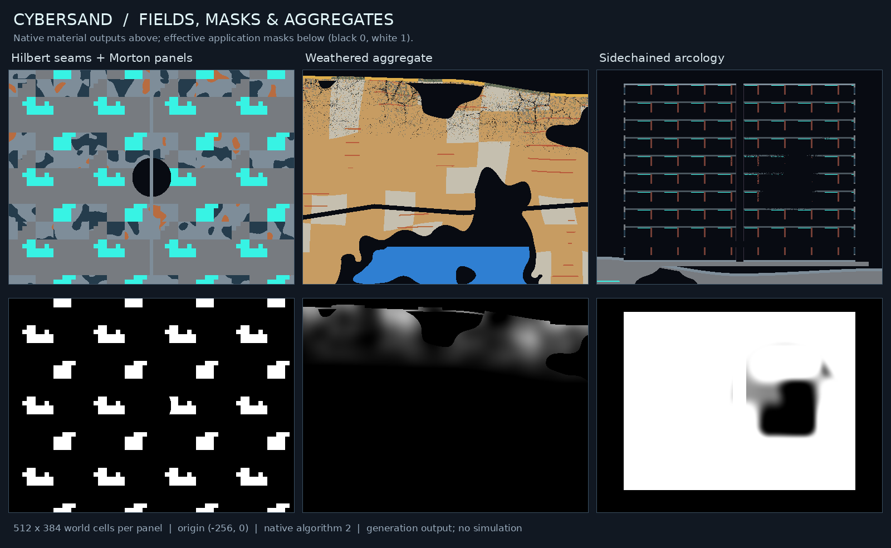
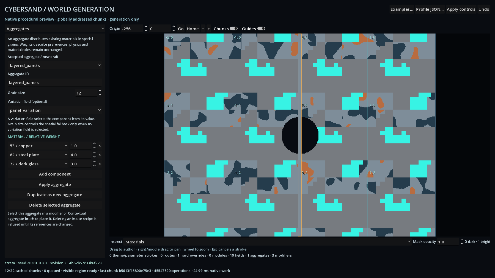

# Procedural generation fields and masked modifiers

GEN-004's opt-in schema-3 [semantic hierarchy](procedural-hierarchical-generation.md)
can reference these normalized application/exclusion masks and existing aggregate
recipes on feature proposals. Its immutable geometry exports can also feed
GEN-003 typed distance fields. Scalar initial context remains the original analytic
candidate snapshot; it never observes partially rasterized semantic features.
Semantic routes restore after material controls and before final hard overrides.

## What does GEN-002 add?

This page owns the retained normalized `fields` graph. GEN-003 schema 2 adds
a separate [typed spatial graph](procedural-typed-spatial-fields.md), with signed
values, distances, vectors, exact categories and explicit mask conversion.
It does not change the scalar/context semantics described below. Existing masks,
module application/exclusion, aggregate variation and parameter mappings may
also name a normalized typed output as `spatial:<id>`; unconverted general
scalars, vectors, categories and booleans reject at that consumer boundary.

**Current candidate source, GEN-002 / [#171](https://github.com/techrote/cybersand/issues/171):**
the three [procedural generators](procedural-world-generation.md) now accept a
named scalar field graph, masked guidance/material modifiers, aggregate material
recipes and masked feature instances. These controls use absolute coordinates and
an immutable description of the initial generated cell. They can be sampled in
any chunk order or cell budget without asking for neighboring chunks.

The [field API](../../native/include/cybersand/generation_fields.hpp) and
[field implementation](../../native/src/generation_fields.cpp) own scalar graph
semantics. The [generation API](../../native/include/cybersand/world_generation.hpp)
and [generation implementation](../../native/src/world_generation.cpp) own how
fields affect themes, geometry, modules and material proposals. None of these
APIs takes a live World or simulation snapshot. Simulation field storage, material
kernels and general resident-world streaming keep their existing contracts.



The figure is rendered from the checked-in Hilbert, weathered aggregate and
sidechained arcology profiles through the native Godot binding. Its cells are
generation proposals before material simulation. The
[dated audit](../audits/2026-10-18-gen002-fields-and-aggregates.md) records the
source/runtime and image reproduction evidence; it does not establish target-PC
frame rate or physical behavior of the generated mixtures.

## How are named fields and sidechains evaluated?

A `fields` entry has `id`, `kind`, ordered `inputs`, a numeric `parameters` map
and, where supported, `warp_x`, `warp_y` or `context`. Input and warp references
name other fields. Compilation validates every declaration, including unused
ones, resolves dependencies and rejects missing references, cycles, duplicate IDs,
wrong arity, unknown parameters and invalid numeric values.

The compiled graph stores outputs in canonical lexical ID order and evaluates in
dependency order. Each node runs exactly once for a sample. An input may be used
by several later nodes without reevaluation; repeated operands such as `x * x`
are valid. Every successful output is finite and normalized to `[0,1]`.
`FieldGraph::evaluate` uses fixed scratch for 64 values, clears unused successful
slots and leaves the caller's entire destination unchanged if coordinates or
context are invalid. The successful scalar evaluation path allocates no ordinary
C++ heap objects; the regression counts those allocations separately from graph
compilation and test setup.

Noise primitives may consume two already evaluated displacement fields. A field
value `v` displaces its axis by `warp * (2*v - 1)` cells; an absent axis contributes
zero. This shifts the receiving primitive's coordinate only. The graph does not
recursively resample a dependency at displaced coordinates, so the declared DAG
also bounds evaluation work. Set `warp=0` for an exact unwarped primitive.

| Field kinds | Meaning and primary controls |
|---|---|
| `constant` | Exact `value` in `[0,1]`, default 0 |
| `value_noise`, `gradient_noise` | Seeded lattice noise; `scale`, `salt`, origin and optional displacement fields |
| `fbm`, `ridged` | Normalized octave combinations; additionally `octaves`, `lacunarity` and `gain` |
| `cellular_distance`, `cellular_gap` | Nearest feature distance or second-minus-first distance on a jittered lattice; `jitter` controls feature displacement |
| `hilbert`, `morton` | Normalized rank within a finite power-of-two curve tile; `order`, `cell_size` and integer origin |
| `circle`, `box` | Analytic world-space masks with optional inward feathering |
| `band` | Select an interval of one input, optionally feathering inward from both ends |
| `remap`, `smoothstep` | Clamp an input's `low..high` interval to `[0,1]`, optionally apply cubic smoothing |
| `invert`, `add`, `multiply`, `minimum`, `maximum` | One-input complement or two-input composition; addition saturates at 1 |
| `mix` | Three ordered inputs `a`, `b`, `t`; exact `a`/`b` at `t=0`/`1` |
| `context` | Normalize a named initial context channel using `low` and `high` |
| `material` | Binary equality to the initial material ID |

Noise scale defaults to 64 cells, or 128 for `fbm`/`ridged`, and accepts
`1..1,048,576`. Salt is an integer in `0..2^32-1`; displacement amplitude defaults
to 32 and accepts `0..4096`. Octaves default to 4 and accept integers `1..6`,
lacunarity defaults to 2 in `1..4`, and gain defaults to 0.5 in `[0,1]`.
Cellular jitter defaults to 1 in `[0,1]`; the fixed feature search covers a 5×5
lattice neighborhood. Distance and gap normalize by `sqrt(2)`. The gap field is
the difference of feature distances, not an exact distance to a Voronoi edge.

Circle hard membership uses distance strictly less than `radius`. Box hard bounds
are half-open. Band hard membership includes both `low` and `high`. Positive
feather values smooth inward, reaching zero at the shape/interval boundary.
Feather cannot exceed the circle radius, half the smaller box dimension or half
the band interval. `low < high` is required for band, remap, smoothstep and context
normalization. The native `field_kind_specs()` table is the exact authority for
all defaults, ranges, integer requirements and operator arity; the Godot catalogue
copies that table for the editor.

## What do Hilbert and Morton guarantee at signed chunk boundaries?

Curve tiles have side `2^order`, where `order` is an integer from 1 through 20.
Each local curve cell covers `cell_size` world cells per axis, an integer from
1 through 4096. Origin coordinates are integer cells. At the maximum settings,
one tile spans `2^32` world cells per axis; intermediate address arithmetic is
wide enough for that extent.

`curve_address(kind, x, y, order, cell_size, origin_x, origin_y)` returns signed
tile coordinates, local unsigned coordinates and a local rank. Floor division
assigns negative cells consistently. `curve_index` and `curve_point` convert
between local coordinates and rank without sampling any neighbor. Scalar curve
fields divide the rank by `2^(2*order)-1`, retaining exact endpoint values.

Hilbert order 1 visits `(0,0)`, `(0,1)`, `(1,1)`, `(1,0)`. Consecutive Hilbert
ranks share an edge **within the same finite tile**. Tiling repeats that local
addressing pattern; there is no promised continuous infinite Hilbert path between
tiles. Morton interleaves x bits in even lanes and y bits in odd lanes; successive
Morton ranks need not share an edge. A Morton field is therefore a spatial ordering
control, not an automatically connected corridor.

The generator's separately defined macrocell hub/port network owns interconnected
routes. Curve fields may guide material seams, masks, variation or parameter
mapping without replacing that connectivity contract. Both curve ranks and
resulting material proposals stay independent of output chunk size, including
partitions and brush shapes crossing negative coordinates.

Samples must lie inside `[-2^40,2^40)`; curve and field origin parameters accept
both endpoints of `[-2^40,2^40]`. Out-of-domain requests and invalid curve ranks,
local coordinates, orders or cell sizes reject explicitly.

## Which context is available to guidance and sculpting?

The generator first resolves the original theme selection, old polyline brushes
and hard parameter/candidate overrides, then rasterizes that initial candidate.
It captures context at this point, before field-guided changes, structural modules,
material/aggregate modifiers, connective carving, explicit paths or hard material
overrides. All fields and modifier predicates for the cell see this same capture.

| Channel | Initial proposal meaning |
|---|---|
| `occupied` | 1 for any non-Empty material, otherwise 0 |
| `solid` | 1 only for the existing `MaterialState::Solid`; Powder is occupied but not solid |
| `fluid` | 1 only for the existing `MaterialState::Liquid` |
| `material` | Exact existing material ID, consumed by a `material` field or predicate |
| `depth` | Downward-positive `y - surface(x)` using the original Strata surface formula |
| `slope` | Absolute surface-height difference across x−1/x+1, divided by two; one-sided at the admitted coordinate boundary |
| `route` | Binary initial shared-network membership for Flow Network/District Grammar; zero for Strata |

The analytic surface uses the original effective `surface_y` and `relief`, even
when the candidate is District Grammar. Slope recomputes the original theme,
brush and hard-parameter state at each neighboring surface sample. Consequently
an authored height brush can contribute slope even with zero noise relief. It
does not read neighboring material occupancy or recursively evaluate fields.

A modifier's `context` predicate is `any`, `empty`, `occupied`, `solid`, `fluid`
or `material`; only the last requires `context_material`. For example, an
occupied-only carving modifier can remove initial terrain without a later
empty-only modifier treating that new hole as initially empty. Material added by
a module does not retroactively change a field mask. This fixed observation point
prevents order-dependent context feedback and keeps cross-chunk sampling local.

The standalone graph accepts a copied `FieldContext` from a native caller. Binary
channels must be finite in `[0,1]`; material IDs must exist; absolute depth and
nonnegative slope are bounded by `2 * 2^40`. That value interface is not a live
World-query hook. A future adapter supplying live observations would need its own
immutable snapshot, revision and scheduling contract.

## How do masks, guidance and hard overrides combine?

A modifier has a stable ID and priority, optional application/exclusion field
names, strength, a context predicate and a shape. Shape is either a half-open
`bounds` rectangle, a point/polyline with `radius` and `falloff`, or the whole
admitted world. Bounds and points are mutually exclusive. Its effective influence
is calculated once per initial cell:

```text
alpha = application * (1 - exclusion) * strength * context_predicate * shape
```

An omitted application is 1; an omitted exclusion is 0. All factors are normalized.
Strength accepts `[0,1]`. Point/polyline geometry uses the existing smooth radial
brush influence, with radius in cells and falloff in `0.1..8`. Zero influence is
an exact no-op and full influence preserves exact targets. Intermediate geometry
and theme edits interpolate; discrete material replacement uses a deterministic
global-coordinate selection with the same influence. It does not create a new
fractional material state.

Each modifier may contain theme weights/exclusions, direct parameter edits,
`mappings`, and one material or aggregate output. A mapping names a generation
`parameter`, source `field` and valid `low`/`high` target values. Descending maps
are valid. A parameter may occur once within the modifier's direct edits and
mappings combined. `district_size` remains global-only and cannot be spatially
mapped or edited.

| Stage | Evaluation and authority |
|---|---|
| Initial proposal | Original theme/brush/parameter/candidate controls establish the immutable context |
| Scalar graph and masks | Evaluate every field once; capture every modifier influence once |
| Theme guidance | Apply all modifier theme blends in ascending priority, then lexical ID |
| Geometry guidance | Reblend theme parameters and old brush parameters; apply modifier direct edits and mappings in the same stable order |
| Hard geometry and raster | Reapply hard parameter/candidate overrides, then produce the updated candidate material |
| Feature modules | Run prepared samplers under bounds, field masks and declared dependency order |
| Material guidance | Apply material/aggregate modifier outputs using their original captured influences |
| Connecting geometry | Restore the shared network, then apply explicit guide paths |
| Hard material | Apply final exact material overrides |

Array order never acts as priority. Higher priority and then later lexical ID win
overlapping edits within their stage. Global theme exclusions remain eligibility
constraints under all later theme guidance. A wholly excluded modifier target
rejects compilation; a group that retains eligible descendants can still resolve.
Hard parameter controls remain exact after guidance, and final hard materials
can deliberately block routes or replace any earlier output.

Feature instances add `application`, `exclusion` and `strength` to the existing
module schema. Their influence also includes the instance's hard bounds. Zero
mask avoids calling the sampler; intermediate influence uses deterministic
selection, while the complete declared module cost remains charged. Modules
retain their existing immutable preparation, dependency and trusted-code contract.
Fields do not add script execution or mutable World access to that boundary.

## How do aggregate definitions become ordinary material cells?

An aggregate has an ID, `components`, integer `grain_size` and optional `variation`
field. Each component names one existing material and a positive finite weight.
The compiler accepts 1 through 16 unique materials per aggregate, rejects zero or
negative weights, caps each weight at 1,000,000 and rejects normalization underflow.
Remove a component to exclude it, or use the modifier's exclusion mask. These
strictly positive aggregate weights differ from the existing theme-selection
schema, which permits zero selectors if the overall selection is valid.

Components sort by material ID. The public compiled recipe preserves authored
weights; separate prepared normalized values select materials. Recompiling that
canonical recipe therefore does not repeatedly renormalize weights or drift its
identity. Aggregate definitions may contain powders, liquids, solids or Empty;
each emitted cell remains one valid existing material ID.

Without `variation`, a seed-and-ID hash selects a material for each world-aligned
square grain. Floor division preserves grains across negative coordinates and
output chunk boundaries. `grain_size` defaults to 4 and accepts `1..4096` cells.
With `variation`, the named scalar field directly selects a component at each
sample; **grain size does not quantize that field**. Values 0 and 1 select the
first and last sorted components respectively. Weights are preferences rather
than exact material quotas in a finite crop.

Aggregate authoring introduces no new density, reaction, collision, Water, visual
or save-state material schema. A generated Water cell receives ordinary native
Water initialization only if the separate World owner admits its material span.
The preview shows the selected material palette before simulation; it does not
predict whether a mixture will settle, dissolve, flow or retain structural support.

## How are diagnostics, budgets and lifetimes bounded?

`Generator::begin(chunk, diagnostic)` and synchronous `generate` accept an empty
channel or exactly one of `field:<id>`, `modifier:<id>` and `module:<id>`. These
report the scalar output, effective modifier influence or bounded module mask.
Unknown channels reject before job preparation. A requested diagnostic allocates
one float per cell beside the private material array and is filled during normal
paced generation, not a second generation pass.

Ready `ChunkResult` values contain the channel name and optional normalized
`float` diagnostics. The material content hash is unchanged by inspection; the
receipt binds channel name, shape and float bit patterns as well as material,
coordinate and recipe identity. `accepts` rejects altered, missing, nonfinite or
out-of-range diagnostic data. Failure and cancellation discard both material and
diagnostic payloads and their hashes. Pending prefixes remain private.

| Bound | Current default / hard ceiling |
|---|---|
| Field declarations | 64 |
| Field dependency depth | 16, including warp references |
| Scalar logical work | 4096 operations per sample |
| Aggregate definitions | 32, each with 1..16 components |
| Modifiers | 64; existing point and geometry bounds also apply |
| Material chunk | Side 8..256; at most 65,536 material bytes |
| Requested diagnostic | At most 65,536 float values / 262,144 payload bytes |
| Chunk logical work | Default 64,000,000; diagnostic adds four operations per cell |

All field nodes, configured modifier work, aggregate components and declared
module costs count toward logical work even when an application mask is zero.
The integrated charge includes immutable-context construction, the two surface
parameter snapshots used for slope and guided rerasterization. Limits bound
declared work; they are not measured CPU instructions, wall-time deadlines or a
sandbox for arbitrary registered C++ callbacks. Excess work fails and publishes
no partial payload.

Jobs retain an immutable compiled generator and prepared field/module state.
Changing a recipe cannot mutate a prior job. This retained schema-1 path uses
generator algorithm version 2 and scalar field algorithm version 1. Explicit
schema-2 recipes use generator algorithm 3 and the separate spatial algorithm 1;
their type-aware receipts and diagnostics follow the
[typed contract](procedural-typed-spatial-fields.md).
Twelve independently retained GEN-001 material hashes cover three candidates in
four signed chunks with the old complex controls and no new fields/modifiers.
Those regressions protect the measured legacy material output; algorithm identity
and receipts intentionally change with the new implementation version.

## How can the controls be authored and inspected?

The opt-in [workbench](../../godot/scripts/worldgen_workbench.gd) has named field
editing from the native kind catalogue, aggregate component controls, modifier
editing, application/exclusion selectors, context filters and field-to-parameter
mapping. Canvas tools carve, paint materials/aggregates or add masked parameter
and theme guidance. Bounded modifiers can be translated/scaled; complete JSON
remains available for combinations and exact values. Inspecting a ready preview
cell can select its material as a future initial-context filter.



This Linux software-OpenGL capture shows the accepted aggregate editor and copied
native material preview. The layout was reviewed at the normal and compact
window sizes recorded in the [audit](../audits/2026-10-18-gen002-fields-and-aggregates.md);
it is not a target-GPU performance measurement.

The diagnostic picker chooses materials or one accepted field/modifier/module
channel. Changing the channel retires the preview work and cache before requesting
replacement data. Packets contain copied `PackedByteArray` materials and optional
`PackedFloat32Array` diagnostics. The UI checks current identity, completion
coordinate, channel, shape and normalized values before display; it does not
recompute the native receipt. Grayscale diagnostic textures are derived views of
those copied floats. No preview or sculpting command installs into the live sandbox.

Start with the complete profiles:

- [Hilbert seams](../../examples/worldgen/hilbert-seams.json): finite curve ordering and structured material seams.
- [Weathered aggregate](../../examples/worldgen/weathered-aggregate.json): noise sidechains, context masks and material selection.
- [Sidechained arcology](../../examples/worldgen/sidechained-arcology.json): field-masked prepared structure and guided terrain.

The [local build guide](../operations/local-build-and-validation.md) owns runnable
commands for the native suites, workbench tests and exact profile renderer.
Independent [field tests](../../native/tests/test_generation_fields.cpp) and
[modifier tests](../../native/tests/test_generation_modifiers.cpp) cover analytical
values, finite-curve inverses/adjacency, signed partitions, canonical ordering,
immutable context, exclusions, hard authority, aggregate IDs, failures and receipts.
Executed results and platform limitations belong to the
[GEN-002 audit](../audits/2026-10-18-gen002-fields-and-aggregates.md).
