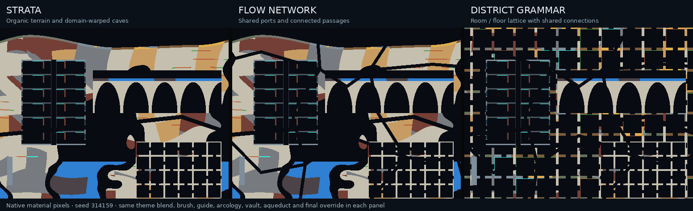
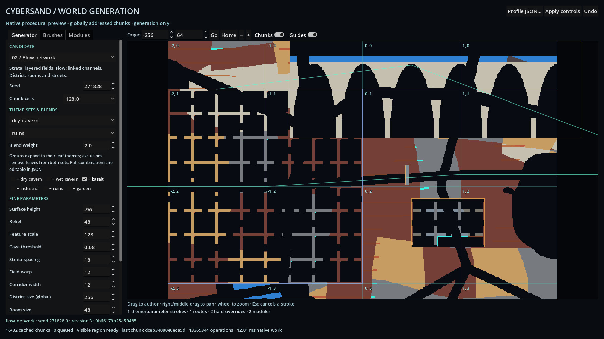

# Procedural world generation candidates

## What is implemented?

**Current candidate source, GEN-001 / [#163](https://github.com/techrote/cybersand/issues/163)
and GEN-002 / [#171](https://github.com/techrote/cybersand/issues/171):**
three CPU procedural generators share one immutable recipe, theme hierarchy,
spatial control stack and extensible native feature registry. They produce actual
material IDs for signed-coordinate chunks. Generation is separate from simulation:
it does not tick materials, query a mutable World, call Godot, request neighboring
chunks or share a mutable random generator. The
[public native API](../../native/include/cybersand/world_generation.hpp) and
[implementation](../../native/src/world_generation.cpp) own these semantics.

GEN-002 adds named structured-noise/finite-curve fields, scalar sidechains,
masked context-aware guidance and sculpting, aggregate material recipes and
paced diagnostic channels. The focused
[fields and modifiers contract](procedural-generation-fields-and-modifiers.md)
owns those controls, immutable initial context and finite Hilbert/Morton scope.

GEN-003 / [#190](https://github.com/techrote/cybersand/issues/190) adds explicit
schema-2 [typed spatial functions](procedural-typed-spatial-fields.md): signed
distance/vector/category values, transformed/derived geometry, reusable parameter
subgraphs, structured seeds, finite adjacency assignments and world-aligned
multiresolution sampling. The retained scalar graph remains separately defined;
typed spatial functions have no per-cell initial-context input. Only explicit
normalized `spatial:<id>` outputs may drive existing masks and mappings.

GEN-004 / [#191](https://github.com/techrote/cybersand/issues/191) adds explicit
schema-3 [hierarchical semantic plans](procedural-hierarchical-generation.md).
Finite canonical regions own nested places and cross-chunk structures; stable
rule/slot IDs, placement constraints, matched sockets, explicit loops/service
trunks and final-raster route reports precede ordinary chunk publication.
Selected immutable semantic geometries may feed the typed graph. The hierarchy
does not add World streaming or replace final hard material authority.

| Candidate | Generated structure | Suitable starting point |
|---|---|---|
| `strata` | Smoothly varying surface, domain-warped caves, strata, deposits and material-specific deep fill | Organic terrain, underground spaces and theme transitions |
| `flow_network` | Strata plus a connected macrocell hub/port network, carved after structural modules | Interconnected passages, service routes and excavation networks |
| `district_grammar` | Global room/floor lattice with repeated doors and accents, plus the same hub/port network | Dense urban interiors, industrial districts and structured construction |



Seed 314159; each panel covers 512 by 384 cells at origin `[-256,0]`.
Reproduce the material pixels with `make worldgen-demo`. This is generation
output, before simulation.

Every candidate consumes the same brushes, paths, overrides and feature instances.
A hard candidate override can choose another generator inside a rectangular zone.
This is deliberately a set of provisional algorithms, not a selected production
world style or a proof of useful player navigation. In particular, generator
connectivity does not establish actor clearance, gravity traversal or fluid
equilibrium; the existing material and actor owners retain those semantics.

**Current authoring surface:** the separate
[worldgen workbench](../../godot/worldgen_workbench.tscn) previews generated material
pixels and performs bounded demand generation while panning. It does not run the
ordinary sandbox simulation. Existing `main.gd`, authored demo worlds, actor
prototypes, material rules and Rapier behavior remain separate.



The representative workbench capture uses the tested Linux software renderer.
Its layout review is recorded in the [dated evidence](../audits/2026-10-18-gen001-procedural-generation.md);
it is not a target-GPU performance result.

**Planned/Deferred beyond this candidate:** a production camera-to-resident-world
coordinator, simulation eviction, disk/network streaming, persistence of modified
chunks, full replay, multiscale LOD and automatic reconciliation of old resident
chunks with edited generation recipes. See [storage](world-storage-and-interest-region.md).
The native fresh-chunk installer below is a usable integration primitive; it is
not a completed residency manager.

## How are themes, subsets and supersets resolved?

The recipe catalogue is a validated directed acyclic graph. A theme has an ID,
zero or more parents, optional typed parameter edits, a `concrete` flag and a
four-material palette. Groups expand into their concrete descendants; concrete
themes are the eligible emitted palettes. A concrete theme may belong to multiple
groups. Unknown parents, cycles, duplicate IDs, invalid materials and oversized
catalogues are rejected before any job exists.

The built-in hierarchy is:

| Group | Concrete descendants |
|---|---|
| `natural` | `dry_cavern`, `wet_cavern`, `basalt`, `garden` |
| `built` | `industrial`, `ruins`, `garden` |
| `world` | All six concrete themes |

`garden` intentionally belongs to both `natural` and `built`. The initial catalogue
can be replaced with an explicit `catalogue` in a native recipe or Godot manifest.
Palette roles are `rock`, `surface`, `accent` and `fluid`; material IDs remain
discrete. Stable rock construction uses block materials, not movable `Stone`.

Selection uses `themes.weights`, a mapping from group or concrete ID to a
nonnegative weight. Each selected group's mass is divided equally among its
eligible concrete descendants. Overlapping selections accumulate, then normalize.
For example, a group containing A/B with weight 3 and an unrelated C with weight 1
resolves to A=0.375, B=0.375, C=0.25. Selecting the A/B group with weight 1 and A
with weight 1 resolves to A=0.75, B=0.25. A repeated selector ID is invalid.

`themes.exclude` removes an entire group or a concrete theme before normalization.
Global exclusions remain hard eligibility constraints in every brush and masked
theme modifier. Neither can reintroduce an excluded descendant. An all-zero or entirely excluded
selection is invalid; generation never silently substitutes a fallback theme.

At a cell, spatial brushes and masked theme guidance blend normalized theme
weights. A uniform hash of a
warped world-space patch selects a concrete palette from the effective weights.
This produces coherent material regions; weights are preferences across regions,
not exact material-area quotas in an arbitrary finite crop. The fallback for
floating-point accumulation can only select a positive, eligible weight.

Theme parameter edits inherit through parents in sorted parent order, with the
child applied last. Multiple-parent conflicts therefore have explicit deterministic
precedence; use a child edit to make a required value unambiguous. Palette fields
belong to each concrete theme and are not implicitly inherited. Effective theme
parameters blend from an eligible reference plus weighted differences, preserving
identical minimum values exactly rather than rounding a one-cell wall to zero.

## What is the control precedence?

The evaluation order is stable and independent of manifest array insertion order.
IDs are required; duplicate IDs within a layer are rejected. For brushes, paths,
modifiers and hard overrides, lower `priority` runs first, with lexical ID as the tie-break.
Later values win. Moving an item in a JSON array is not a hidden priority control.

| Order | Control | Meaning |
|---|---|---|
| 1 | Global parameters and resolved theme parameters | Establish the selected candidate's initial shape and palette distribution |
| 2 | Broad polyline brushstrokes | Blend theme weights and selected shape parameters using radius, strength and falloff |
| 3 | Hard parameter/candidate overrides | Assign exact values within a half-open world-space rectangle |
| 4 | Initial raster and context | Capture the original proposed material, surface and route context before later changes |
| 5 | Scalar fields and modifier influence | Evaluate the field DAG once and capture each modifier's application/exclusion/context/shape mask |
| 6 | Masked theme and geometry guidance | Apply all theme blends; reblend theme/old brush parameters; apply direct edits and mappings; reapply hard geometry controls and rasterize |
| 7 | Prepared feature modules | Add or carve structured zones in dependency order, clipped to bounds and optional field masks |
| 8 | Masked material or aggregate modifiers | Use the original captured influence to select discrete existing material IDs |
| 9 | Shared network and explicit guide paths | Reserve connective space after modules/modifiers; a guide may carve Empty or paint another material |
| 10 | Hard material overrides | Force the final material, including intentionally blocking a route |

Schema 3 inserts accepted semantic shell/interior/aggregate proposals between
steps 6 and 7 and restores explicit semantic passages after step 9. Existing
native modules and material modifiers can therefore contribute to semantic
places, while final hard material overrides still win. The hierarchy's final-cell
route report observes that complete stack and reports any blocked passage;
it does not reinterpret a hard override as optional. Recipes without grammar
retain the table's preceding behavior.

The [field/modifier contract](procedural-generation-fields-and-modifiers.md)
defines the two guidance stages, mapping endpoints and immutable context.
No earlier modifier can change the context observed by a later modifier. Recipes
without new controls retain their old material behavior; fixed legacy hashes
cover all three candidates in four signed chunks.

Brush points are world-space `[x,y]` pairs. A single point is a dab; multiple
points form a polyline. Influence uses distance to the nearest segment, a smooth
radial falloff raised to `falloff`, and `strength`. `radius` is in cells.
Parameter-only strokes have an empty theme weight map. A full-strength stroke
centre and a hard parameter assignment retain the exact target, including
non-integer values that would otherwise suffer cancellation in `a+(b-a)*1`.

Guide `width` is the full path width. Guides have no dependency on chunk load
order. A hard override uses `[x,y,width,height]`, with inclusive lower and exclusive
upper bounds. It may supply material, candidate, parameter edits, or a combination.
An empty hard override is invalid. Hard overrides are authoring constraints on
new proposals; they do not mutate already installed simulation content.

## Which fine parameters are available?

All positions, distances and widths below are measured in cells. Values must be
finite. Out-of-range values are errors; the generator does not silently clamp the
authored recipe. Spatial interpolation remains inside the endpoints' valid range.

| JSON key | Default | Accepted range | Effect |
|---|---:|---:|---|
| `surface_y` | 96 | -1,000,000..1,000,000 | Mean Strata surface height, downward-positive |
| `relief` | 48 | 0..4096 | Surface variation amplitude |
| `feature_scale` | 96 | 8..4096 | Cave/terrain scale; global value also anchors palette patch scale |
| `cave_threshold` | 0.60 | 0..1 | Higher values leave more solid terrain |
| `strata_period` | 18 | 2..1024 | Spacing of potential deposit bands |
| `warp` | 12 | 0..512 | Organic domain displacement amplitude |
| `corridor_width` | 7 | 2..64 | Full width of shared connective routes |
| `district_size` | 256 | Integer 64..2048 | Global macrocell topology size |
| `room_size` | 48 | 12..256 | District room lattice spacing |
| `wall_thickness` | 3 | 1..5 | District walls/floors |
| `detail` | 0.32 | 0..1 | Accent/deposit preference |
| `fluid_level` | 224 | -1,000,000..1,000,000 | Deep-cave fluid fill threshold |

`district_size` is global-only. Theme, brush, modifier/mapping and hard spatial edits of it reject:
varying a macrocell ownership grid across individual samples would break shared
port ownership. Other hard controls can deliberately interrupt connectivity, so
the resulting authored zone must be evaluated on its own terms. Integer room/wall
rasterization has cell-sized steps even when the input editor accepts decimals.

The default seed is 1 and chunk size is 128. Native seeds are unsigned 64-bit;
Godot accepts nonnegative signed-64 values, while JSON numeric values are restricted
to exactly representable integers through 2^53-1. Use modest numeric JSON seeds
for portable profile roundtrips. `configure` owns its revision; `revision` is not
an accepted user JSON field. Schema 1 retains generator algorithm 2 and its
optional field/aggregate/modifier declarations. Schema 2 explicitly adds `spatial`
and `spatial_limits`, using generator algorithm 3 and spatial algorithm 1.
Legacy scalar semantics/material output remain independently tested; selecting
schema 2 changes recipe/receipt identity deliberately.

## How do chunks connect without generating neighbors?

Every field is sampled at global coordinates. Seeded lattice values depend on
seed, coordinates and an algorithm lane, not a mutable PRNG sequence. Changing
request order, slicing a job into different cell budgets, or partitioning the same
region into different chunk sizes therefore leaves its material cells unchanged
for the same effective recipe.

Flow Network and District Grammar divide the plane into fixed macrocells. Each
cell has a seeded interior hub. An edge's port is derived from a canonical edge
coordinate and axis; its two owners independently obtain the same port. Each hub
connects to all four edge ports. No recursive neighbor request, global graph
construction, speculative edge negotiation or neighbor-residency check is needed.
The shared skeleton is carved after feature modules and material modifiers so their ordinary walls do
not seal it. An independent regression fills the region with solid Metal and
requires a four-neighbor Empty component across a negative-coordinate 2x2
macrocell region to reach every outer side.

The current guarantee is a deterministic raster connection in one unchanged
recipe. It does not guarantee that independently edited recipes meet, that a
large player fits every passage, or that a passage containing later simulation
material remains traversable. Explicit hard material/candidate changes may alter
connectivity by design. The workbench replaces its complete preview revision after
an edit, avoiding a mixture of old and new generated chunks.

Native World supports wider signed coordinates. This generator deliberately
accepts only complete chunks inside `[-2^40,2^40)` cell coordinates: brush geometry
uses doubles, and out-of-domain requests must refuse rather than alias distant
positions. Negative coordinates use mathematical floor division. A job must fit
the entire chunk in that domain before allocating its output.

## How are advanced feature modules loaded and extended?

A manifest module instance names a registered factory ID and exact version,
world-space bounds, numeric parameter map, instance ID, priority and optional
`after` dependency IDs. Optional `application`/`exclusion` field references and
`strength` control its influence inside those bounds. The native registry resolves the factory and prepares a
shared immutable sampler during recipe compilation, before ordinary generation.
Each job invokes that sampler only inside its instance bounds. A sampler receives
the current global cell coordinate, seed, effective parameters, palette and previous
material; it can return one material or decline the cell.

| Built-in factory | Preparation / generated feature | Optional integer parameters |
|---|---|---|
| `arcology` v1 | Multistory floors, bays, shell/windows, service shaft, cables and lights | `bay_width=48`, `floor_height=32`, `wall=3`, `shaft_width=10` |
| `vault` v1 | A deterministic spanning-tree maze of connected rooms, prepared once and then sampled in constant work | `cell_size=32`, `wall=2`, `door_width=8` |
| `aqueduct` v1 | Repeated arched masonry supports, deck and fluid trough | `span=64`, `deck_height=24`, `wall=3`, `channel_depth=6` |

Vault bounds must be multiples of `cell_size`, with at most 64 rooms per axis and
4096 rooms total. Its DFS preparation visits a fixed finite room graph; generation
does not rerun the maze solver per chunk. Two outer doorways join the connected
interior. Arcology validates that its shaft/shell fit. Aqueduct validates room for
the trough and arches. Unknown keys and invalid geometry reject compilation.

Dependencies refer to instance IDs, not neighboring chunk outputs. The compiler
uses stable topological order; among currently ready instances, priority and ID
decide order. Missing/self/duplicate dependencies and cycles are rejected. The
order allows one module to refine a previous module's material in overlapping
bounds without giving it access to another job or mutable World.

To add a native algorithm, implement `FeatureSampler::sample`, register a
`ModuleFactory` with `ModuleRegistry::add`, and compile the recipe with that
registry. The factory can precompute BSP rooms, a bounded constraint solution,
architectural supports, a transport graph or a sampled computational field.
Keep prepared state owned by the returned sampler, const/thread-safe for concurrent
jobs, and invalidate the module version whenever its output algorithm changes.
Registered factory versions and prepared inputs participate in recipe identity.

This is a **trusted native module ABI within the source build**, with runtime
factory registration and manifest-driven loading of prepared instances. The Godot
binding currently supplies the built-in registry. JSON imports do not download or
execute scripts, load arbitrary DLLs, or install new C++ code. A new factory must
be registered by the native host / extension build before its manifest can load.
This keeps the core independent of an OS-specific dynamic library loader and
leaves room for the existing Web build.

The engine can enforce instance clipping, validated material outputs, job output
capacity and declared logical-work charges. It cannot preempt an infinite loop,
allocation explosion or mutable global state inside arbitrary in-process C++.
Module callbacks are cooperative trusted code, not a sandbox. The preparation
cost/memory of a custom factory is its author's responsibility; use bounded
precomputation and external scheduling for expensive solvers.

## How are work, cancellation and stale results bounded?

`Generator::compile` validates and owns a deep recipe copy plus prepared samplers.
`begin(chunk, diagnostic)` creates a job and allocates its private material buffer
plus optional scalar diagnostic output; the channel defaults to empty.
`advance(cell_budget)` generates at most that many additional cells; zero is a
no-op. A completed job does not restart. The built-in per-cell path uses stack
working values, not per-cell container growth. Diagnostic `sample` and
`theme_weights_at` are convenience APIs, not the paced job interface.

| Bound | Default / hard ceiling |
|---|---|
| Chunk side | Default 128; accepted 8..256; at most 65,536 material bytes per job |
| Catalogue entries | 64 |
| Strokes, guide paths, hard overrides | 64 of each |
| Points per stroke/path | 128 |
| Feature instances | 32 |
| Named fields / dependency depth / scalar logical work | 64 / 16 / 4096 operations per sample |
| Aggregate definitions / components | 32 / 1..16 unique existing materials per aggregate |
| Masked modifiers | 64 |
| Optional diagnostic payload | One normalized float per cell; at most 262,144 bytes |
| Registry entries | 128 |
| Parameters per instance | 32 numeric named values |
| Logical charge per chunk | Default 64,000,000; native configurable through 1,000,000,000; Godot may only tighten its default |

That diagnostic row describes retained scalar channels. Schema-2
`spatial:<id>` channels instead own one typed value per cell plus metadata;
signed doubles, vector pairs and exact category tuples retain their meaning.
Typed graph/preparation/cache capacities and conservative recursive sampling
costs are specified by the [typed contract](procedural-typed-spatial-fields.md)
and [operator inventory](../reference/procedural-spatial-operators.md).

The logical charge is a conservative accounting bound derived from the configured
controls and each factory's declared per-cell cost. All declared fields, modifier
work, aggregate components and module charges are included even under zero masks
or outside module bounds; it is not a measured instruction count or wall-time
deadline. Each cell is charged before its sampler runs. Exhaustion fails the job
and discards the partial payload. Invalid module material and exceptions do the
same. Diagnostic allocation failure cannot expose a previously generated prefix.

`result()` refuses while Pending. Ready results contain owned material cells,
chunk coordinate/size, revision, recipe fingerprint, content hash, receipt hash and
logical charge. The receipt binds coordinates and recipe identity to the content
and charge, plus any diagnostic channel and float payload, detecting accidental
completion-slot, coordinate or inspection-channel mixups. These
non-cryptographic hashes are integrity/reproducibility checks, not authentication.
`Generator::accepts` validates identity, size, bounds, materials, optional normalized
diagnostics and both hashes.
For typed channels, the receipt also binds the declared type, units, distance
qualification and exact typed payload; malformed, nonfinite, wrong-type or
wrong-sized data rejects. Typed and legacy diagnostic arrays are mutually
exclusive. Inspection colours never replace raw diagnostic values.
Changing a recipe even with the same manually supplied native revision changes its
fingerprint. Custom factories must bump their version when their implementation
changes; function machine code is not hashed by the registry.

Cancellation discards a Pending job's cells and diagnostics. Jobs retain their immutable generator
so destroying the caller's generator reference cannot invalidate a running job.
The Godot adapter owns at most one job; successful configuration advances its
monotonic revision and cancels old work, while rejected configuration preserves
the last valid generator/job. Packets copy material bytes. The workbench bounds
its request queue and cache and checks receipt revision/coordinate before display.

## How does generated content enter the native simulation?

`World::install_generated_chunk(chunk, row_major_materials)` is an additive native
C++ owner operation. It requires exactly the World's configured chunk area,
checks all materials and coordinate arithmetic, refuses failed/in-progress Worlds,
checks transient occupancy and capacity, and rejects **any already resident
chunk**, including pre-reserved empty storage or cells edited and then erased.
Thus generation cannot mistake an excavated resident area for never-generated
terrain. Even an all-Empty payload establishes residence.

After admission, ordinary `World::set` initialization supplies material-local
state, configured full Water mass, epochs, dirty/wake/hard-surface metadata and
discovery observations. No generated temperature/state bytes, Rapier bodies or
new material semantics are invented. The owner may then simulate the chunk using
the existing native rules. Invalid input/capacity/occupancy refusals produce no
partial material installation. Initial allocation may throw before installation.

The raw installer takes materials, not a generator/session receipt. Its caller
must first check `Generator::accepts`, match chunk size, and own the World/reset
lifetime. `World::clear` permits new chunks again; an old result from a previous
World session must be discarded by the coordinator even if the recipe is unchanged.
No automatic world-session receipt protocol or live Godot simulation attachment
is claimed by this primitive. It must never run concurrently with World ticks,
queries or rendering publication.

## How can the candidates be tried and reproduced?

With the source-matched extension built, launch the separate scene:

```text
godot --path godot res://worldgen_workbench.tscn
```

The workbench provides candidate/seed controls; group/leaf weights and exclusions;
fine parameters; theme/parameter strokes; guide paths; final material overrides;
module placement and parameter editing; named fields, aggregate components,
masked modifiers and context-aware sculpting; diagnostic overlays; and complete
JSON import/export.
It displays an explicit unavailable/error state if the native generator class is
missing. It never substitutes a visual-only noise algorithm for native generation.
Use the JSON editor for custom catalogues, multiple dependencies and exact bounds.
The example profiles are under [examples/worldgen](../../examples/worldgen).

Native verification and material-pixel preview need no Godot runtime:

```text
make worldgen-test
make worldgen-sanitize
make worldgen-demo
./build/worldgen_demo --output build/worldgen-plain.ppm --seed 314159 --plain
```

The demo emits three side-by-side exact material-palette previews and a JSON
summary with recipe identities and illustrative local timing. Left to right:
Strata, Flow Network, District Grammar. The default shares the same theme brush,
path, hard override and three feature modules between candidates; `--plain`
removes those spatial controls to isolate the base algorithms. Its output is a
generation preview, not Godot-rendered graphics or gameplay acceptance.

The [GEN-001 evidence](../audits/2026-10-18-gen001-procedural-generation.md) and
[GEN-002 evidence](../audits/2026-10-18-gen002-fields-and-aggregates.md) record
their actual native, sanitizer, Godot, source/runtime and publication results separately.
Visual preference, production tuning and target-device performance remain owner
evaluation rather than conclusions inferred from passing software tests.

## Generation Workbench 2 inspection and quality

The [GEN-007 workbench contract](generation-workbench-2.md) extends the existing
opt-in scene with native identity-bound provenance, actual sampler-stage views,
typed graph and semantic hierarchy editing, four-plane inspection, bounded
seed/recipe comparisons and transactional undo/redo. All editing paths retain
complete supported recipe data and native validation. The
[procedural qualification guide](../operations/procedural-qualification.md)
owns the complete 1024-square scene and distinguishes final projected-material
checks and actual visual review from a generation preview or base route report.
