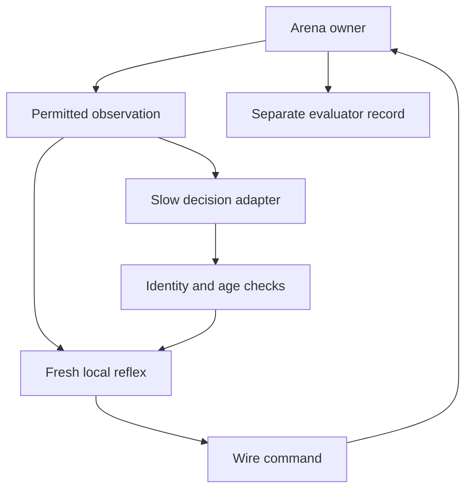

# Thunderbowl actor arena and control reference

ACT-004 adds a separate [physical Thunderbowl v2](#physical-thunderbowl-v2).
The ACT-003 contracts below retain sampled Thunderbowl v1's tag combat, control
examples and observation privileges. The two environments publish their own
version and schedule rather than silently sharing an acceptance result.

## What is Thunderbowl for?

Thunderbowl (ACT-003, [issue #172](https://github.com/techrote/cybersand/issues/172))
compares the same actor rigs under different control laws, information access
and group behavior. Controller sophistication, population size and privileged
knowledge are separate advantages that each result must identify.

The sampled v1 arena is a standalone native desktop scene with at most eight actors,
separate from the ordinary F5 rig comparison and the registered scientific
fixtures. Its battle model is an arena-owned virtual tag exercise with bounded
aim, range, line of sight and cooldown. Virtual hit points and tag outcomes are
gameplay bookkeeping. They do not establish native actor damage, actor-to-actor
collision, rigid-body impacts or a general weapons simulation. The
[actor-rig contract](actor-rigs.md) remains the authority for the underlying
sampled locomotion and terrain tools.

Current source defines the prototype below; the
[validation ledger](../reference/validation-evidence.md) owns dated acceptance
evidence, with source/runtime identities and preserved failures in the
[ACT-003 audit](../audits/2026-10-18-act003-thunderbowl-control-lab.md).
Trained policies, a terrain-lattice NCA and a live model service remain
**Planned**. No controller-efficacy or target-machine performance claim follows
from having executable examples.

## Physical Thunderbowl v2

**Current experimental ACT-004/ACT-005:** the separate physical lab uses all 46
[articulated Rapier actors](physical-actor-rigs.md), their actual jointed parts,
native materials and the same human/demo/policy session as F5. It owns a native
world and an isolated Rapier space. Its purpose is manoeuvre, recovery and usable
testing. It has no virtual tag score, damage/reward system, metal lane, oracle
team, NCA controller or live model service. Those sampled v1 examples remain
independently runnable below.

The five SetP entries are human movement presets with explicitly empty starting
mounts; the original ACT-005 41-rig tool loadouts remain defined. Their separate
[seven-preset playground](player-control-playground.md) also includes Sand/Water
fields that are not physical Thunderbowl actors. Earlier dated lab results retain
their original roster and source scope.

Run the physical scene from the launcher or directly:

```text
godot --path godot res://examples/thunderbowl/physical_thunderbowl.tscn
godot --headless --path godot --script res://examples/thunderbowl/run_physical_thunderbowl.gd -- --rig=ripper --actors=4 --ticks=600 --seed=0 --output=physical-result.json
```

The UI selects any catalogue rig and one through eight actors. Actor zero may be
human, demo or policy; companion actors use the local scripted examples. Whole
arena/follow cameras and collider outlines show the actual parts. Click the
arena to arm human control. WASD, mouse, Space/Shift/C, Q/E, Z/X and brackets
match F5; M uses the tool, N releases a held object, U reattaches a nearby one.
ACT-005 gives actor zero the full equipment picker and independent equipment
power. Left mouse or M triggers primary use; right mouse requests the usable's
alternate action. Selection and use enter the same physical session as demo and
policy actions.
Pause, cancel, focus changes and reset revoke pending control through the owner.
The whole-arena camera is evaluator information, so human play is not an
equal-perception policy benchmark.

[`CyberPhysicalActorArena`](../../godot/scripts/physical_actor_arena.gd) exposes
`configure`, `reset`, `observation`, `submit`, `cancel`, `set_paused`, `step`,
`snapshot` and `close`. Configuration has this shape:

```json
{
  "version": 2, "seed": 0, "max_ticks": 600, "local_patch_radius": 6,
  "actors": [
    {"model": "ripper", "producer": "policy"},
    {"model": "copter", "producer": "demo"}
  ]
}
```

Actor positions may optionally be explicit finite `[x,y]` coordinates in the
authored arena. Unknown fields and invalid capacities are refused before replacing
a live environment. `submit(command, producer)` and `step(policy_commands)`
consume the same version-2 issued-observation envelope as the desktop
[physical command interface](../reference/interfaces-and-message-contracts.md#physical-actor-control-and-effects).
Model names alone never invoke model APIs.

`observation(actor_id)` contains the copied local rig view plus a bounded square
native material/body-ID patch, default radius six and maximum eight. It includes
only that actor's effect receipts. The patch identifies its sample tick and body
mask pose tick. `snapshot()` is a separate evaluator surface with all actors,
cellular feedback, effect totals, terrain and termination/truncation state;
do not feed it into a nominally local policy. The seed selects authored material
fixture geometry; it does not promise bit-identical Rapier replay.

The headless runner accepts `--config=<json>` instead of roster options and an
optional `--actions=<json>` array of `{tick, actor_id, action, lease_ticks?}`.
Scheduled actors must be policy-owned. The driver builds each command from a
fresh issued observation at that step. It exercises the policy admission path,
but does not simulate network latency or frontier-model computation. Files are
bounded and outputs contain explicit environment version and schedule.

The synchronous schedule is mask, actuation, effects, material tick, cellular
feedback, terrain update, Rapier integration and next observation. It uses one
native worker and 60 Hz physics; the
[threading contract](../architecture/simulation-tick-and-threading.md#physical-actor-scheduling)
owns timing details. Desktop remains asynchronous and Web is not migrated by
this lab. Dated source/platform evidence is in the
[ACT-004 audit](../audits/2026-10-18-act004-articulated-actors.md).

### Physical usable course

The launcher entry **Physical usable course — 32 tools, payloads and processors**
opens the same physical scene in its **Usable course** mode. The scene's
**Manoeuvre / Usable course** selector resets the environment into the selected
authored layout. All 46 rigs retain their catalogue loadout and the same
human/demo/policy admission path; the course does not provide a separate actor
controller with direct material access.

```text
godot --headless --path godot --script res://examples/thunderbowl/run_physical_thunderbowl.gd -- --course=usables-v1 --rig=digger --actors=8 --ticks=600 --seed=0 --output=physical-usable-result.json
```

[`CyberPhysicalUsableCourse`](../../godot/scripts/physical_usable_course.gd)
defines bounded native material fixtures and a varied default roster. The eight
sections expose different interactions:

| Section | Observable interaction |
|---|---|
| Bore / Cut | Editable packed-earth seams for advancing excavation rigs |
| Sort / Drain | Powder, glass and liquid targets for selective material work |
| Penetrate | Separate editable leaves for swept projectile penetration |
| Ricochet | Protected hard faces for damped bounce and physical firing recoil |
| Stage / Burst | Flight space for fuse, airburst and staged ignition behavior |
| Drop / Deposit | Receiving bins for downward payloads and native deposits |
| Release / Grip | Same-body release, retained momentum and nearby physical reattachment |
| Place / Jam | A service pad for dropping, settling, fixing and operating processors |

For a deployed processor belonging to the selected follow actor, **Feed**, **Jam**
and **Clear output** perform explicit bounded fixture edits at the current
physical ports. Feed uses that device's real material recipe; Jam/Clear expose
the existing rule that blocked outputs prevent input consumption. These are
visible authoring controls, separate from the actor's copied local observation
and equipment actions. They do not imply autonomous material creation or a
general inventory economy.

Course configuration adds `"course": "usables-v1"` to the physical version-2
environment schema. Equipment observations, requests, receipts and native
processor state follow the [physical equipment interface](../reference/interfaces-and-message-contracts.md#physical-equipment-actions-and-results).
Body pose, joint aim, charged resources and native changes remain separate
observable facts; the course has no virtual combat score or automatic assertion
that every scripted actor completed every section. Acceptance is recorded in
the [ACT-005 audit](../audits/2026-10-19-act005-physical-usables.md), with
[focused validation commands](../operations/local-build-and-validation.md#physical-usable-validation).

## How should the control modes be classified?

Human fly-by-wire, a central oracle, an NCA and an emergent swarm describe
different properties. Classify them on independent axes before comparing presets.

| Axis | Meaning | Examples |
|---|---|---|
| Actuation lane | What commands reach the motor, with which assists and limits? | High-level wire intent; direct metal actuator channels |
| Decision placement | Where are decisions made and which actors share a decision process? | Human pilot; one independent controller per actor; central team controller |
| Perception privilege | What information may that decision process receive? | Own state; filtered nearby observations; camera image; full present-state oracle |
| Coordination | What agent-to-agent or environment-mediated information changes decisions? | None; shared altered terrain; designed neighbor steering; bounded messages |
| Controller family | What computes a decision from its permitted inputs? | Hand-authored reflex; search; recurrent neural policy; NCA-inspired graph; vision/language planner |
| Training privilege | What information was used to produce the deployed controller? | No training; local rollouts; global critic; full-state teacher |

A central process can aggregate only permitted local views and still lack oracle
knowledge. Independent actor processes can each receive full state and therefore
be privileged. Shared neural weights do not mean shared runtime memory. Human
input can feed either actuation lane if that rig exposes the lane. The same
local controller can be compared with and without communication while preserving
its motor and sensory capabilities.

Keep the actuation lane fixed for an actor's configured lifetime. Wire inputs
request rig behavior: movement, aim, effort, trim, reel and the three action
buttons. Metal inputs address the supported rig's direct actuators and bypass
the high-level behavior dispatch. A force or torque expressed in game units is
only meaningful with the published mass, inertia, channel map and integration
law. It must not be described as a physical SI quantity or a Rapier force when
the motor is an authored sampled approximation.

## Which versioned contracts does the prototype use?

The value boundary is
[`CyberThunderbowlContract`](../../godot/scripts/thunderbowl_contract.gd).
Its version-1 dictionaries require every named field and reject unknown fields,
wrong types, nonfinite values and oversized files. File loading is capped at
65,536 bytes. Structural validation is followed by owner checks for the issued
observation, run, actor, epoch, sequence, configured lane, liveness and expiry.
The corresponding JSON Schemas live in
[`examples/thunderbowl/schemas`](../../godot/examples/thunderbowl/schemas):
`match`, `command`, `observation`, `input`, `actuator-input`, `smart-request`,
`smart-decision` and `nca-weights`, each with the `.schema.json` suffix.

| Object | Required fields and bounds |
|---|---|
| Arena configuration | `version: 1`, `seed` integer 0–2,147,483,647, `max_ticks` 1–36,000, `layout: "training_pit"`, `evaluation`, `actors` with 1–8 entries |
| Actor definition | `model`, `control_mode`, `observation_mode`, `team` integer 0–7, `controller` |
| Command envelope | `version`, `run_id`, `actor_id`, `epoch`, `sequence`, `observed_tick`, `observation_id`, `lease_ticks`, `kind`, `action`, `tag`, `message`, `message_type`, `cancel` |
| Wire action | `movement[2]`, `aim[2]`, `effort`, `trim`, `reel`, `primary`, `secondary`, `auxiliary` |
| Metal action | `actuators[4]`, `tag_aim[2]` |
| Normalized input frame | Wire fields plus `version: 1`, `device`, `tag`, `deadman` |
| Direct input frame | `version: 1`, `device`, `actuators[4]`, `aim[2]`, `tag`, `deadman` |

`control_mode` is `wire` or `metal`; `observation_mode` is `self`, `local` or
`oracle`. The prototype registry permits metal for `human_metal` and
`metal_pulse`, using Ripper, Copter or Gemini. Other controller IDs use wire.
Only `oracle` receives the oracle profile. `lemming` and `emergent` require
`self`; `wire_seek`, `local_swarm`, `nca` and `smart_link` require `local`.
`emergent` specifically uses Digger. These are the implemented preset
combinations; the independent classification axes describe how future combinations
should be specified without silently expanding this registry.

Action vector components and trim/reel lie in −1–1, effort in 0–1; buttons are
Booleans. The metal profile supplies narrower actuator ranges and requires every
reserved channel to be zero. `tag` requests the arena's virtual tag independently
of rig tool buttons. `message` is either empty or exactly four values in −1–1;
`message_type` is respectively `none`, or `goal_hint`/`latent_state`.
A cancel packet has zero/neutral action, no tag and an empty message; it also
clears armed charge rather than turning release into an unintended launch.

Commands identify an opaque `run_id` and a previously issued `observation_id`
bound to the run, epoch, actor and tick. Actor IDs are 0–7; epochs start at one;
sequence numbers are nonnegative bounded integers. Leases are 1–18 simulation
ticks, anchored to the observation tick. `Contract.command(view, sequence,
action, tag, message, cancel, message_type)` copies the issued identity and
requests 12 ticks.
Receiving a command is distinct from consuming it, and expiry does not grant an
action a new observation timestamp.

The example driver binds each ordinary controller result to the exact actor and
observation it supplied. The shared oracle may return commands only for its
assigned views, once each. Misaddressed outputs are dropped and counted; a
controller cannot acquire another slot through a guessed observation identifier.
The arena's central batch API remains a trusted owner interface.

For example, a wire envelope has this shape. Identity strings and the observed
tick must come from an actual view; the illustrative strings below are not
admissible identities for a running arena.

```json
{
  "version": 1,
  "run_id": "issued-run-id",
  "actor_id": 0,
  "epoch": 1,
  "sequence": 4,
  "observed_tick": 120,
  "observation_id": "issued-observation-id",
  "lease_ticks": 12,
  "kind": "rig_action",
  "action": {
    "movement": [1.0, 0.0], "aim": [1.0, 0.0], "effort": 0.7,
    "trim": 0.0, "reel": 0.0,
    "primary": false, "secondary": false, "auxiliary": false
  },
  "tag": false, "message": [], "message_type": "none", "cancel": false
}
```

For a configured metal Ripper, the alternative is `kind: "actuator_action"`
with `action: {"actuators": [0.8, 0.0, 0.0, 0.0], "tag_aim": [1.0, 0.0]}`.
It requests direct drive without torque or brake. An ordinary command cannot
change the actor's configured lane or mix both action forms.

Input device labels are `keyboard_mouse`, `gamepad`, `touch` or `virtual`.
They describe a normalized input source, not proof that all corresponding
hardware adapters have been exercised. With `deadman: false`, the human example
produces an explicit cancellation packet. Human wire passes through the action
fields. Human metal maps those fields to its rig's actuator channels; it does not
ask the wire motor to interpret direct force commands.

## What does fly-by-metal apply and report?

[`actor_rig_actuation.gd`](../../godot/scripts/actor_rig_actuation.gd) owns the
JSON-safe profile manifest and
[`actor_rig_motor.gd`](../../godot/scripts/actor_rig_motor.gd) supplies
`simulate_actuator_action(delta, channels, world)`. This path bypasses high-level
rig behavior while retaining bounded sampled collision, rotation and motion caps.

| Profile | Four channels, in order | Game mass / inertia | Authored actuator gains |
|---|---|---|---|
| `ripper-metal-v1` | Track drive −1–1; chassis torque −1–1; track brake 0–1; reserved 0 | 2 / 100÷3 | Drive 600; torque 800; traction depends on support and orientation |
| `copter-metal-v1` | Collective 0–1; lateral cyclic −1–1; rotor torque −1–1; rotor brake 0–1 | 1 / 52÷3 | Collective 312; lateral 84; torque 416 |
| `gemini-metal-v1` | Left thrust 0–1; right thrust 0–1; reserved 0; reserved 0 | 1 / 52÷3 | Each thruster 156, arm 4; unequal thrust creates torque |

Forces are reported in world coordinates using game mass × cells/s²; torque uses
game inertia × radians/s². The unconstrained increments are force/mass × step
duration and torque/inertia × step duration, including passive forces separately.
Gravity is 156 cells/s² in this lane. Braking is commanded dissipative drag,
without a hidden target heading or target velocity. Powered demand is reduced
proportionally when energy is insufficient; holding powered demand at zero
energy does not recharge it. Neutral powered demand permits 0.30/s ground or
0.14/s air recharge. The profile owns remaining drag and energy coefficients.

The additive session publication has `actuation_version: 1`,
`actuation_stride: 32`, `actuation_states`, `actuation_profiles`,
`actuation_capabilities` and `control_modes`. It preserves the existing wire
observation/action versions. Each 32-value actuation row means:

| Offsets | Values |
|---|---|
| 0–3 / 4–7 | Requested actuator channels after range handling / applied channels |
| 8–10 / 11–13 | Requested world force x/y and torque / resource-and-contact-limited actuator force x/y and torque |
| 14–16 | Passive force x/y and passive torque |
| 17–19 | Actual post-collision delta velocity x/y and delta angular velocity |
| 20–25 | Mass, inertia, resource scale, energy used, contact scale, consumed step duration |
| 26–31 | Center displacement x/y, rotation displacement, flags, profile index, remaining energy |

“Applied force” precedes collision and speed/rotation caps. Actual motion is
reported separately and cannot be reconstructed from actuator force alone when
the hull is constrained. Flags distinguish input clamping, resource/contact
limits, motion/collision constraints, invalid input and unsupported profiles.
Metal has no terrain-tool channel; arena virtual tags remain a separate request.

## What does the arena publish and resolve?

[`CyberThunderbowlArena`](../../godot/scripts/thunderbowl_arena.gd) exposes
`configure(config)`, `observation(actor_id)`, `snapshot()`, `step(commands)` and
`close()`. A successful configuration installs an exclusive native world and
actor session; a refused configuration preserves the existing instance. Each
`step` advances one 1/60-second motor/material tick, with at most eight commands.
An oversized batch is refused as a whole. Failed material ticks quarantine the
owner and retain the last completed actor/reward publication.

| Published view | Contents and permission |
|---|---|
| Every policy observation | Run/actor/epoch/tick/observation identity; assigned model, lane, team and view mode; own alive/HP/tag readiness; own 40-value rig state and 32-value actuation state/profile |
| Own terrain stencil | 9×9 material samples spaced four cells, with explicit origin; this is a sampled 32-cell span, not every intervening cell |
| `self` | Empty neighbor and message arrays |
| `local` | Up to seven alive neighbors within 64 cells and clear terrain LOS; visible ID/team, relative center, velocity, body size and rotation; no neighbor HP, energy, actions or hidden state |
| `oracle` addition | All actors' current 40-value states, HP and alive status, plus a 32×18 terrain grid sampled every eight cells; not every native cell or future state |
| Evaluator `snapshot()` | Full copied actor/session state, HP, rewards, tags, bounded events, admission/work counters, layout and material hashes; never the ordinary local-policy input |

Neighbor order is actor-ID order. LOS uses bounded supercover rays and treats any
non-Empty material as blocking. At most 8,192 sensor and 10,752 tag cell reads
are available per completed tick; exhaustion refuses visibility/hits. Optional
full-arena presentation samples are separately bounded and excluded from those
policy-sensing budgets.

Virtual tags require a rising edge, nonzero aim, range ≤56 cells, aim dot product
≥0.94, clear LOS and a 30-tick cooldown. The nearest eligible opponent center is
selected; a shot attempt consumes cooldown even on a miss. Each actor starts
with three HP. Simultaneous hits resolve before eliminations: each hit gives
+1/−1 reward, and an elimination's +2 bonus is shared among that tick's attackers;
the victim loses two more. Ring-out costs two and eliminates the actor. Elimination
cancels input and marks virtual status; it does not remove a native body or slot.

## What are the three different swarm experiments?

Individual intent, population effects and intentional use of peers are separate
experimental variables. The baseline presets isolate their mechanisms.

| Baseline | Individual decision rule | Coupling | What a result may establish |
|---|---|---|---|
| Independent selfish actors | Each actor pursues its own local task or tag opportunity | Ordinary shared terrain and arena rules; no designed collective objective or peer message | Performance of independent local decision makers |
| Density or environment-mediated emergence | The same simple rule is repeated at different population densities | Shared terrain changes, constrained passages or another explicitly implemented common resource | Whether population and environmental changes produce useful aggregate behavior without peer coordination |
| Explicit nearby coordination | An actor deliberately adjusts behavior using permitted nearby peers | Neighbor steering or a bounded communication protocol | Whether that particular information exchange improves a stated outcome |

Reynolds's original flock model uses programmed local behaviors and local
perception to produce collective motion. Vicsek's particle model explicitly
aligns heading with nearby particles. Those are useful local-coordination
comparators; their neighbor rules must not be hidden inside a baseline described
as having no coordination. [Reynolds 1987](https://www.red3d.com/cwr/papers/1987/boids.html),
[Vicsek et al. 1995](https://journals.aps.org/prl/abstract/10.1103/PhysRevLett.75.1226).

Clustering can arise from a different mechanism. Fily and Marchetti studied
self-propelled repulsive disks without alignment and found density separation
and clusters in that model. This supports distinguishing aggregation from
alignment; it does not establish that CyberSand actors reproduce the same
mechanism or gain a combat advantage from it.
[Fily and Marchetti 2012](https://journals.aps.org/prl/abstract/10.1103/PhysRevLett.108.235702).

Thunderbowl's density example uses Diggers modifying shared destructible terrain.
One actor may open a passage that another subsequently encounters through its
own local terrain sensing. There is no message, neighbor alignment or assigned
collective route. This is environment-mediated coupling. A resulting passage or
cluster is not proof that the actors intended or learned cooperation.

The sampled actor path does not provide actor-to-actor exclusion or contact.
Increasing the number of overlapping actors therefore cannot demonstrate
collision-driven crowd pressure. It may merely increase independent attempts or
aggregate tag opportunities. Report the implemented coupling and compare against
a terrain-edit-disabled control before attributing a benefit to emergence.

## How is oracle knowledge kept separate from local decisions?

The owner has authoritative state for collision, tags and validation; controllers
receive their assigned views. Oracle privilege covers declared present state,
not future outcomes or internal random-generator state.

Filter observations before invoking policy code or helper functions. Choosing
the nearest opponent from the full roster and passing that target to a “local”
policy already leaks privileged information; filtering its output cannot undo it.

A remembered track retains its original timestamp; invisible position or health
must not keep updating. Future image adapters must apply the same privilege to
camera centering, overlays and semantic labels. Image-only input cannot quietly
include an exact hidden-state side channel.

Review roster counts, persistent identifiers, kill notifications, rewards,
debugging telemetry and shared recurrent buffers for undeclared information.
Keep evaluator records separate. An action packet cannot upgrade its actor's
configured perception privilege.

The desktop demonstration explicitly displays the **full evaluator view**.
Human examples therefore use `mechanics` or `asymmetric`, not a claim of equal
visual privilege with local bots. The current oracle example centrally assigns
targets using copied oracle actor states; it is a greedy reference, not an
optimal planner or theoretical upper bound.

This is a data contract for the supplied registered controllers, not a security
sandbox for arbitrary in-process scripts. Isolating an untrusted controller would
require a separate process or service boundary with the same observation rules.

Centralized training is a distinct permission. For example, a global teacher can
generate demonstrations or a critic can use additional state while the deployed
actor remains local. The MADDPG paper explicitly separates privileged training
information from the local actors used at execution. Record both privileges and
evaluate the deployed controller through the actual local observation boundary.
[Lowe et al. 2017](https://papers.nips.cc/paper_files/paper/2017/file/68a9750337a418a86fe06c1991a1d64c-Paper.pdf).

## What does explicit nearby coordination require?

Separation, alignment, cohesion, target votes and teammate status vectors can all
implement intentional coordination. “Decentralized” does not mean communication
is absent.

Current `local_swarm` and `nca` actors may send one typed four-float message per
accepted command. Same-team recipients must still be alive, within 64 cells and
in clear LOS. Delivery occurs on the next tick, with at most one newest message
per sender and seven per receiver. Messages retain `sent_tick` and expire at the
source command's observation-derived deadline; leaving the permitted neighborhood
also removes them. `goal_hint` belongs to `local_swarm`, `latent_state` to `nca`;
each example ignores the other kind.

The local-swarm example combines explicit teammate spacing with a permitted
target hint. Receiving a hint can guide travel but cannot authorize firing at an
unseen enemy. It is intentional local coordination, including when no message is
available and only the spacing rule affects movement.

Read from a completed previous neighborhood snapshot and deliver new messages
according to the declared schedule. In-place actor updates can otherwise let a
message traverse an entire ordered list in one nominal local step. Likewise,
several graph message-passing rounds enlarge effective information reach.
Record the rounds and their latency instead of advertising only the one-hop
radius. Tolstaya and colleagues demonstrate controllers that use local exchanges
to obtain multi-hop information, including changing communication graphs; this
is a relevant architecture reference, not a performance result for Thunderbowl.
[Tolstaya et al. 2020](https://proceedings.mlr.press/v100/tolstaya20a.html).

Packet loss, delayed updates, partitioned neighborhoods and inactive actors are
useful planned ablations. They should alter only the declared communication
mechanism. A globally computed replacement target would invalidate a claim that
the local controller tolerated loss using local information alone.

## Where could neural cellular automata fit?

Growing Neural Cellular Automata uses shared learned local updates and recurrent
cell state on a grid. Its demonstrations concern pattern growth, persistence and
regeneration. These results motivate a local recurrent design experiment; they
do not show that an NCA is an effective actor pilot, battle policy or population
controller. [Mordvintsev et al. 2020](https://distill.pub/2020/growing-ca/).

The executable candidate and a future lattice experiment retain different
names and contracts:

| Form | State and neighborhood | Claim boundary |
|---|---|---|
| NCA-inspired actor graph | A small recurrent vector per actor; shared update using permitted neighboring actor state | A bounded graph-controller candidate; untrained weights provide no learned-control evidence |
| Proposed terrain-lattice NCA | A separate coarse spatial lattice with recurrent channels and local cell updates | A training/interface proposal until its encoder, update, action readout and evaluation actually exist |

Current [`nca.gd`](../../godot/examples/thunderbowl/nca.gd) uses a shared
12→8→4 residual MLP with four private recurrent values per actor. Inputs are own
recurrent values, the mean of delivered `latent_state` messages, visible-enemy displacement,
own horizontal velocity and energy. One update uses old delivered state; output
is bounded to −1–1 and controls movement, effort and primary action. Episode or
actor identity changes reset recurrence. The supplied weight artifact is explicitly
`untrained`; loading `trained_external` metadata alone proves no training quality.

For a proposed version-1 lattice experiment, start with an explicit spacing,
16 latent channels, a radius-one Moore neighborhood, one synchronous update round
and a declared stochastic update probability. Freeze boundary handling, reset,
sensor injection and local action readout before training. Keep the neural grid
separate from authoritative material cells. A full-arena truth encoder creates a
distributed sensor field with more coverage than an actor's local view and needs
its own perception tag.

Neither variant may hide global pooling, full-roster attention or in-place
unbounded propagation behind a local label. Account for recurrent state,
communication and update cost separately from the actor's collision queries.
The existing world is not a differentiable training graph. Learning an update
rule for this arena therefore needs an explicit route such as imitation,
black-box policy optimization or a separately validated differentiable surrogate.

## How should a smart model link run at several rates?



A large decision or vision/language model can propose a goal while a smaller
local controller handles fresh observations. The current driver samples humans
at 60 Hz, runs scripted/local-reflex/NCA decisions at 10 Hz, and steps motors and
materials at 60 Hz. No external service latency is assumed.

Current [`smart_link.gd`](../../godot/examples/thunderbowl/smart_link.gd) permits
one outstanding request, no more often than every 30 simulation ticks, expiring
120 ticks after its source observation. The request includes `request_id`,
run/actor/epoch/observation identity, `observed_tick`, `expires_tick` and the copied
permitted observation. A response echoes those identities and supplies
`valid_for_ticks` in 1–120 and
`intent: {"mode": "pursue_visible", "goal": [0, 0], "speed": 0.65, "engage": true}`.
Modes are `hold`, `move_to` and `pursue_visible`; goal components are world-cell
coordinates 0–1024. `speed` is normalized drive demand, not guaranteed velocity.

Plan expiry stays anchored to the request observation; admitting a late reply
does not renew it. A fresh local reflex converts an admitted goal into a new
12-tick motor command and only aims tags at currently visible enemies. Zero
drive, `hold`, missing/expired plans or an absent pursuit target cancel armed
actions and coast under passive physics. There is no implicit hover, brake or
path solver. No owner waits for model inference or a reply. The sample adapter
synchronously polls bounded files between arena ticks, so filesystem latency can
still delay the next step; this is not asynchronous I/O or a hard real-time guarantee.

Log the sensor sample tick, material/render sample age when images are involved,
request time, response time, plan admission, local action production and actual
command consumption. Measure service latency separately from simulated-time
age. A model trained or tested with paused decision time belongs to a different
evaluation class from a real-time pilot. The sample file adapter only exercises
the decision contract; it does not establish a live LLM, vision encoder, reward
trainer or neural service integration.

## Which examples and controls can be run?

The [match presets](../../godot/examples/thunderbowl/matches) use the same
[`driver`](../../godot/examples/thunderbowl/thunderbowl_driver.gd):

| Preset filename stem | Demonstration |
|---|---|
| `human_wire`, `human_metal` | Human input through the selected lane |
| `wire_duel`, `metal_lab` | Reactive intent pursuit; direct actuator pulses |
| `oracle` | Central greedy assignment with privileged actor state |
| `lemmings` | Independent, self-only turning and blind periodic tag attempts |
| `emergent_1`, `_2`, `_4`, `_8` | Digger population examples without peer sensing/messages |
| `local_swarm` | Nearby teammate spacing and typed target hints |
| `nca` | Untrained recurrent actor-graph candidate |
| `smart_link` | Local reflex plus optional external intention file |
| `mixed` | Eight-actor asymmetric demonstration |

From the repository root, replace `<godot>` with the pinned executable from the
[build guide](../operations/local-build-and-validation.md):

```sh
<godot> --headless --path godot --script res://examples/thunderbowl/run_thunderbowl.gd -- --match=res://examples/thunderbowl/matches/wire_duel.json --ticks=600 --output=/tmp/thunderbowl.json
<godot> --path godot res://examples/thunderbowl/thunderbowl.tscn -- --match=res://examples/thunderbowl/matches/human_metal.json
```

The headless runner also accepts `--seed=INT`. Its JSON result contains final
evaluator state, configuration, timing scope and adapter statistics; it is not
a complete serialized replay. The output parent directory must exist.

Keyboard input uses WASD, mouse aim/left-click tag, Space/Shift/C actions,
Q/E trim and Z/X reel. The scene has a power slider and requires release/rearm
after focus or device changes. Metal Ripper uses A/D drive and Q/E torque;
Copter uses W collective, A/D cyclic and Q/E torque; Gemini uses Space/Shift
for independent engines. Direct gamepad input supports independent analog
Gemini triggers. Touch JSON demonstrates the normalized boundary; no touch UI
or physical-device acceptance is implied.

To exercise the **mock** smart-link client, start the arena with the following
arguments, then run the Python client in a second terminal:

```sh
mkdir -p /tmp/thunderbowl-link
<godot> --headless --path godot --script res://examples/thunderbowl/run_thunderbowl.gd -- --match=res://examples/thunderbowl/matches/smart_link.json --smart-dir=/tmp/thunderbowl-link --realtime --output=/tmp/thunderbowl-smart.json
```

```sh
python3 tools/thunderbowl/mock_smart_link.py --request /tmp/thunderbowl-link/actor-0-request.json --response /tmp/thunderbowl-link/actor-0-response.json --watch --seconds 60
python3 tools/thunderbowl/validate_examples.py
```

The schema validator requires development-only `jsonschema`; the application
does not. Fast headless stepping and `--realtime` wall-clock pacing are distinct
experiment settings, especially for an external client.

## What comparisons would establish useful behavior?

Record a comparison manifest before interpreting a score. At minimum it should
identify the source/runtime and rig capabilities, arena layout and material
configuration, actor counts, actuation/assist lane, observation profile, decision
and message schedules, controller/checkpoint, training privileges, seed policy,
time limit and scoring rules. Distinguish these evaluation classes:

| Evaluation tag | Intended interpretation |
|---|---|
| `matched` | Equal rig, lane and observation profile with scripted cadence; humans are rejected. Further resource/compute matching still needs an experiment manifest |
| `asymmetric` | Declared information, actuation, population or compute differences |
| `oracle_reference` | Declared oracle privilege; no optimal-play claim |
| `mechanics` | Mechanism, capacity or timing demonstration; not a policy ranking |

Use paired map/initial-state seeds, exchange sides or spawn locations, retain
failed runs and report variation across episodes. A single arena win is an
example, not a statistically supported policy ranking. A stronger aggregate
force is not necessarily a more efficient actor policy.

For density experiments report both actor count per free arena area and a stated
body-footprint measure. More actors at fixed area also adds action opportunities,
energy and tag capacity. Smaller areas at fixed count change travel distance and
confinement. Preserve those distinctions when interpreting the result.

Useful ablations include fixed-area count sweeps, fixed-count area sweeps,
constant-density population/area scaling, terrain edits enabled versus disabled,
independent random streams versus correlated inputs, and nearby coordination
enabled versus disabled under a matched budget. Geometry and passability changes
must be recorded; the ablation is not automatically a pure density intervention.
Actor-contact-on/off trials remain unavailable until actor contact is implemented.

Measure the outcome that matches the hypothesis: passage creation and traversal
time for the Digger example, coverage and dispersion for exploration, or virtual
tags and survival for battle. Also report per-actor and aggregate results, energy
or actuator work, saturation, decision age and capacity/command refusals.
Clustering, heading agreement and success are different measurements. Crowding
may help, hinder or make no difference; no monotonic density benefit, trained-NCA
advantage or advanced-model advantage is claimed without those experiments.

## Primary research references and their limits

| Primary source | Why it is relevant here |
|---|---|
| [Reynolds, 1987](https://www.red3d.com/cwr/papers/1987/boids.html) | Local programmed behaviors can produce flock motion; this is designed local coordination |
| [Vicsek et al., 1995](https://journals.aps.org/prl/abstract/10.1103/PhysRevLett.75.1226) | Neighbor-heading alignment is an explicit interaction, not a no-neighbor baseline |
| [Fily and Marchetti, 2012](https://journals.aps.org/prl/abstract/10.1103/PhysRevLett.108.235702) | Repulsive self-propelled disks can aggregate without alignment; that contact mechanism is not supplied by the current actor rigs |
| [Lowe et al., 2017](https://papers.nips.cc/paper_files/paper/2017/file/68a9750337a418a86fe06c1991a1d64c-Paper.pdf) | Centralized training and decentralized execution have different information permissions |
| [Tolstaya et al., 2020](https://proceedings.mlr.press/v100/tolstaya20a.html) | Learned local controllers can use bounded multi-hop communication; effective reach must be declared |
| [Mordvintsev et al., 2020](https://distill.pub/2020/growing-ca/) | Shared local recurrent grid updates can learn pattern behavior; actor-control efficacy is a separate experiment |
