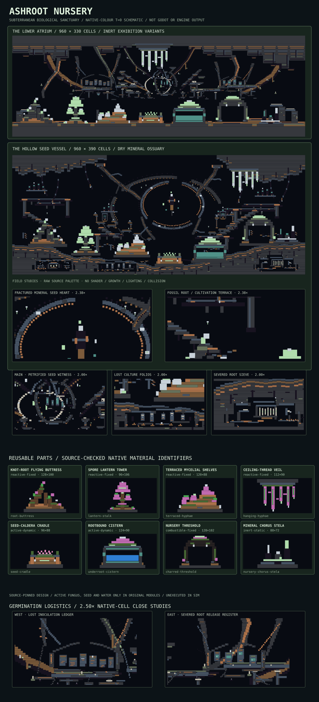

# ASHROOT NURSERY — world-feature collection 004

**Status:** Draft design only, not an admitted importer or validated gameplay map. Authoritative checkout: [main at `ba9cbc89029be88b812af59b19e5c59829bbcd90`](https://github.com/techrote/cybersand/commit/ba9cbc89029be88b812af59b19e5c59829bbcd90), tree `3af18f50e6094776263119623b64a1b2f4ca0ab2`, 2026-11-05.

An abandoned subterranean fungal nursery: basalt, earth and charred timber frame a violet living canopy with pale green phosphor accents, a seed caldera and a witness cistern. New and intentionally distinct from Lumen Fault #408 (survey geology), Chalkbone Coast #410 (shoreline), Carved Ice Choir #412 (glacial crystal instrument).



## Pieces

| Exact feature ID | Name | Size (cells) | Type | Live hazard |
|---|---|---:|---|---|
| `root-buttress` | Knot-root flying buttress | 128×100 | reactive-fixed | Fungus/Plant grow; OakLog and MossWall remain combustible; no structural support proven |
| `lantern-stalk` | Spore lantern tower | 96×106 | reactive-fixed | Fungus/Plant growth and ignition; OakLog/MossWall combustible |
| `terraced-hyphae` | Terraced mycelial shelves | 120×88 | reactive-fixed | Plant/Fungus are stateful; MossWall is combustible |
| `hanging-hyphae` | Ceiling-thread veil | 112×90 | reactive-fixed | Fungus and Plant grow; no tensile or hanging constraint exists |
| `seed-cradle` | Seed-caldera cradle | 96×88 | active-dynamic | Seed 19 is movable powder with germination/ignition kernel |
| `underroot-cistern` | Rootbound cistern | 124×90 | active-dynamic | Water 3 is conserved FreeMass, not a static filled rectangle |
| `charred-threshold` | Nursery threshold | 128×102 | combustible-fixed | CharredTimber 90 and MossWall 97 remain combustible, Fungus 18 grows |
| `nursery-chorus-stela` | Mineral chorus stela | 88×72 | inert-static | Only kernel None and immovable cells; optical appearance and collision remain unqualified |

The collection has **8 features, 165 ordered material-cell rectangles and 16 explicitly defined variants**. Every feature in `pack.json` includes local bounds, material IDs, anchor, neighbours, intended visual effect, status and simulation considerations. Its **960×330-cell** `ashroot-lower-atrium` gallery contains all eight modules and a continuous floor/ceiling, with each feature rendered through an **inert/petrified** variant. The dynamic originals remain documented but are not placed in that gallery.

## Design language and adjacency

Use **BasaltColumns 100** and **Obsidian 101** for contrast, **PackedEarth 56** and **RammedEarth 109** for ochre strata. **Fungus 18** draws pink-violet caps and filaments; **Plant 11** green tips, **MossWall 97** shaded masses and **OakLog 83** woody skeletons. **PhosphorPanel 127** and **QuartzCrystal 122** are bounded accents, not emitters that cast physically computed light. Sparse use of **ChemicalGlass 71** defines the cistern.

Maintain roughly 60% negative-space air, 25% stone/earth, 10% fungal growth, 5% pale accents. Alternate one tall landmark (lantern, arch) with two low shelves/stelae. Reserve at least **12–16 cells** between modules; leave **60 cells** under the ceiling veil. Roof and floor anchors require continuous host material and explicit checked clearance, not just coordinate coincidence. No rotation or mirroring is currently supported; variants are literal material-ID swaps, not animation or shader layers.

The proposal uses ordered **`[x,y,width,height,native_material_id]`** rectangles with top-left local origin, +x right and +y down, matching only the shape of `CyberDemoWorlds._rect` in `godot/scripts/demo_worlds.gd`. Later writes win. Unwritten air does *not* clear the host; explicit ID 0 is an erase command. This JSON is **not** an accepted GEN recipe, CYSD1 level, or existing importer. There are no independent background/decoration layers.

## Simulation and future qualification

The pinned native enum (`native/include/cybersand/material.hpp`) and shadow catalogue (`materials/catalogue/catalogue.json`) assign **Plant 11** and **Fungus 18** to native growth kernels although their cells are immovable; **Seed 19** is a movable, germinating powder. **OakLog 83**, **MossWall 97** and **CharredTimber 90** have **Combustible** kernels despite being fixed. The interaction registry documents hot-neighbour ignition, growth and germination; do not treat a good t=0 silhouette as permanent.

**Water 3** uses conserved **FreeMass**, unlike yielding liquids. The rootbound cistern is a visual closed-vessel *hypothesis*; mass, leak-rate, wall ownership, head distribution and thermal response need native-tick testing. ChemicalGlass 71 is physically fixed even if translucent. Biological filaments may grow and collide differently after elapsed steps. Dense mixed-kernel boundaries may increase scheduler work; narrow root/portal gaps require actor/Rapier tests; patterned silhouettes may differ significantly under the production shader.

Admission order, separately approved: source-ID and catalogue-drift checks → explicit bounded host terrain clear/overwrite → deterministic placement and material-ownership capture → inert variants in a bounded editor fixture → fungal, seed, ignition and Water native characterization → contact, actor, render/readability, performance and generation replay. Do not change the canonical material catalogue, production maps, physics, gameplay, GEN or Godot shaders in this proposal.

## Reproducible staging checks

```sh
node docs/world-design/ashroot-nursery/validate_pack.mjs --source-check --self-test
node docs/world-design/ashroot-nursery/render_pack.mjs --check
```

Validator checks schema, native IDs, rectangles, anchors, 16 variants, placement bounds, minimum floor gaps and inert gallery replacements. Source-check requires exact Git blob identities for native enum, shadow catalogue and interaction registry and all embedded palette records. The 10 mutation self-tests must fail their individual bad inputs. Renderer builds `preview.svg` deterministically from `pack.json`.

**Actually executed at design creation:** tool-side structural validation **PASS**, **10/10** deliberately corrupt inputs rejected, and reproducible renderer produced an SVG of **51797 characters**. Repository-checkout Node commands, source SHA runtime check, native/Godot ticks, shader screenshot, actor collision, FreeMass containment and hosted CI **NOT EXECUTED**. The illustration is a source-colour schematic only.

## Next independent candidates

Silt Clockworks — abandoned hydraulic regulators; Emberglass Fumaroles — refractory volcanic vents; Signal Orchard — engineered signal forest.

## A2 flagship terrain pass — The Fossil Heart Atrium (6 November 2026)

The **960×330 lower atrium** is reshaped as an interconnected petrified fungal nursery instead of eight free-standing objects in a rectangular cavern. A deliberately ruptured, stepped upper stone canopy frames asymmetric fossil root arches, smaller buttressing counter-roots, hanging rootlets, two interrupted overhead cultivation walkways, braced columns and eroded access niches. A suspended open-centre fossil spore heart is an interior focal point, while low sediment terraces and fractured earth bands connect the original modules. Thin stone scars, cut joints and occasional quartz/phosphor mineral inclusions supply smaller-scale authored detail without asserting biological activity or actual light emission.

The composition adds **864 ordered, inert scene terrain rectangles**, preserving all eight source modules, sixteen variants and eight existing placed exhibition versions. Render ordering remains terrain first, module placements last; unwritten negative space never means an automatic host erase. Ordered native-material raster comparison of the 960×330 scene: **54,351 changed visible cells of 316,800**, including **46,118 changes above y=190**, with **53.1% unwritten air** retained. These geometry measurements are not artistic acceptance scores.

Source-verified additions use only currently kernel-None, immovable native IDs. Active original module variants and their Water/Plant/Fungus/Seed implications are unchanged. The regenerated SVG remains a flat, source-colour schematic—not a Godot shader frame, source-matched simulation fixture or proof of clearance. Independent gallery comparison and native rendering/physics remain unqualified. Next iteration: alternate descending nursery-vault composition that reuses the same eight original modules and includes equivalent-scale close-detail crops.
