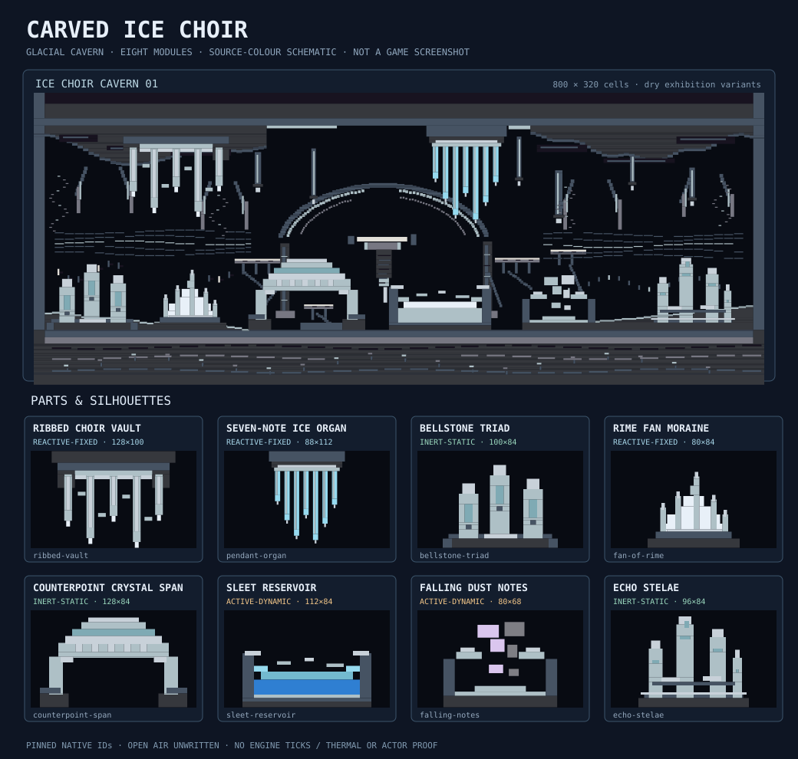

# CARVED ICE CHOIR — world-feature collection 003

**Design-stage proposal only.** No production gameplay, native physics, canonical materials, map fixture or GEN integration edits. Pinned to main [`ba9cbc89029be88b812af59b19e5c59829bbcd90`](https://github.com/techrote/cybersand/commit/ba9cbc89029be88b812af59b19e5c59829bbcd90), native enum blob `dcf05895da3015a2e999e3d1cbbae0fdc7fe32b3`, shadow catalogue blob `d7a47d60721598a16589daf177a6ff4401b84b43`, interaction registry blob `b70fc9dc2599f648e5374f06e4cc0ae9cb868d79`. Distinct from Lumen Fault [#408](https://github.com/techrote/cybersand/pull/408) (industrial survey) and Chalkbone Coast [#410](https://github.com/techrote/cybersand/pull/410) (fossil coast).



**Preview is not a Godot screenshot.** It paints native palette colours at t=0 but depicts no tick, melting, sound, dynamic settlement, shaders, actor collisions or structural load. Dark cave air is **empty/unwritten**, not a filled Obsidian backdrop.

## Composition and palette

Imagine a glacial cavern as a giant silent instrument: **BasaltColumns 100** and **Slate 49** form a continuous musical staff, with **FrostedGlass 121** and **QuartzCrystal 122** forming pale suspended musical notes. **GlassBlock 120**, **PackedSnow 105** and **Ice 9** accent the strong structural forms. Only specially marked dynamic pieces introduce **Water 3**, **Slush 21**, **Dust 14** or **Stone 13**.

Assemble two different bands: hanging ceiling ribs and standing floor chimes. Alternate a dominant high note with two shorter forms and retain 24–48 cells of negative air; repeat a specific organ profile no more often than every 130 horizontal cells. Avoid a grid of identical prisms. Keep the material-mass ratio intentionally dark and airy. No decorative material makes a real light source or resonator. Use source RGBA faithfully (not stylised game shader claims).

## Eight authoring modules

| ID | Dimensions | Class | Structural and physical intent |
|---|---:|---|---|
| `ribbed-vault` | 128×100 | Reactive fixed | Five ribs, fixed translucent glass, heat/salt-reactive PackedSnow 105 |
| `pendant-organ` | 88×112 | Reactive fixed | Seven Ice 9 icicles, thermal phase risk; `inert-glass` alternative |
| `bellstone-triad` | 100×84 | Inert static | Three graduated vitreous standing bells |
| `fan-of-rime` | 80×84 | Reactive fixed | Asymmetric fan of PackedSnow 105 and quartz |
| `counterpoint-span` | 128×84 | Inert static; clearance unproven | Two-foot bridge/arch, visual void underneath |
| `sleet-reservoir` | 112×84 | Active dynamic | Water 3 / Slush 21 / Ice 9 in a proposed open catch bowl |
| `falling-notes` | 80×68 | Active dynamic | Dust 14 and Stone 13 moving powders over a mineral catch basin |
| `echo-stelae` | 96×84 | Inert static | Four irregular inert glass megaliths ending the rhythm |

There are 151 ordered rectangles and 16 controlled material-swap variants. Feature-local rectangles are `[x,y,width,height,native_id]` with **half-open bounds** and +x right/+y down. Local ground anchors are placed at y=height; ceiling anchors at y=0; the bridge has two ground feet. Anchor and clearance rules, substitution maps, neighbouring material exclusions and individual visual intent are machine-readable in `pack.json`. Last paint wins, but unwritten voids never clear pre-existing cells. No rotations/mirrors or true engine layers are admitted.

## Scene: ice-choir-cavern-01

A single **800×320** cavern, continuous cap at y=0–35 and floor beginning y=260. Exact module origins:

| Module | Scene origin (x,y) | Variant |
|---|---|---|
| ribbed-vault | (92,36) | default |
| pendant-organ | (430,36) | default |
| bellstone-triad | (14,176) | default |
| fan-of-rime | (131,176) | default |
| counterpoint-span | (235,176) | default |
| sleet-reservoir | (389,176) | mineral-dry |
| falling-notes | (535,192) | fossilized-notes |
| echo-stelae | (674,176) | default |

The exhibition composition deliberately uses two **dry/mineral alternatives** instead of claiming liquid/powder equilibrium. The dry reservoir still includes reactive PackedSnow; inspect Fire, Lava, Salt and Steam contacts if eventually placed in an active map. Do not apply any of the features to an old fixture without a separate **bounded clear-then-paint** transaction and source-matched material initialization; existing editor/GEN/socket and player spaces must retain their own ownership. Do not assume the arch is traversable until tested against native and Rapier geometry.

## Reality checks and risks

- **Static:** `bellstone-triad`, `counterpoint-span`, `echo-stelae` use default fixed kernel-none materials. Fixed cells do not automatically provide physical support or collision guarantees.
- **Reactive fixed:** `pendant-organ` contains Ice 9 with hot-neighbour melt and sampled Water freezing. `ribbed-vault` and `fan-of-rime` contain fixed PackedSnow 105; source interaction pairs include Fire/PackedSnow, Lava/PackedSnow, Salt/PackedSnow and Steam/PackedSnow.
- **Dynamic:** `sleet-reservoir` uses native Water 3 **FreeMass** and Slush 21 **CellularYield**, distinct physics and accounting. Its containment is **untested**. `falling-notes` has downward-moving Dust 14 and Stone 13; its default t=0 columns will change.
- **Performance:** flowing liquid, thermal revalidation and falling powders can cause region activation; limit replication until measured and inspect actual material accounting, cell wake costs, leaks, mutation and settled snapshots.
- **Not validated:** native ticks, conservation, visual persistence, Godot shader captures, Rapier or player clearance, load-bearing semantics, supported editor import, GEN exact-recipe behaviour or hosted CI.

## Files and reproduction

- `pack.json`: schema `cybersand.world-feature-pack.proposal`, **not** a native GEN module or CYSD1 save.
- `preview.svg`: native catalogue-colour source preview; no simulation.
- `validate_pack.mjs`: standalone Node structural checks, with optional exact-source Git blob comparison.
- `render_pack.mjs`: deterministic SVG regeneration and `--check` byte comparison.

```sh
cd docs/world-design/carved-ice-choir
node validate_pack.mjs
node render_pack.mjs --check
# If you have the exact pinned source tree:
node validate_pack.mjs --repo-root /path/to/cybersand
```

**Publication checks in tool-side JavaScript:** authoring schema, all rectangle bounds/ID references, variants and placement integrity PASS; 8 deliberately invalid mutations rejected; source IDs came from GitHub exact-head catalogue. Preview generated successfully. This is not a claim that the checked-in scripts were run via a Node CLI in a checkout; no engine or hosted CI was run.

**Future integration questions:** choose clearing/overwrite semantics and a trusted editor/GEN resource path, define scene-collision support semantics, qualify thermal transition and performance of optional dynamic compositions, and establish a dry-first palette trial. Keep the PR Draft until an owner chooses these contracts.

## Flagship art pass — The Sundered Canticle (2026-11-06)

This **design-only** refinement replaces the largely uniform 15-rectangle cavern terrain with 1132 ordered terrain rectangles (including 1117 newly authored fixed scenic rectangles). Two asymmetric stratified rock transepts frame a broken mineral halo and hanging survey weight. Ruined ledgers, notched choir niches, five interrupted inspection galleries, graded talus, quartz-tipped chord formations and uneven lower strata add historical storytelling and close detail without turning the cavern into repetitive wallpaper. The source-colour 800×320 scene changed **28,379/256,000** final raster cells while **45.9% remains unwritten air**. The eight source modules, sixteen variants and original placements are unchanged.

All added terrain IDs (40, 49, 98, 100, 101, 121, 122) have `movable=false` and `kernel=0` in the pinned source palette. Worn frosted-glass and quartz cues are **illustrative**, not real transparency, sound or lighting. The original optional Water/Slush/Dust/Stone pieces are neither simulated nor tested. The previous `preview.svg` at commit `538ab31cc9e4797e36555ab04ccdba484a11bcfd` is the before reference; the regenerated current preview is the after schematic. No actual Godot output, thermal response, collision support, traversability or reference-gallery artistic superiority is claimed. Next improvement: distinct staggered vertical choir assembly and equivalent-scale engine captures.

## Alternate panorama — The Descending Antiphon (6 November 2026)

A second **800×360** dry composition now contrasts the horizontal *Sundered Canticle* without altering its source module definitions, sixteen variants or original placements. A broken overhead ceiling, six unequal descending geological terraces, two damaged approaches, interrupted inspection ledgers, a suspended split-chord tuning cage, and tightly curated mineral scars depict an abandoned glacial calibration sanctuary. Eight original modules are rearranged, not replaced: ceiling vault/organ above and uneven bass chimes, a weathered counterpoint arch, dry catch basin, fossilized notes and stelae descending toward the deep chamber.

The new `alternate_scene` contains **1416** fixed, kernel-none material rectangles. Ordered exact-source-ID cell reconstitution of the 800×360 alternate yields **145151 unwritten cells (50.4% of the view)** and **0 active-material final cells**. Unwritten cells are not host-erase commands. Both panoramas, all eight modular silhouettes and two explicit 2.4× close crops appear in the deterministic source-colour `preview.svg`; the original single-panorama preview at `72e6579c4306c386cb529241bb6ba3c6bcf22e51` is the before reference. The focused validator now checks alternate bounds, distinct scene ID, kernel-none terrain, selected variants, and exactly one appearance of every original module.

**No Godot/native engine render or physics test was performed**. Fixed FrostedGlass/GlassBlock/Quartz accents are not proofs of transparency, sound, dynamic light or mechanical support. Water/Slush/Dust/Stone originals, thermal persistence, actor clearance, and performance remain untested. Real engine captures and matched-scale comparison against all five earlier gallery PNGs and human review are prerequisites to artistic acceptance. Next refine the tuning cage's geological anchorage and examine fine detail at 1× without cluttering the central air gap.

## A8 refinement — Fault-anchored Descending Antiphon (6 November 2026)

This bounded pass develops the already distinct 800×360 alternate glacial sanctuary, rather than adding another collection or changing the eight reusable modules. A pair of opposing asymmetric **fault-shoulder cantilevers** now points into the fractured tuning-cage crown. Stepped mineral flying struts continue its side loads into ruined terrace abutments; two interrupted lower diagonals establish a visual route from the instrument to the foundations. Sparse horizontal geological bed lines, damaged capstones, scored shears, pitch-register fragments and broken talus add place-specific close details without filling the central unwritten chamber. This is an illustration of **plausible** attachment and former maintenance access, not proof of structural support, traversability or acoustic behaviour.

The pass adds **403 ordered fixed source-material terrain rectangles** (1416 → 1819). Compositing the exact ordered 800×360 source-colour cells yields **10,779 differing cells**, **136,604 unwritten cells (47.4%)**, and **0 final kernel-nonzero cells** in the dry alternate. These are geometrical/color counts, not quality scores. The original 800×320 panorama, eight module definitions, sixteen variants and both scenes' eight placements are preserved.

**Reproduction at this commit:** the *unchanged checked-in* `validatePack` and `renderPack` function bodies were executed in a tool-side V8 JavaScript isolate using the exact JSON, including 27/27 deliberately invalid mutated inputs rejected and repeatable exact SVG generation. The old checked-in SVG also matched its source renderer byte-for-byte before editing. This is **not** a local `node validate_pack.mjs` or `node render_pack.mjs --check` process run: GitHub host DNS resolution prevents a local checkout. The source blobs for native material enum, catalogue and interaction rules match the pinned SHAs; no Godot/native tick was executed. The current preview has one unaltered original panorama and an updated alternate plus two source-colour detail crops. Compare against the preceding exact-parent SVG; a flat SVG cannot certify artistic superiority over engine-captured references. Independent human evaluation and matched-scale actual engine captures remain open.

## Worker A9 — The Buried Counterpoint (6 November 2026)

This flagship refinement creates three **genuinely unwritten** stepped crypts within the formerly unbroken lower basalt of *The Sundered Canticle*. The west **broken bell ossuary** has a high vent, three unequal quartz/marble pendants, asymmetric weathered bearing feet and measured pitch marks; the centre **severed score archive** contains fractured display ledges, staggered memorial score tablets, a collapsed plinth and splintered approach ties; the east **twin echo throats** introduce two upper wellheads, a split pier, damaged mineral-organ rods and thirteen constrained witness marks. Layered geology and selective fracture damage join the lower vaults to the upper choir without flooding the original negative space with repetitive stamps.

The source terrain was geometrically resectioned around eighteen deliberately differently shaped cut blocks: 1138 retained terrain fragments plus 274 new fixed-source decorative stamps, totaling 1412 ordered terrain rectangles. Last-write-wins 800×320 raster comparison to the immediately preceding source returns **21,871 changed final material-ID cells**, **19,009 previously painted cells genuinely unwritten**, and **136,600 currently unwritten cells**. The existing 1690 nonzero-kernel original/module cells remain exactly unchanged; new authored pieces use only pinned fixed IDs 40, 49, 98, 100, 101, 121, 122. Air is still an authoring proposal, not a host-cell clearing or traversal guarantee.

The source-colour deterministic SVG now also includes **three 128×112 at 2.25× flagship foundation studies** in addition to the preserved original modular sheet, main panorama and spatially distinct *Descending Antiphon* alternate plus its original two crop studies. All eight reusable module definitions, sixteen variants, both placement sequences and the entire alternate scene remain unchanged.

The checked-in `validatePack` and `renderPack` function bodies were actually executed in an isolated V8 JavaScript environment: positive geometry, palette and source-blob checks, 10/10 deliberately bad mutations rejected, original baseline SVG byte-match and repeated new SVG byte-match. This is **not** a Node CLI subprocess: local GitHub DNS fails (git exit 128), preventing full checkout; no Node subprocess exit 0 or full-repo CLI qualification is claimed. No actual Godot capture, live thermal/physics/acoustic behavior, actor clearance, performance, or benchmark gallery human acceptance was performed. Preserve Draft status and obtain real executable source-matched captures and local Node checks before any independent quality gate.

