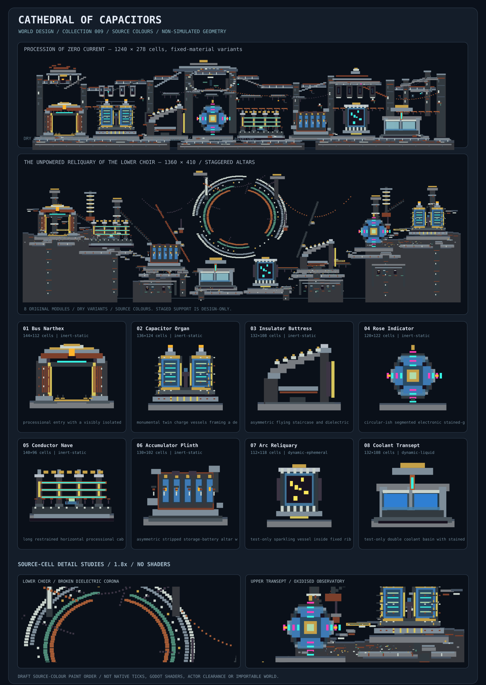

# Cathedral of Capacitors — world-feature collection 009

**DRAFT / DESIGN ONLY / DO NOT MERGE.** Eight reusable architectural remnants of an unpowered electrical sanctuary: twin capacitor organs, an insulator buttress, a rose circuit, a bus portal, a cable nave, a ransacked cell-bank altar and two explicitly experimental active cabinets. No production map, generator, gameplay, physics, engine, editor or canonical catalogue changes.



## Exact current source / staging contract

Main `ba9cbc89029be88b812af59b19e5c59829bbcd90`, tree `3af18f50e6094776263119623b64a1b2f4ca0ab2`. Native enum `dcf05895da3015a2e999e3d1cbbae0fdc7fe32b3`, shadow catalogue `d7a47d60721598a16589daf177a6ff4401b84b43`, interaction rules `b70fc9dc2599f648e5374f06e4cc0ae9cb868d79`. All 28 referenced material IDs and source properties checked against catalogue and enum; shadow metadata does **not** supersede actual native runtime authority.

`pack.json` is a provisional design-resource schema **not** a map save, engine importer, prefab or physics qualification. All positions are integer native cells, origin upper-left, +x right, +y down; rectangles are half-open `[x,y,w,h,material_id]`. Paint order is sequential and later rectangles replace prior cells. There are **no engine layers** or alpha compositing semantics. All pieces anchor bottom centre, 0° / 1×; no rotation or mirroring validated. Combined scene 1240×278, shared ground y=248. Gaps and glass apertures are **not host erasers**: a future importer must own/clear terrain explicitly.

## Design identity

Treat obsolete electricity as *ceremonial architecture*, rather than working machines. 65% dark basalt/slate/iron, 20% steel/ceramic, 10% cyan-magenta phosphor diagnostics and 5% brass/oxidised contacts. Large paired vertical vessels interrupt long low horizontal conductor lines, with one circular rosette and one open portal. Draw attention with sparse fluorescent marks; do not blanket-fill cyan. Source RGBA is used in the preview; no glow, power, circuit behavior or lighting is asserted.

**Assembly:** preserve an 18–32 cell transition around primary silhouettes. Default sequence: Bus Narthex → Conductor Nave → Accumulator Plinth → Insulator Buttress → Capacitor Organ → Rose Indicator → Arc Reliquary (silent) → Coolant Transept (glass). The combined preview uses exactly one of each with source-colour, dry replacements. Reusable patterns in `pack.json`: `nave-spine`, `signal-choir`, `quiet-test-pavilion`. Do not stamp over gameplay-critical collision or existing content without a bounded importer.

## Eight modules

| Module | Cells | Status | Purpose / constraint |
|---|---:|---|---|
| Bus Narthex / broken current gateway | 144×112 | inert-static | processional entry with a visibly isolated central opening; actor clearance not tested |
| Capacitor Organ / twin dielectric towers | 136×124 | inert-static | monumental twin charge vessels framing a delicate central gap; actor clearance not tested |
| Insulator Buttress / stepped support arch | 132×108 | inert-static | asymmetric flying staircase and dielectric studs; actor clearance not tested |
| Rose Indicator / fractured circuit mandala | 120×122 | inert-static | circular-ish segmented electronic stained-glass shrine; actor clearance not tested |
| Conductor Nave / side-chapel cable run | 140×96 | inert-static | long restrained horizontal processional cable and insulated arches; actor clearance not tested |
| Accumulator Plinth / plundered cell bank | 130×102 | inert-static | asymmetric stripped storage-battery altar with missing cells; actor clearance not tested |
| Arc Reliquary / sealed lightning cabinet | 112×118 | dynamic-ephemeral | test-only sparkling vessel inside fixed ribs; actor clearance not tested |
| Coolant Transept / paired baptismal baths | 132×108 | dynamic-liquid | test-only double coolant basin with stained-glass drip fall; actor clearance not tested |

Each includes local bounds, ordered material stamps, two independent palette substitution variants, anchor, neighbor rules and clearance flag. All six original fixed features exclusively use kernel=0, nonmoving source materials. These are **source-classified inert candidates**, not native-tested collision or stability proofs. Concrete/metal appearance does not imply functioning electronic or structural constraints.

### Active experiments — intentionally excluded from dry composition

- **Arc Reliquary:** Spark **34** has `movable=true`, kernel **24**, initial state A **12**. Its original dispersed lightning marks can expire, propagate or interact; behavior was *not run*. Combined scene selects `silent-arc` (Spark→NeonCyan **77**, fixed kernel 0), a design stand-in, not energisation.
- **Coolant Transept:** Water **3** is mobile, kernel **2**, initial state A **255**, and may reconfigure or escape the depicted bowls. Nothing proves containment or FreeMass behavior. Combined scene selects `frozen-mirrors` (Water→GlassBlock **120**, fixed kernel 0). Never co-locate both original active pieces as a tested gameplay system without separate simulation fixtures.

No temperature, curing, erosion, fluid pressure, combustion or energy consumption behavior is supplied by the rectangular prototype. Native interaction rules remain authoritative if later active fixtures are constructed. Active test sequence should be t=0/60/600 on current-main native with mass/state, leaks, cell counts and CPU measurements, then shader-correct Godot capture and actor clearance; authoring integration only after a reviewed owner-clearing and collision contract.

## Reproduction

From this directory:

```sh
node validate_pack.mjs
node validate_pack.mjs ../../../materials/catalogue/catalogue.json ../../../native/include/cybersand/material.hpp
node render_pack.mjs preview.regenerated.svg
cmp preview.svg preview.regenerated.svg
```

The scripts and preview are staging aids, not a production toolchain. Generation-side structural validation, enum+catalogue comparisons and 13 deliberately invalid mutation rejects completed. **Not executed:** checked-in Node scripts in checkout; native solver ticks; Godot capture; import/host clearing; physical support; actor/Rapier clearance; hosted CI; performance measurements. Preview is static SVG.

## Dependencies and outstanding admission questions

1. Is a reviewed world-feature import schema accepted, including overwrite/clear rules, scaling and terrain ownership?
2. Which authoring palette uses these modules: manual brushes, bundled maps or procedural placement recipes?
3. How should power/thermal cues be represented without misleading authors into treating cyan/amber fixed materials as powered circuits?
4. Does simulation at exact current source keep active Spark/Water variants viable, or should those two stay visual-only fixtures?

This PR is **independent from PLAY, SOL, MAT-AUTH, IN-TOOLS and all solver work**. Do not merge without separate admission and validation.

## Worker B3 — Severed Choir of Zero Current flagship (6 November 2026)

The redesigned **Procession of Zero Current** now depicts a broken and interconnected electrical sanctuary rather than a catalogue of eight isolated machines. The west socket-belfry, paired organ clerestory, open-center shattered rose, ruptured vaulted arches and flying buttresses, hanging interrupted maintenance bridge, east transformer horns, cable routes and eroded split lower aisle communicate a derelict ceremonial power-distribution site. Source-faithful joinery, insulator chips, fasteners and corrosion details enrich four reusable original inert modules. Upper architecture is allowed to fail in readable discontinuities rather than uniformly enclosing the skyline. Two **1.8× source-colour detail windows** are generated from the *same* ordered geometry in the SVG preview, not separately fabricated Godot captures.

**Ordered source-material cells:** 832 fixed backdrop rectangles paint before modules, then 118 foreground rectangles after modules. Module rectangles 280 → 412. All **eight original features, sixteen variants, eight placements, three patterns, anchors, active-original module geometry and dry Spark/Water replacement choices** remain. This is a proposal-only authoring field; no implicit engine-layer, host erasure, free-space guarantee or lighting/collider/physics claim. The retained native material header blob is `dcf05895da3015a2e999e3d1cbbae0fdc7fe32b3` and shadow catalogue blob `d7a47d60721598a16589daf177a6ff4401b84b43`.

**Before/after geometry proof:** 102,393 / 344,720 dry scene cells differ, 44,988 above y=135; **52.3% unwritten air** remains. Cell change count does not establish artistic superiority, and comparison to the five existing CyberSand gallery images remains unaccepted. This SVG represents flat source RGBA rather than actual Godot pixels.

**Checks:** Before-change checked-in `renderSVG` reproduced baseline `preview.svg` byte-exactly; after-change checked-in `renderSVG` reproduced the revised preview twice; actual checked-in `validatePack` function passed against the pinned source catalogue and native enum; **9/9 negative scene/material mutations rejected**. Execution was V8 JavaScript over exact fetched sources, **not** a local Node CLI process: on a real checkout run `node validate_pack.mjs ../../../materials/catalogue/catalogue.json ../../../native/include/cybersand/material.hpp --negative`, `node render_pack.mjs preview.regenerated.svg`, `cmp preview.svg preview.regenerated.svg` and record actual exit codes. The shell could not resolve GitHub to obtain the checkout. No Godot/native/Water/Spark/clearance/performance testing was performed.

**Next most valuable:** a distinct deep-crypt descent variant using the eight already-authored motifs and real engine close-up comparison; retain Draft until independent seven-criterion and reference-gallery human review.

## Worker B4 — The Unpowered Reliquary of the Lower Choir (6 November 2026)

A second **1360×410-cell dry source-colour composition**, not a replacement for *The Severed Choir of Zero Current*. Its narrative is a failed cathedral power-distribution crypt: eight intact original motifs are rearranged along a **descending and reascending sequence of individually staged altars**, from a western socket gate and severed nave to the central entombed diagnostic cabinets and eastern organ. The lower procession is joined by differentiated bearing platforms, exposed maintenance galleries, three hollow side crypts, failed copper returns, fractured masonry braces and sparse inscribed field registers.

A **broken double ceramic/copper dielectric corona** dominates the deliberately open centre without implying electricity. Its incomplete rings, missing socket teeth, splintered service cables, detached load paths, left and right incomplete stairways and clustered oxidation/chip scars document architectural damage at atlas, architectural and close-detail scales. All geometries are ordered integer native-material rectangle stamps: **1499 dry backdrop + 285 dry foreground rectangles**, painted around the **eight unchanged modules** with their existing 16 variants and three recipes. Both original and alternate compositions are retained in the SVG; the two close-detail windows now depict the alternate *from its same source-cell geometry* rather than separately illustrated overlays.

The alternate uses **staggered anchor heights** documented in each placement's `anchor_world`; `baseline_y=396` is a lower extent datum, **not** a claim that any raised platform supports a physical actor. This proposal extension is explicitly checked by the updated validator. The staged floors, cable hangs, chipped ceramic, glass, phosphor and neon are graphic motifs only; they are **not** a new engine layer, glow, power, structural support, host clearing, Water/Spark stability or gameplay traversability evidence. Original Arc Reliquary and Coolant Transept remain dynamic standalone experiments; this dry scene uses their existing `silent-arc` and `frozen-mirrors` substitutions.

**Source identities:** native enum `dcf05895da3015a2e999e3d1cbbae0fdc7fe32b3`, shadow catalogue `d7a47d60721598a16589daf177a6ff4401b84b43` (unchanged from original source pins). **Independent source-art evidence:** 242,969 of 557600 alternate cells visibly painted under later-wins compositing, 56.4% unwritten, zero Water/Spark ID cells; see exact SVG before/after at PR #454. Isolated V8 execution of the actual revised `validatePack` with exact catalogue and enum yielded 0 errors, and 10/10 newly injected alternate mutation cases were rejected. The revised `renderSVG` generated the same 740,121-character dual-scene SVG twice. These are actual JavaScript function checks **not** Node subprocesses: local Git clone/checkout still fails DNS resolution; therefore real Node CLI exit codes, direct image inspection of the five benchmark PNGs, true Godot captures, actor clearance and native simulation are not established.

**Full-checkout commands still needed:** `node validate_pack.mjs ../../../materials/catalogue/catalogue.json ../../../native/include/cybersand/material.hpp --negative`; `node render_pack.mjs /tmp/cathedral-regenerated.svg`; `cmp preview.svg /tmp/cathedral-regenerated.svg`. Those commands are not represented as executed. Independent comparative art review remains an owner/human gate.

## Worker B — Six Buried Registers / architectural afterlife (6 November 2026)

In the 1360×410-cell dry alternate *Unpowered Reliquary of the Lower Choir*, the former nearly solid flanking basal masses now contain **six architecturally different stepped unpainted vaults**, grouped west/east: a failed bus coupler, dismantled rectifier registry, broken harmonic spool, severed copper exchange, damaged recorder ledger and three unequal terminal coffins. Four slender service shafts descend from the broken upper infrastructure. Each room has distinct stepped clearance geometry, stressed supports, threshold wear and incomplete circuitry. The centre's existing empty descent and the flagship *Procession of Zero Current* are preserved. These are design-only **unstamped cells**, not erasure of a populated host map.

**Source-colour evidence:** exact prior SVG `21405ee223424eacb83e1de146b4d1ee28eef2f3` → new deterministic SVG. Ordered native-ID raster comparison at 1360×410: **46,769 changed final cells**, including **32,709 former painted cells becoming unstamped**, and **1,118 previously unpainted cells receiving source-fixed details**. 348 specific architectural and localized-wear rectangles added after clipping the originally 1499 backdrop and 285 foreground rectangles against stepped vault apertures. Three additional 2.1× SVG detail studies show lower-register source geometry; these are *not* actual Godot/shader images. Structural consistency, load transfer, clearance, live Water/Spark behavior, electricity, performance and benchmark-superiority are **not** demonstrated.

**Checks at source checkpoint:** pinned native enum `dcf05895da3015a2e999e3d1cbbae0fdc7fe32b3`, source catalogue `d7a47d60721598a16589daf177a6ff4401b84b43` matched expected Git blobs; checked-in `validatePack`/ `renderSVG` code bodies executed in connected V8 against exact pack and source text: original preview byte-identical, revised geometry PASS, **18/18 adverse mutations rejected**, new SVG deterministically reproduced twice. The independent local Linux shell failed `git ls-remote https://github.com/techrote/cybersand.git` (DNS, exit **128**); therefore full checkout `node validate_pack.mjs --negative` and `node render_pack.mjs` subprocess exits remain **unexecuted**, not exit 0. Follow with exact-checkout Node CLI and actual engine captures before artistic certification.


## Worker B — The Severed Canticle / raised-choir flagship (6 November 2026)

The **1240×278** flagship now gains a joined but damaged ceremonial choir: west truncated gantry and window ribs, unequal surviving structural piers, interrupted suspended spans, a **fractured double-ring null-cantor dial** and a dismantled eastern transept with dangling fixed insulating plaques and stripped conductor channels. The bridges are visibly broken, not ordinary connected platforms. 484 additional fixed backdrop stamps and 87 small foreground details change 17,839 final material cells, including 10,862 formerly unstamped positions. Original eight reusable modules, 16 variants, all original placements, and the full alternate *Unpowered Reliquary* remain unchanged. The first two 1.8× SVG studies now capture the changed **flagship** centre and eastern bridge instead of duplicating alternate crops. These are ordered native-material-cell rectangles, not SVG decoration.

**Executed source-function checks:** exact checked-in `validatePack` with source catalogue and native enum: **PASS (0 errors)**; **8/8** independent bad-geometries rejected; exact checked-in `renderSVG` executed twice and output byte-identical **PASS (1,498,001 characters)** in connected V8. **Not executed:** Node subprocess CLI (the local shell's GitHub DNS fails, `git ls-remote` exit 128), checkout-based render and `cmp`, Godot capture/native ticks. Source-colour SVG never establishes real electrical action, lighting, physical support, actor clearance, host clearing, Water/Spark retention or performance. Five-gallery direct pixel comparison and independent human review remain pending. Next: full-checkout Node commands and matched native-scale Godot capture of dial-to-east transept.
