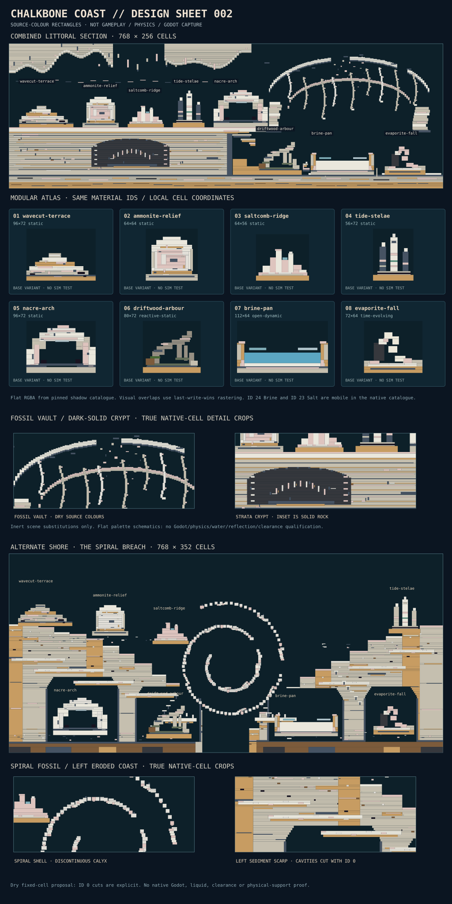

# CHALKBONE COAST — world-feature collection 002

**Status: proposed design-only scenery pack.** No production map, material catalogue, Godot source, native solver, tests or CI have been changed. This set was authored against CyberSand [`main` `ba9cbc89029be88b812af59b19e5c59829bbcd90`](https://github.com/techrote/cybersand/commit/ba9cbc89029be88b812af59b19e5c59829bbcd90), with native material definitions at blob `dcf05895da3015a2e999e3d1cbbae0fdc7fe32b3` and shadow metadata at blob `d7a47d60721598a16589daf177a6ff4401b84b43`. Unlike the contemporaneous **Lumen Fault** (#408) technical-survey theme, this is a fossil-rich littoral landscape with a sparse human trace and no neon machinery.



The image is a reproducible raster-derived **flat catalogue-colour schematic**, not a screenshot or native engine render. It does not depict future physical settlement, actual shader finishes, fluid escape, structural support or traversal. `pack.json` is an independent **proposal schema** modelled on the ordered `[x,y,w,h,material_id]` rectangles of `godot/scripts/demo_worlds.gd::_rect`; it is **not** a current supported importer, CYSD1 save or GEN recipe.

## Eight modular pieces

| ID | Cells | Primary native IDs | Physical class | Intended role |
|---|---:|---|---|---|
| `wavecut-terrace` | 96×72 | 38 LimestoneBlock, 39 SandstoneBlock, 99 ChalkBlock, 106 RockSaltBlock | **Static** | Receding dry sediment shelves with tide erosion marks |
| `ammonite-relief` | 64×64 | 98 Marble, 99 ChalkBlock, 106 RockSaltBlock | **Static** | High-readability square-spiral fossil in an excavated face |
| `saltcomb-ridge` | 64×56 | 99 ChalkBlock, 106 RockSaltBlock, 120 GlassBlock | **Static** | Asymmetric salt teeth / bleached windward crest |
| `tide-stelae` | 56×72 | 49 Slate, 99 ChalkBlock, 54 VerdigrisCopper | **Static** | Ancient unequal waterline markers; not electrical equipment |
| `nacre-arch` | 96×72 | 38 LimestoneBlock, 99 ChalkBlock, 106 RockSaltBlock | **Static; clearance test** | Open cave silhouette and natural passage landmark |
| `driftwood-arbour` | 80×72 | 88 Driftwood, 97 MossWall, 42 MossyCobblestone | **Reactive-static** | Storm-stranded organic roof / cover with combustibility caveat |
| `brine-pan` | 112×64 | 24 Brine, 38 LimestoneBlock, 39 SandstoneBlock | **Open dynamic** | Turquoise shallow saltwater pocket, intentionally not sealed |
| `evaporite-fall` | 72×64 | 23 Salt, 99 ChalkBlock, 100 BasaltColumns | **Time-evolving** | Falling powder salt and lower catch-shelf contour |

All IDs above are **native serialized material IDs**, not generic material families or decorative-only aliases. The authoritative full name/ID/state/mobility/kernel/flat-RGBA inventory used by the pack is embedded in `pack.json` and is checkable against `materials/catalogue/catalogue.json` plus `native/include/cybersand/material.hpp`. The shadow catalogue is an inspectable source-derived inventory, not an independent authority that may change production materials. Native `Material::Salt` **23** has `MaterialState::Powder`, `movable=true`, Sand kernel; native `Material::Brine` **24** is `MaterialState::Liquid`, `movable=true`, YieldingLiquid/CellularYield (not Water FreeMass); `Driftwood` **88** and `MossWall` **97** are fixed solids with Combustible kernels.

Each piece includes two material-swap variants (16 alternatives total). Recommended **inert presentation set**: `driftwood-arbour:fossilised` (88→38, 97→42), `brine-pan:stone-pan` (24→99) and `evaporite-fall:petrified` (23→106). The `brine-pan:dry-pan` variant writes explicit Empty 0 cells in place of Brine; it is safe only after the destination's overwrite/clearing rules have been explicitly selected. No variant creates new native material types.

## Combined scene and placement contract

The draft `chalkbone-littoral-section-01` uses **768×256 native cells**. An upper chalk shelf at `y=148` holds five ornaments; a lower tideflat at `y=232` holds the remaining three. A carbonate cliff ends near `x=395` and descends through a broken ramp towards `x≈510`. Coordinates are top-left module origin, not anchors.

| Module | Position `(x,y)` | Ground-contact `(x,y)` | Placement terrain |
|---|---|---|---|
| `wavecut-terrace` | (18,76) | (66,148) | High shelf |
| `ammonite-relief` | (130,84) | (162,148) | High shelf |
| `saltcomb-ridge` | (210,92) | (242,148) | High shelf |
| `tide-stelae` | (290,76) | (318,148) | High shelf |
| `nacre-arch` | (362,76) | (410,148) | High shelf / lip |
| `driftwood-arbour` | (438,160) | (478,232) | Lower bank at the shelf shadow |
| `brine-pan` | (534,168) | (590,232) | Lower tidal pan |
| `evaporite-fall` | (665,168) | (701,232) | Lower salt fan |

Half-open `[x,y,width,height,ID]` rectangles are applied in **list order**. The combined scene paints its own terrain rectangles first, then modules in placement order, using **last write wins**. Missing rectangles leave an unwritten cell: a cave opening or dark sky is **not** an automatic erase operation against an occupied host. Do not insert this pack into old fixtures and assume cutouts survive, or overlay it onto existing map features. Instead, perform an explicit bounded clearing transaction (using the accepted host mechanism once selected) before painting, and preserve the original fixture as a separate historical baseline. Module orientations are authored for +x right, +y down; mirroring/rotating is not an admitted authoring operation here.

The composite is intentionally **not** a player navigation map. The cave mouth at local `nacre-arch` `x≈28–67, y≈29–53` is geometrically open *within the proposed module's written cells*; terrain clearance, collider coupling, Rapier collision size and any player doorway guarantee remain untested. Static material cells are fixed in the native cell world, not automatically valid independent rigid-body structures.

## Style guide / reusable grammar

Keep the palette dominantly chalk-white, pink evaporite and sandstone ochre: **ChalkBlock 99 / LimestoneBlock 38 / SandstoneBlock 39** define ~70% of a shore section by intent. Shadows are **Slate 49** and **BasaltColumns 100**; small seams use **Obsidian 101**. Use **RockSaltBlock 106** for long-lived pale crystalline structure and reserve physically falling **Salt 23** for a single obvious cascade. In a wet design, **Brine 24** supplies one cyan resting focal plane; do not paint it as a background-only cosmetic if a live native world will tick. Avoid emissive neon and industrial panel grids. Grey Driftwood 88 is a secondary silhouette with an explicit combustible warning.

At large scale, alternate **two or three low shelves** with **one taller arch, fossil or marker**. Keep fossil reliefs at least ~180 cells apart so the repeated square-spiral glyph remains a landmark. Reserve about 16 cells of visible empty sky over the saltcomb, eight above the stelae, and a real cleared cavern throat for `nacre-arch`. The two upper-to-lower bands make a reusable cliff transition; a generator can reuse the *pattern* but may not assume that moving material will remain in the initially authored pixel positions. Avoid placing two brine pans closer than ~400 cells until a performance measurement exists. All pieces require uninterrupted grounding for their depicted physical silhouette; overhangs have no demonstrated support-breakage/rigid mechanics.

## Simulation, thermal and authoring risks

**Inert/static:** `wavecut-terrace`, `ammonite-relief`, `saltcomb-ridge`, `tide-stelae`, and `nacre-arch` use `movable=false`, `kernel=None` source materials. Their pixel layouts are expected to remain fixed under normal native cell movement, but **traversal, contact collision and integration success have not been tested**. GlassBlock 120 and FrostedGlass 121 are solid cells, not holes; the tiny teal glint is not a flow channel.

**Reactive-static:** `driftwood-arbour` is stationary as drawn, but Driftwood 88 and MossWall 97 use the bounded **Combustible** kernel. Fire/heat contact could change the canopy. The fossilised variant avoids those kernels. No fire setup is included here; do not read this as an ignition acceptance fixture.

**Mobile / evolving:** `brine-pan` paints shallow **Brine 24** in an open-sided basin with a nominal lip; its cellular flow/contacts, surface motion and reaction/phase effects are **not observed**. `evaporite-fall` paints **Salt 23 powder** in hanging steps: it is expected to settle/spread when unpaused, but actual destination, mass closure, contact consequences and CPU cost are unknown. In the initial raster, there are **1,553 mobile-material cells** (Brine and Salt together), not 1,553 confirmed settled or retained cells. No native tick was executed. In particular, the Brine pan should not be called sealed, pressure-safe or leak-free. Additional Salt↔Brine intermaterial chemistry must be checked against the exact live rule profile rather than inferred from names.

**Thermal and curing:** No Fire, Lava, MoltenGlass, Cement, or heated fixtures are authored. There is no proposed curing or hardening stage. Glass and saltblock are authored as their existing fixed cell types, not products of an in-scene thermal process. A future thermal variant must receive independent sourced interaction, lifetime and performance tests. There is no new fluid solver, density law, erosion model or material catalogue override.

**Performance:** The draft composite paints **135 module rectangles plus 19 base-terrain rectangles**, with **72,209 nonempty cells** at design time; these are raster accounting numbers, not measured native writes, native timer durations, shader cost or gameplay frame time. Treat open liquid and falling powder as cost-bearing if adopted. Generated worlds should obey host rectangle count/cell budget and source/target-owner rules; a high-density grid of this collection is not performance-admitted.

## Deterministic local checks and next admission work

From an actual checkout of this branch:

```sh
python3 docs/world-design/chalkbone-coast/validate_pack.py --repo-root . --self-test
python3 docs/world-design/chalkbone-coast/render_pack.py --check
# Explicitly regenerate the flat schematic if modifying any geometry:
python3 docs/world-design/chalkbone-coast/render_pack.py
```

The validator checks schema/ID/rect bounds, unique modules/variants, substitution legality, physical classification, zero invalid/reserved ID use, combined scene AABB fit, eight non-overlapping module placements, and reconstructs the last-write-wins raster. With `--repo-root .` it additionally **requires the two pinned blob SHAs** and compares every colour/name/state/mobility/kernel row against the native shadow catalogue and enum. If main has changed, a new source-qualified version is required rather than silently adopting a new definition. The SVG renderer is deterministic and `--check` refuses stale previews. `--self-test` rejects twelve independent deliberate corruptions.

**Checks performed during authoring (detached local tool environment, 2026-11-05 UTC):** structural validator **PASS**, 12/12 corruptions rejected, SVG regenerate/check **PASS**; Python-based preview generated and inspected. The validator's full two-file `--repo-root` comparison was **not executed** because the complete repo checkout is unavailable in the local sandbox; the current main files and row values were read separately through the connected GitHub source. **NOT RUN:** native simulation, Godot material shader, Windows/Linux live importer, heat/combustion, liquid conservation/escape, Salt settlement, actor/Rapier geometry, or hosted CI. None of these can be inferred from the design preview.

**Future integration choices (owner decisions; not authorized here):** choose a versioned accepted schema and location for palette-resource prototypes; define clearing, placement priority and source-identity rules; expose an opt-in static editor preview first; exercise `nacre-arch` doorway on the shared workbench and run a finite Brine/Salt native fixture before live-map adoption. Keep historical maps/fixtures immutable, and keep this draft PR **unmerged** until explicitly reviewed. Next distinct theme candidates: *the Carved Ice Choir* (glacial wind tunnels, phase-unstable spires); *Ashroot Nursery* (self-growing volcanic plant beds); *Silt Clockworks* (abandoned tidal rotary mills).


## A5 terrain flagship — The Ossuary Tide (2026-11-06)

This dry source-colour diorama changes the original separated specimen procession into a coastal fossil landscape. An asymmetric chalk overhang and broken inland shelf frame a monumental, deliberately ruptured double fossil arch with nine varied costae, unequal abutments and fallen bone-like stones. A scoured littoral bench descends through sedimentary layers to the stranded timber, lithified basin and petrified salt fan. The basalt-filled inset crypt is visually dark **solid** rock, not an open cave or gameplay-clearance guarantee. The SVG includes two enlarged exact source-cell crops; original modules remain individually illustrated in their base variants.

**Geometry and preservation:** 965 ordered scene rectangles (946 new fixed/kernel-none source-material pieces; baseline 19), plus 30 handcrafted wear/joint details in three modules. All eight module names, dimensions, anchors, original material IDs, 16 variants and eight placements are preserved. The new combined view chooses the existing fossilised, stone-pan and petrified substitutions; its raster has **zero mobile-material cells**. The original Brine 24, Salt 23, Driftwood 88 and MossWall 97 modules are retained separately and remain physically unqualified.

**Measured authoring delta:** 33,872 of 196,608 ordered scene cells differ from the original, including 18,490 above y=148; 105,248 cells (53.5%) remain unwritten negative space. These measurements do not score artistic quality. The renderer now uses sorted colour-run traversal for byte-repeatable SVG generation and crops both studies from the identical 768×256 scene raster.

**Outstanding:** Full-checkout Python validator/preview subprocess checks, actual Godot/native source-material capture, full reference-gallery comparison and independent human aesthetic admission. Static pale fibres and dark crypt stones do not demonstrate fossilisation, passable voids, Brine containment, Salt settling, actor clearance, or performance. No engine/material/gameplay/CI change is proposed.
