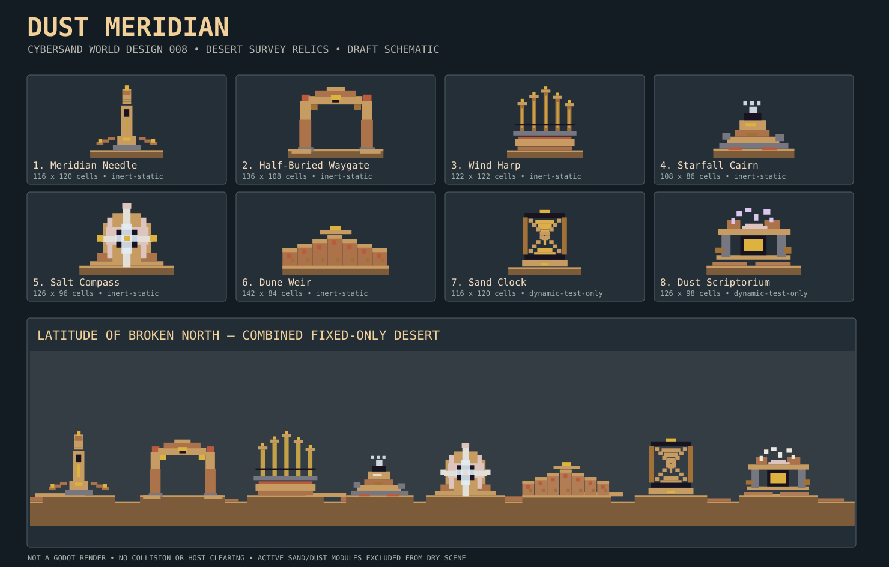

# Dust Meridian — World-feature collection 008

**DRAFT; design-only. Do not merge.** A ruined desert-navigation system: cardinal obelisk, half-buried gateway, silent wind harp, star cairn, crystallized compass, terraced windbreak, sand clock and dust archive. Unlike Signal Orchard's electrical groves or Silt Clockworks' tidal machinery, this collection uses geology, spatial bearings and long, empty desert horizons.



## Exact source and staging contract

Accepted `main`: `ba9cbc89029be88b812af59b19e5c59829bbcd90`, tree `3af18f50e6094776263119623b64a1b2f4ca0ab2`. Native material enum blob `dcf05895da3015a2e999e3d1cbbae0fdc7fe32b3`; material catalogue shadow blob `d7a47d60721598a16589daf177a6ff4401b84b43`; interaction header blob `b70fc9dc2599f648e5374f06e4cc0ae9cb868d79`. The current catalogue's material IDs, source RGBA, kernel, mobility and initial state are included in `pack.json`. **The shadow is metadata, not a replacement for the native runtime authority.**

Integer native cells; top-left origin, +x right / +y down; ordered half-open `[x,y,width,height,material_id]` rectangles with later paint over earlier paint. Matches the *primitive arguments* of `godot/scripts/demo_worlds.gd::_rect`, but this is **not** a CYSD save, admitted importer or engine/editor scene. Each stamp anchors at bottom-centre; combined scene seam y=244. No layers, scaling, automatic rotation, mirroring or permission to clear host cells. Clear all intended negative-space cavities only after authoring import/ownership design is accepted.

## Visual identity and combination rules

Ocher SandstoneBlock **39**, RammedEarth **109** and PackedEarth **56** dominate, with TerracottaTile **48** on wind-cut edges. Slate **49**/Obsidian **101** provide recessed openings; Bronze **52**/BrassPanel **119**, QuartzCrystal **122**, Marble **98** and GoldLeaf **118** mark sightlines. Fixed RockSaltBlock **106** is *not* loose Salt **23**. Target ~70% warm stone/earth, 20% dark structural patterning, 10% white/quartz/gilt details. Alternate one tall silhouette with at least one low marker; preserve gaps between wind strings and gateway posts. Do not imply actual sound, power, shadow-based timekeeping or aerodynamic shielding.

| Module | Size (native cells) | Function | Runtime hypothesis |
|---|---:|---|---|
| `meridian-needle` | 116×120 | dominant cardinal zero | fixed-kernel dry candidate |
| `half-buried-waygate` | 136×108 | broken pedestrian-looking arch | fixed-kernel candidate; collision NOT measured |
| `wind-harp-pylons` | 122×122 | five graduated string towers | fixed-kernel candidate; no audio/wind |
| `starfall-cairn` | 108×86 | low wayfinding rest | fixed-kernel dry candidate |
| `salt-compass-register` | 126×96 | circular mineral survey register | fixed-kernel candidate; wet contact untested |
| `dune-weir` | 142×84 | low serrated barrier | fixed-kernel candidate; no wind effect |
| `sand-clock` | 116×120 | granular hourglass | dynamic Sand **2**, kernel **1** |
| `dust-scriptorium` | 126×98 | dispersing dust inscriptions | dynamic Dust **14**, kernel **12** |

**Variants and scene:** Each module has two substitution variants (16 total), with precisely ordered geometry, anchors, clearance guidance and neighbour rules. The original **1320×280-cell** `Latitude of Broken North` composition places all eight at explicit coordinates, using `petrified-hour` (Sand **2** → SandstoneBlock **39**) and `chalk-inscription` (Dust **14** → fixed ChalkBlock **99**); its other six modules are source-fixed. `ChalkBlock` can still respond to Water; "fixed" is not a claim of global chemical inertness. `dune-weir:adobe-rampart` uses water-reactive AdobeBrick **102**. Dry scene substitutions are visually representational, not recorded granular volumes.

**Repeatable patterns:** `broken-survey-line` (Needle → Cairn → Salt Compass, >=20 cell gaps), `pilgrim-threshold` (Waygate → Harp → Weir, >=22), and `sediment-archive` (Weir → Sand Clock → Scriptorium, >=24; fixed variants mandatory). Do not stamp active source versions into general maps.

## Physical limitations and integration requirements

- **Static scenery candidates:** all combined-scene materials have source `movable=false`, `kernel=0`, but can still participate in pair reactions. Avoid claiming permanent static behavior in thermal, acidic or wet hosts. The broad dry scene floor is a staging sketch only.
- **Evolving modules:** Sand and Dust are movable powders; source alone cannot establish retained shape, mass conservation in cavities, settlement duration, oscillation, erosion or dispersal. Isolate each in a native fixture and record exact source, cell counts and tick timing.
- **Performance risk:** the pack retains 278 local module rectangles, 704 original scene rectangles and 1042 alternate scene rectangles; dense repeats plus mobile particles may increase kernel and contact costs. No frame/tick measurement performed.
- **Authoring admission gates:** specify negative-space clearing authority, material-ID compatibility, persistence format, rotation policy, collision/player clearance, actor spawn exclusion, tile-edge stitching, thermal and wet interactions, runtime fixtures, shader captures and a deterministic import/export receipt. Avoid importing production maps directly from this draft.
- **Presentation:** `preview.svg` is source-colour vector geometry; it is NOT a native or Godot screenshot.

## Reproduction

```sh
node docs/world-design/dust-meridian/validate_pack.mjs docs/world-design/dust-meridian/pack.json materials/catalogue/catalogue.json --negative
node docs/world-design/dust-meridian/render_pack.mjs docs/world-design/dust-meridian/pack.json docs/world-design/dust-meridian/preview.svg --check
```

The generation-side V8 validation executed successfully with **18** exact catalogue materials, **194** rectangles, **16** variants, **8** fixed scene placements and 12/12 invalid-input mutations rejected. Checked-in Node scripts, native simulation, Godot renderer, collision tests, performance and hosted CI have **not** been executed.

**Open questions:** should a future importer clear entire bounds or a separately versioned negative-space mask? Should visual-only powder substitutions be marked explicitly in map palettes? What wet-host exclusion/rule evaluation is appropriate for Chalk and Adobe?

Next candidate themes: **Cathedral of Capacitors**, **Mirror Marsh**, **Drowned Observatory**. No gameplay, native code, materials or canonical map modified.

## Worker B2 — Shattered celestial causeway (6 November 2026)

The `Latitude of Broken North` flagship is now an **integrated landscape**, not just eight separated survey relics on a level strip. Layered western/eastern escarpments frame a failing elevated latitude-spine: eight discontinuous dressed-stone spans, six masonry-and-metal bearing buttresses, two deliberate collapse gaps, tumble debris and exposed strata. The open-centre cardinal wheel over the central register is a broken sky instrument; its discontinuous rim, braces, sight ticks and gilded datum are **purely visual**, not a working telescope, solar mechanism, generated lighting or navigable bridge. Thin sediment lenses, fallen measurement stones and residual surveying marks connect the relics into one lost long-distance navigation system.

The reusable `half-buried-waygate` and `wind-harp-pylons` also gain worn masonry courses, scratched plates and irregular fasteners; all **eight original modules, 16 variants, three pattern recipes and eight dry scene placements** survive. No active Sand/Dust variant is placed in this composition. Geometry counts: **12 → 704** scene terrain rectangles; **194 → 278** reusable feature rectangles; **33,013 / 369,600** native-grid source-material cells differ after ordered-stamp comparison, of which **12,962** lie above y=145. **65.6%** of raster remains unwritten air; this measures composition only, not quality.

Validation: `validatePack` checked-in function against exact pinned source shadow, plus **12/12** negative mutations; `render` checked-in function reproduces the original SVG byte-identically and deterministically regenerates the improved SVG. Execution took place in an isolated JavaScript V8 runner, **not** a Node CLI subprocess: local `node validate_pack.mjs ... --negative` and `node render_pack.mjs ... --check` exits are **not available** because no checkout could be accessed from the shell. Run those commands from a real checkout before admission. Source material/header/interaction identities were checked at the recorded baseline. Real Godot output, performance, host clearing, actor clearance and wet/thermal reactions remain untested. The generated `preview.svg` is a flat-colour schematic.

**Next alternate:** reuse all eight modules on a serpentine descending canyon path with lower observatory and changed line-of-sight, rather than adding more modules. Independent human review and reference-gallery comparison remain open.

## Worker B — The Sunken Azimuth (6 November 2026)

A distinct **1320×448-cell** dry descending observatory contrasts with the original *Latitude of Broken North*. Four upper instruments survey a monumental **fractured cardinal wheel** and discontinuous viaduct; four lower documentation courts descend toward a buried slate-and-chalk field register. Eroded ledges, unequal bearing piers, terraced steps, broken rigging, damaged inscribed slabs, exposed strata and fallen measuring stones tell a story of repair and abandonment. Two SVG detail crops examine the wheel and lower records. They are **source-colour geometry only, not a Godot render**.

The 1,042 new fixed-material terrain rectangles cover 141,916 / 591,360 cells (24.0% before module overlays). All eight original reusable modules, sixteen variants, three pattern recipes and the original flagship remain untouched. Active Sand/Dust source variants are excluded; the alternate uses `petrified-hour` and `chalk-inscription`. Fixed kernel IDs do not imply global chemical inertness.

**Qualification:** the exact committed `render` and `validate` functions were evaluated in isolated V8 with pinned source identities; all 20 original and alternate negative mutations rejected, and rendering was byte-identical on repetition. This is **not** a local Node CLI subprocess result. Full CLI execution remains untested because local git checkout could not resolve github.com. Real Godot/native graphics, collision and host clearance, wet/thermal interactions, wind, sand/dust transport, performance and independent comparative human gallery acceptance remain untested.

Next: full-checkout `node validate_pack.mjs docs/world-design/dust-meridian/pack.json materials/catalogue/catalogue.json --negative` and `node render_pack.mjs docs/world-design/dust-meridian/pack.json docs/world-design/dust-meridian/preview.svg --check`; then matched-scale visual critique and Cathedral of Capacitors structural refinement.

## Worker B — Four Witness Vaults / interrupted latitude tramway (6 November 2026)

The flagship **Latitude of Broken North** now contains four truly *unstamped* subgrade archaeological rooms: a star-chart archive, damaged bearing room, compass calibration court, and lost transit ledger. They are cut out of the formerly continuous 36-cell floor, with individually arched roof profiles, offset bearing piers, deliberately broken record rails, rare source-defined gilt/quartz marks and eroded masonry. Unlike painted dark rectangles, the chambers remain genuinely unwritten in the pack and **do not authorize clearing any host terrain**.

Above them, asymmetric banded desert escarpments with deliberate sky clefts frame a discontinuous high survey tramway, six mismatched load-bearing towers, snapped inert copper sightline cables and localized spall. The central original landmark and open sky remain readable. 1013 new source-fixed terrain/wear stamps; 281 replacement foundation stamps. Cell-resolved last-write-wins comparison changed **53,314 of 369600 cells** (including 11,769 actually newly unwritten, 22,456 in the upper 157 rows); **59.8%** of the scene is unstamped. Those are structure measurements, not artistic acceptance scores.

The deterministic SVG adds **two detailed flagship undercroft views** below the pre-existing alternate views, using identical source-colour native-cell geometry. Eight modules, 16 variants, three repeatable patterns and the complete alternate scene are preserved without change. Re-run the existing Node commands from an actual repository checkout; the isolated V8 checked-in validator and renderer executed with 20/20 original negative cases rejected, pinned material-source match and byte-exact preview regeneration, but **full local Node CLI exit codes were not available** because the shell cannot resolve github.com (`git ls-remote` exit 128). This is no Godot capture. No wind, sound, electrical signalling, Sand/Dust physics, clearance, host erasure, performance or five-gallery human acceptance is claimed.
