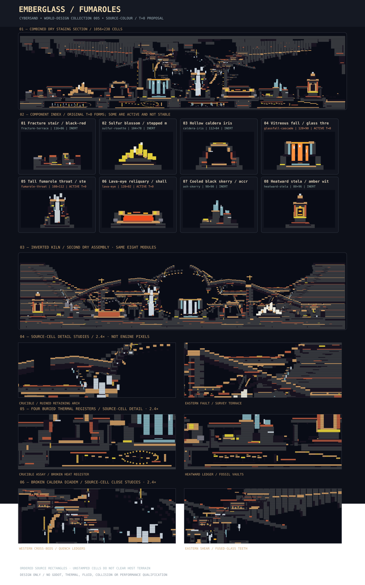

# EMBERGLASS FUMAROLES — World-feature collection 005

**Status:** DRAFT creative design / authoring-resource proposal, not an accepted importer, validated GEN recipe, CYSD1 save or gameplay map. Pinned current `main` [`ba9cbc89029be88b812af59b19e5c59829bbcd90`](https://github.com/techrote/cybersand/commit/ba9cbc89029be88b812af59b19e5c59829bbcd90), tree `3af18f50e6094776263119623b64a1b2f4ca0ab2`, source read 2026-11-05.



## Deliverables

Eight intentionally coordinated volcanic modules, **182 ordered native-cell rectangles**, **16 literal material-swap variants**, and one combined **1056×238** modular scene with all eight modules in fixed dry variants. The iconography is cooled lava terraces, sulfur petal structures, impossible volcanic hollows, streaked vitrification, steam plumes, and sparse geometric witness markers. This is substantially different from the prior survey ruin (#408), fossil coastline (#410), glacial instrument cave (#412) and biological sanctuary (#414).

| Exact ID | Module | Cells | Native t=0 state | Combined scene choice |
|---|---|---:|---|---|
| `fracture-terrace` | Fracture stair / black-red strata | 116×86 | inert-static | `cold-strata` |
| `sulfur-rosette` | Sulfur blossom / stepped mineral fan | 104×78 | inert-static | `ochre-rosette` |
| `caldera-iris` | Hollow caldera iris | 112×84 | inert-static | `dark-iris` |
| `glassfall-cascade` | Vitreous fall / glass thread cascade | 120×90 | active-dynamic | `quenched-glass` |
| `fumarole-throat` | Tall fumarole throat / steam crown | 108×112 | active-dynamic | `ghost-fumarole` |
| `lava-eye` | Lava-eye reliquary / shallow caldera pool | 128×82 | active-dynamic | `cold-lens` |
| `ash-skerry` | Cooled black skerry / accreted glass shelves | 98×90 | inert-static | `sulfur-skerry` |
| `heatward-stela` | Heatward stela / amber witness marker | 80×96 | inert-static | `unlit-marker` |

## Design language and placement grammar

Use **BasaltColumns `100`** as the large structural black rock, **Obsidian `101`** for deep fractures, **Firebrick `104`**, **TerracottaTile `48`** and **RedBrick `43`** for cooled earth-red rims. **SulfurBlock `126`** and **QuicklimeBlock `108`** are rare yellow/white rosette petals, not emitters. **GlassBlock `120`** and **QuartzCrystal `122`** articulate cooling flows. **NeonAmber `79`** provides thin static amber keylines; it is *not* a simulation light or thermal energy source. Use **HeatShieldTile `131`** only as an optional future palette colour, not proof of insulation.

Ground anchors sit on a common horizontal seam at native y=211 in the combined section. Positive y runs down; all modules have authored orientation 0° and scale 1×. Leave 7+ cells between adjacent bounding boxes, leave at least 8–18 cells of negative space above tall modules, and reserve the open upper void to keep silhouettes legible. Alternate one tall chimney/marker with low rocks; a single yellow rosette should dominate each continuous gallery. Do not repeat every vivid module at the same cadence in a generated world. No flipped, rotated, tiled, rescaled or multi-layer version is authored.

Geometry uses the construction shape `[x,y,width,height,native_material_id]` from `godot/scripts/demo_worlds.gd::_rect`. **This does not mean the JSON is natively loadable**. Rectangles are applied in order; later writes win; absent cells **do not** clear host materials. The caldera iris opening specifically needs a bounded host erase before placement. Destination owner, terrain priority, exact material buffer, actor contact and collision policies must be admitted separately. Fixed world cells are not Rapier bodies; glass and inset effects are physically solid.

## Native materials / physics boundary

Source authority: `native/include/cybersand/material.hpp` (blob `dcf05895da3015a2e999e3d1cbbae0fdc7fe32b3`); `materials/catalogue/catalogue.json` (shadow blob `d7a47d60721598a16589daf177a6ff4401b84b43`); `native/include/cybersand/interaction_rules.hpp` (blob `b70fc9dc2599f648e5374f06e4cc0ae9cb868d79`). All 20 palette entries were checked for **ID, enum name, exact RGBA, state, mobility, kernel and lateral flow** against these source reads.

**Safe t=0 inert candidates (static world material, not validated playability):** `fracture-terrace`, `sulfur-rosette`, `caldera-iris`, `ash-skerry`, `heatward-stela`. They use kernel-None, immovable materials only. They remain **unqualified for shader rendering, contact/clearance, terrain overlap or gameplay stability**.

**Time-evolving original variants requiring simulation:**
- `glassfall-cascade`: **MoltenGlass `36`** is a yielding mobile liquid, has native cooling/evolving Glass conversion and a Water/MoltenGlass reaction yielding Steam+Glass. Its narrow columns and collector basin can slump or overflow; `quenched-glass` substitutes GlassBlock `120` for a static gallery.
- `fumarole-throat`: **Steam `22`** is a rising Gas, and the initial plume does **not** regenerate after placement. It may disperse. `ghost-fumarole` substitutes fixed QuartzCrystal `122` and is collision-solid, despite visually resembling vapour.
- `lava-eye`: **Lava `8`** is a moving CellularYield liquid; initial pool and thermal contacts can change. Native registry includes Lava/Water quench and sampled Lava/Obsidian transformation. Main geometry avoids intentional direct live Lava/Obsidian contact. `cold-lens` replaces Lava with inert Obsidian `101` in the gallery.

**Interaction risks:** The pinned interaction registry has thermal/chemical pair rules; do not introduce Water, Ice, combustible material, generic Glass or mixed live sources nearby without a dedicated native fixture. Building-material names like Firebrick and HeatShieldTile are not a general guarantee of thermal insulation. SulfurBlock is presently fixed inert mineral decor. Active cells and narrow thermal contact boundaries require measurement of native ticks, visual accumulation, quantity, emissions, active chunk count and render/collision load.

## Preview, reproducibility and validation

`preview.svg` is generated from `pack.json` with raw native material catalogue RGBA and geometry. Combined view uses inert substitutions only. Individual tiles show **original t=0 arrangements**, including active materials (these are not stable-state illustrations). No parallax layers or real shading were simulated.

From an appropriately source-pinned repo checkout, run:

```sh
node docs/world-design/emberglass-fumaroles/validate_pack.mjs --source-check --self-test
node docs/world-design/emberglass-fumaroles/render_pack.mjs --check
```

Tool-side performed now: all source palette entries and enum IDs matched; structural validation **PASS**; **13/13** intentionally corrupted clones rejected; deterministic SVG creation **PASS** (34273 characters). These checks were executed in the authoring tool with live connected GitHub reads, **not** by executing checked-in Node scripts on a checkout. **NOT RUN:** native or Godot simulation, thermal pair characterization, renderer screenshots, hosted CI, gameplay interactions, actor/Rapier clearance, actual ENVO generation, time evolution and performance measurements.

## Later integration steps (not authorized here)

Approve format, clearing and host-ownership contract; use a bounded placement fixture with exact hash inputs; review original and inert variants separately; run native t=0 and 60/600 tick captures on Steam/Lava/MoltenGlass with conservation and temperature-ownership evidence; then measure shader silhouettes, actor clearance, responsive physics, chunk counts and repeatability. Preserve current production physics/PLAY/SOL/MAT-AUTH/IN-TOOLS independently; keep this PR **Draft / DO NOT MERGE**.

## Distinct future collections

**Silt Clockworks** — terraced abandoned tide regulators; **Signal Orchard** — engineered luminous forest; **Dust Meridian** — asymmetric desert navigation debris.

## A1 terrain-art pass — the broken caldera crown (2026-11-05)

This first flagship pass reshapes the original isolated eight-motif strip into **one broken-ceiling caldera panorama**. The western hanging mantle, collapsed central canopy and sheared eastern cliff frame the original fumarole over a large negative-space aperture. Intermediary scree steps relate the discrete monuments without moving their original source-local anchors. Deliberately sparse terracotta/firebrick contact bands and cross-cutting obsidian seams convey erosion, cooled flows and successive ash events. The central fumarole gains worn wall edges, mineral inlays, dark fracture cuts and fixed glass/quartz traces; none represents real emission or thermal insulation.

**Geometry:** 124 new inert scene-terrain rectangles; 21 new inert detail rectangles in `fumarole-throat`; 138 scene rectangles and 182 module rectangles after the pass. Eight modules, 16 original literal material-swap variants, feature bounds/anchors, 1056×238 scene and original eight placements at the y=211 seam remain intact. All IDs are original source-pinned native materials and the ordered overwrite rule is preserved. No dynamic material was added.

**Visual delta at exact scene-cell scale:** Comparing the original #454 consolidation preview geometry with this revised deterministic `preview.svg` records 29,697 visibly changed cells, including 24,031 above y=100 and 7,997 in the x=322–650, y=0–99 signature canopy region. 60.2% of scene cells remain unwritten air. The before SVG is still accessible from the parent #454 commit; the after SVG is regenerated from the pack using this directory's original renderer. These are quantified *geometry* differences; no independent artistic score or simulated visual outcome is claimed.

**Qualification method:** The checked-in JavaScript validator `validatePack`, its `selfTest` (13/13 deliberately corrupt clones refused), and the checked-in deterministic SVG renderer `svgForPack` were actually executed against connected GitHub exact-head text in an isolated V8 JavaScript executor. The baseline preview first reproduced byte-for-byte; source enum, shadow catalogue and interaction registry blob SHAs matched the pinned references, and palette IDs/fields were compared to the native header and catalogue. The executor was **not** a Node CLI checkout; therefore no shell exit codes or Node process execution are claimed. Native/Godot pixels, Steam/Lava/MoltenGlass evolution, host clear/overwrite, actor/Rapier clearance, thermal performance, comparisons to the five gallery references and independent human acceptance **remain untested**.

**Next art target:** a second substantially different authored lower-vault panorama using the same eight reusable modules, with genuinely different negative space and erosion story, followed by close-crop evidence and an independent seven-axis visual review.

## A6 — The Inverted Kiln / second geological panorama (6 November 2026)

**Second fully authored alternate composition.** The preceding *Broken Caldera Crown* remains intact as the original `scene`. A new independent `alternate_scene` reassembles **all eight unaltered modules** in a different order, with source-defined dry material substitutions and original ground-contact seams. Its geological story is a failed ancient quenching/calibration works: opposed inward-stepping basalt scarps; exposed cooled-lava strata and vitrified drains; four interrupted elevated gallery spans; two load-bearing datum piers and diagonal braces; a **broken double-walled furnace calibration wheel** with deliberate breaches rather than a closed ring; submerged-looking but dry inscription benches, fractures and collapsed witness posts. Its silhouette emphasizes a deep dark central basin rather than the earlier overhead caldera roof. Architectural scratches, wear and mineral seams are restricted to appropriate contacts.

**Evidence:** ${land.length} new fixed/kernel-none source-material rectangles in the alternate. A complete ordered-cell raster comparison with the retained flagship changes ${diff.toLocaleString()} of 251,328 scene cells (${topDiff.toLocaleString()} above y=115); ${(blank/baseline.length*100).toFixed(1)}% of the alternate is unwritten negative space. The alternate contains **zero movable or active-kernel displayed cells**. Original A1 flagship geometry, 8 original feature definitions, 16 variants and their original placements are retained verbatim as parsed JSON. `preview.svg` now deterministically renders both panoramas, all eight original modules and two 2.4× source-cell close studies. These are design schematics, **not** Godot or simulated physics frames.

The pack validator now checks alternate bounds, original material palette, dry-only identities, seam, nonoverlap and complete module presence, with five new negative controls. The exact checked-in renderer and validator functions were executed in isolated V8, including byte-exact original SVG reconstruction and repeated revised generation, ${rejects}/${rejects} negative mutations rejected, and pinned native material/catalogue/interaction source SHA checks. A full Node CLI checkout was unavailable (GitHub DNS failed, git exit 128); CLI exit codes for `node docs/world-design/emberglass-fumaroles/validate_pack.mjs --source-check --self-test` and `node docs/world-design/emberglass-fumaroles/render_pack.mjs --check` are **not established**. Independent human comparison with all five reference captures, actual Godot rendering, thermal interactions, host erasure, clearance and performance remain untested.
