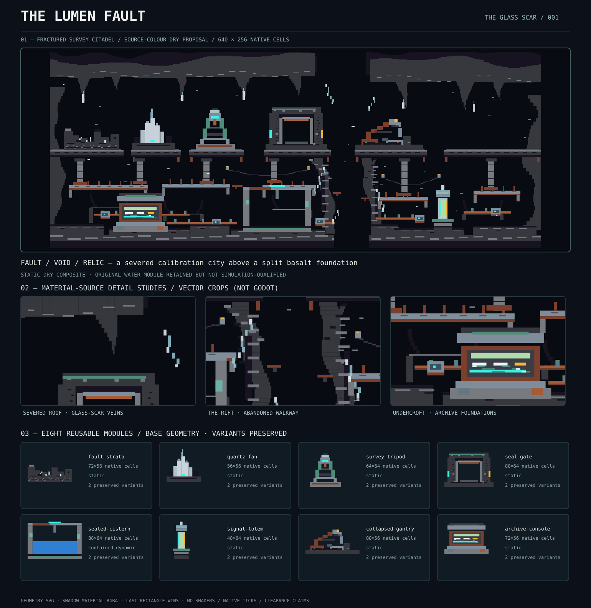

# THE LUMEN FAULT — world-feature collection 001

**Status: draft / design only.** Source: [`main` at `ba9cbc89029be88b812af59b19e5c59829bbcd90`](https://github.com/techrote/cybersand/commit/ba9cbc89029be88b812af59b19e5c59829bbcd90), inspected 2026-11-05.

An abandoned deep subterranean survey station: sharp basalt formations, bright quartz needles, oxidised copper observatory instruments, and a specimen cistern isolated beneath a calibration terrace. The set is intended for later selection into map-editor palettes, scenario maps and generative resource bundles—not a production map or runtime engine change.



The preview visualises the exact draft rectangle descriptions with flat RGBA from the **shadow** catalogue. There has been **no Godot capture, native tick, shader-material review, Rapier extraction, or fluid qualification**.

## Pieces

| Feature | Cells (w×h) | Dynamics | Reuse role |
|---|---:|---|---|
| `fault-strata` | 72×56 | static | Jagged mineral flank and seam grammar |
| `quartz-fan` | 56×56 | static | Asymmetric shard bloom and high-contrast focal landmark |
| `survey-tripod` | 64×64 | static | Oxidised measurement rig with optical hood |
| `seal-gate` | 80×64 | static | Basalt architectural portal with actual void opening |
| `sealed-cistern` | 88×64 | contained-dynamic | Enclosed Water specimen, inspector windows, corrosion |
| `signal-totem` | 48×64 | static | Vertical monument with opposed optical bands |
| `collapsed-gantry` | 88×56 | static | Frozen diagonal crash silhouette and loose cable motifs |
| `archive-console` | 72×56 | static | Unreadable but tactile instrument wall in glass and steel |

The [machine-readable draft pack](pack.json) contains each piece's ordered rectangle list, exact native material IDs, coordinates, floor-contact anchor, placement limits, variant material swaps and size. It also includes a **640×256** two-tier combined section with eight explicit feature placements, supports and service pipes. This is not a claims-bearing playable map.

## Design grammar

Keep the dark basalt/obsidian area dominant; use glass and quartz as carefully spaced highlights. Cyan **NeonCyan 77** is the ordinary instrumentation cue; **NeonAmber 79** is an exceptional alert. Oxidised **VerdigrisCopper 54** links rock to instruments; **RustedSteel 65** connects the broken mechanical lineage. Use one sharp vertical accent in roughly every 160–240 horizontal cells, flanked by lower, rough rock or damaged truss parts.

Modules are 48–88 cells wide and 56–64 high. All coordinates start from a top-left local origin, with +x right, +y down, half-open rectangles `[x,y,width,height,native_material_id]`. The mapping follows the *shape* of construction commands in [`CyberDemoWorlds._rect`](../../../godot/scripts/demo_worlds.gd), but **this new JSON format has no existing accepted importer**. Later rectangles overwrite earlier writes. Missing cells do not constitute a separate decorative layer or automatic erase. Host terrain must be explicitly cleared where actual openings and enclosures are needed.

### Evolution classes and contact limits

Seven pieces are made exclusively of `movable=false` materials, checked against the pinned source catalogue and [native enum](../../../native/include/cybersand/material.hpp); they are **static authored geometry**, not supported floating-body construction. The fallen gantry is immovable scenery, not a real collapsing structure. SteelGrating 66 is visually perforated but a solid collision surface; DarkGlass 72 and ChemicalGlass 71 remain solid despite translucent presentation. Emissive finishes are presentation effects, not light sources that affect simulation.

**Sealed witness cistern** is deliberately different: ID **3 Water** is an active native FreeMass liquid, within visually sealed immovable concrete/steel. A rectangular enclosure is only a **design hypothesis**, not proof of leak freedom, conservation, hydrodynamic stability, pressure limit or performant scheduling. The `dry` variant replaces Water with Empty ID 0. Any wet-map admission requires native execution with source-pinned geometry and fluid measurements.

The actual [material visual programs](../../systems/material-visual-pattern-library.md) add orientation, relief, neighbours and time effects absent in this flat preview. No per-cell cosmetic overlays are modelled. Variant definitions are **literal material ID swaps**, not shader variant state or in-game animation.

## Validation and prospective integration

A stdlib [validator](validate_pack.py) checks structure, exact native IDs against the actual enum, shadow palette consistency, rectangle bounds, static immovability, variant references, scene bounds, and expected unique contained Water rectangle. It does **not** perform an engine or gameplay test. Run on a checkout of the pinned commit plus these draft files:

```sh
python3 docs/world-design/lumen-fault/validate_pack.py
```

**Integration staging proposal:** separately approve the resource-bundle schema; devise explicit host-clearance and overwrite/priority rules; translate the rectangle cells into GDScript `PackedInt32Array` construction (or later native GEN semantic-plane override data) with source/material identity, before trying real maps. Never treat this pack as valid CYSD1 level content or a proven GEN recipe. Test silhouette, orientation-sensitive material shader, high-surface revision/collider cost, traversal clearance, and wet cistern native behaviour. Do not change production gameplay, PLAY, SOL, MAT-AUTH or IN-TOOLS on this design branch.

## Follow-on themes

- **Moon-salt terraces:** layered RockSaltBlock 106 and Brine 24 with separately qualified reaction/flow boundaries.
- **Root-flooded ossuary:** an organic analogue with deliberately tested combustible/biological rule interactions.
- **Celadon heat-sink chamber:** ceramic, refractory and quiescent laboratory surfaces; avoid fake thermal claims.

## Flagship refinement / The Glass Scar — 2026-11-06

**Authored design improvement, not an engine result.** The `640×256` section is now a fractured calibration citadel: unequal basalt ceiling banks and hanging teeth, bright quartz fissures, six separated survey-deck segments, two levels of service arches, disrupted cable suspension, connected conduits and a deliberately *unwritten* geological chasm beneath the severed mid-span. Terrain shifts elevation without reducing the scene to a repeated horizontal module catalogue. Five modules gain source-material-faithful fractures, panel scars, joint lines and corrosion accents while the eight feature identities, sizes, anchors and two variants each remain unchanged.

The scene intentionally uses the existing `sealed-cistern:dry` variant (ID 3 Water is replaced by explicit ID 0 Empty); the standalone default cistern **still proposes active native Water**, without a sealing, stability or conservation result. All new composite terrain uses palette IDs whose source `movable` property is false. Emissive-looking LED/Cyan/Amber finishes, reflective glass, hanging stone and damaged bridge geometry are **flat source-colour proposals**; no real illumination, collision clearance, support mechanics, rendering parity, physics or tick-time is evidenced. An unwritten rift cannot clear an already occupied host map.

**Reproducible visual source:** `node docs/world-design/lumen-fault/render_pack.mjs` regenerates the scene, three explicit close-crop studies and eight base modules from `pack.json`; `node docs/world-design/lumen-fault/render_pack.mjs --check` checks byte identity. Existing `python3 docs/world-design/lumen-fault/validate_pack.py` remains the full source/material/structure check for an actual checkout. The crop panels are enlarged views of the *same flat vector geometry*, not separate art overlays or Godot captures. The earlier sheet is recoverable at the parent Git revision; compare at matched scales, and request native-Godot captures before judging against the five gallery benchmarks. **Target not independently accepted.**

**Alternate delivered:** *The Rising Datum* now rebuilds all eight originals around an ascending observatory terrace. See the independent study and limits below.

## Alternate composition / The Rising Datum — 2026-11-06

This **distinct 640×256 dry composition** reverses the flagship's descending broken-deck story: the left side becomes a collapsed witness vault, five detached shelves rise eastward, and an interrupted double calibration halo envelopes a fractured quartz datum. Carved stone buttresses, broken stair runs, unequal ceiling teeth, suspended cables, weathered archival markers, stratigraphic seams and inspection piers link the eight existing modules as one environment. Deliberately unwritten gap shafts separate foundation masses. The existing original Glass Scar scene, **all eight standalone modules and all sixteen original variants** remain intact. The dry cistern variant is used; there is **no placed Water** in this alternate, but the original standalone cistern still contains unqualified native Water.

The deterministic SVG includes both full panoramas, an enlarged close study of the alternate halo, two original close studies and the eight base modules. This is a **flat shadow-catalogue source-colour preview only**. The rising terrain, arch, suspension and relief are visual illustrations, not proof of contact support, negative-space clearing, traversability, functioning cables, lighting or physics. A valid material palette does not establish actual Godot shader appearance.

**Source checks:** run `python3 docs/world-design/lumen-fault/validate_pack.py` with the pinned source and shadow catalogue; run `node docs/world-design/lumen-fault/render_pack.mjs --check` for byte-exact deterministic preview. The validator additionally verifies alternate placement bounds, distinct relocation, eight-module coverage, source-material-fixed composite rectangles and absence of mobile cell materials after variant substitution. Actual engine rendering, independent five-reference comparison and human artistic admission remain open. No production system imports this JSON schema.

## Terrain refinement / The Three Unsealed Witness Courts — 2026-11-06

**Design-only revision of The Rising Datum; not a native capture.** Three deliberately unequal subterranean adits are now cut from the overly continuous lower-right obsidian/basalt escarpment. A narrow western witness niche, a partially collapsed ledger chamber and a wider eastern relay court have irregular stepped roofs, asymmetrical surviving piers, scarred stone lintels, stranded shelf instruments, eroded footings and interrupted sedimentary seams. Two bowed, non-operational survey ties extend beneath the fractured upper halo to explain its architectural descent into the ruined foundation. Selective quartz fissures and oxidised copper scratches remain subordinate to the dark rock value mass. The third vector close-study now frames these damaged witness courts at a matched crop scale.

The scene adds **188** ordered, fixed-material rectangle instructions; **5344** visually different cells explicitly receive source Empty (ID 0), not implicit absence. The original source-colour layout changes **8063** of 163,840 final cells, retaining **89983** wholly *unwritten* cells (those are distinct from the explicit Empty cuts). The original flagship, eight module definitions, sixteen variants, all placements, and palette are unchanged. Explicit Empty in this *proposed* geometry is not proof that an unimplemented importer clears occupied host terrain; the reopened vaults, stays, arches and apparent supports are art specifications, not verified collision/traversal/contact physics.

**Validation envelope:** source palette ID/mobility/kernel metadata must match native `material.hpp` and shadow catalogue, and `python3 docs/world-design/lumen-fault/validate_pack.py` plus `node docs/world-design/lumen-fault/render_pack.mjs --check` must pass from a fully mounted repository before final qualification. The vector preview uses shadow RGBA, not actual Godot pixels. Native material rendering, dynamics, clearance, performance, and independent superiority against the five existing gallery captures remain untested. Comparison remains **target not independently accepted**.
