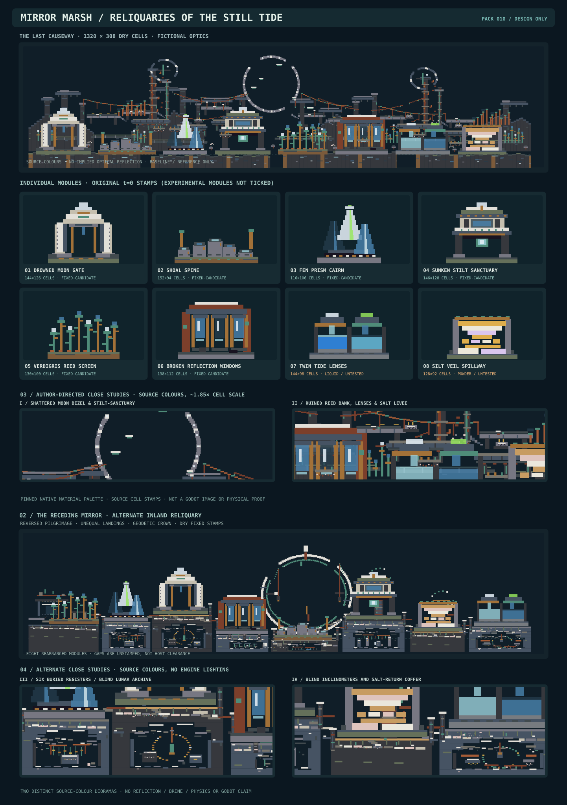

# Mirror Marsh — Reliquaries of the Still Tide (world-feature collection 010)

**DRAFT / DESIGN ONLY / DO NOT MERGE.** Eight cohesive modular, source-pinned compositions about an abandoned tidal pilgrimage route across a reflective mineral marsh. The colour and negative-space language is **metaphorical**: no genuine optical reflections, actual moonlight, vegetation growth, wave/tide motion, native containment or player clearance is claimed.



## Source custody / authoring contract

- Accepted `main` at preparation: `ba9cbc89029be88b812af59b19e5c59829bbcd90`, tree `3af18f50e6094776263119623b64a1b2f4ca0ab2`.
- Native material enum blob: `dcf05895da3015a2e999e3d1cbbae0fdc7fe32b3` (`native/include/cybersand/material.hpp`).
- Shadow catalogue blob: `d7a47d60721598a16589daf177a6ff4401b84b43` (`materials/catalogue/catalogue.json`). This is **shadow metadata**, not a second production material authority.
- Interaction source: `native/include/cybersand/interaction_rules.hpp` blob `b70fc9dc2599f648e5374f06e4cc0ae9cb868d79`.
- Rectangle ordering follows `godot/scripts/demo_worlds.gd::_rect` construction vectors. JSON is a **provisional authoring resource**, not a recognized map-save/importer or prefab schema.
- Coordinates are integer native-cell units, origin upper-left, +x right, +y downward. Rectangles are `[x,y,width,height,material_id]` half-open. Later rectangles replace earlier stamps; **no multilayer semantics, transparency blending, masking, or host clearing**. Every module is bottom-center anchored at 0° and 1×. Rotations, mirrors, scaling and actors have not been qualified.

## Theme, visual grammar, and module catalogue

A deserted pilgrimage network uses drowned windows, ceremonial moon gates, oxidized copper reeds and shards of milky glass to imply silent water without depending on an unproven optical or physics system. Basalt/slate/wet stone creates a low dark horizon, pale marble and quartz establish one point of attention per module, and sparse teal metal implies coastal erosion. Fewer than one in ten visible accent strips should be bright brass or crystal.

| Module | Size (cells) | Original classification | Assembly / interaction |
|---|---:|---|---|
| `drowned-moon-gate` — Drowned Moon Gate | 144×126 | inert-static | A half-submerged ceremonial arch with a dark central passage and a broken quartz moon crest. |
| `shoal-stepping-spine` — Shoal Spine | 152×94 | inert-static | Low fractured stepping stones, with mineral inlays that resemble pools of sky. |
| `fen-prism-cairn` — Fen Prism Cairn | 116×106 | inert-static | Three tapered dark-glass and pale-crystal spires emerge from a salt-grey plinth. |
| `sunken-stilt-sanctuary` — Sunken Stilt Sanctuary | 146×128 | inert-static | An asymmetrical shrine held above a dark reed-choked floor on heavy basalt pilings. |
| `verdigris-reed-screen` — Verdigris Reed Screen | 130×100 | inert-static | Sculptural copper-stem reeds rise from a narrow stone berm, with glass seed heads. |
| `broken-reflection-windows` — Broken Reflection Windows | 138×112 | inert-static | A lower terrace of three interrupted window frames; staggered glass facets read as missing reflections. |
| `twin-tide-lenses` — Twin Tide Lenses | 144×98 | dynamic-liquid | Paired small pools use different liquid families: Water 3 on the left, Brine 24 on the right. |
| `silt-veil-spillway` — Silt Veil Spillway | 128×92 | dynamic-powder | A fractured levee deposits staggered Sand, Salt and Dust bands in the open lower basin. |

**Status interpretation:** `inert-static` means all currently catalogued source materials in that module have `movable=false` and `kernel=0`. It does not prove native stability, collision suitability, support constraints or that the existing host is empty. `dynamic-liquid` and `dynamic-powder` are **untested initial stamps**; their intended final shape is not guaranteed.

## Combined staging scene

`Reliquaries of the Still Tide` occupies **1320×308 cells**, with a baseline at **y=272**. Order: moon gate → shoal spine → prism cairn → stilt sanctuary → reed screen → broken windows → twin tide lenses → silt veil. Origin positions and ground anchors are exact in `pack.json`. Adjacent footprints are separated by at least 12 cells, and the skyline alternates tall and low features.

The combined gallery uses `dry-mirrors` to substitute Water **3**→GlassBlock **120**, Brine **24**→StainedGlass **55**, and `set-sediments` to substitute Sand **2**→SandstoneBlock **39**, Dust **14**→ChalkBlock **99**, Salt **23**→RockSaltBlock **106**. All scene stamps consequently use source-fixed, kernel-zero materials. These are **visual stand-ins**, not thermally or hydrologically derived outcomes.

Three reusable patterns are declared in `pack.json`: `broken-procession` (portal → walk → shrine), `false-reed-forest` (artificial reeds around prism), and `marsh-optics-transect` (windows → paired lenses → silt spill; **dry-only**). Preserve 18–28-cell readable transitions between dominant silhouettes and an isolated crystal accent per subscene. Neighbour constraints, individual floor anchors, two literal material-swap variants per module, baseline and source palette are machine-readable.

## Live-material experiments and limitations

- **Twin Tide Lenses** original has two separated pools. Water ID **3** uses native FreeMass (`lateral_flow=1`); Brine ID **24** uses CellularYield (`lateral_flow=2`). Their placement in two basins is not evidence of retained quantity, sealed walls or compatible pressure mechanics. Run each pool separately before a shared scene; preserve volume, leak and CPU receipts at t=0/60/600. The source-colour swatches are *not* a verified reflective shader.
- **Silt Veil Spillway** original Sand **2**, Salt **23**, Dust **14** are falling/reactive mobile powders and can collapse from the authored initial arrangement. Separately validate t=0/60/600 states, deposition footprint, mass and frame times. **Never** claim the rectangular powder plume is stable.
- **Other six:** fixed source-classified, not proven safe in live worlds; thin isolated spans, windows and clearance are all unverified. Unmapped terrain may fill every intended aperture if the future host does not explicitly clear it.
- Wet-looking Cobblestone **61** and green MossyCobblestone **42** are fixed palette materials, not actual wetness, biological growth or material weathering. Copper/bronze stems in the Reed Screen deliberately avoid Plant's active kernel.
- Thermal/combustion/curing side effects for future added live materials require independent current-source interaction audits. No speculative heat or planting behavior is built into this pack.

**Performance risks:** A large set of overlapping stamp rectangles could cause unnecessary paint and dirty-region work; factor paint into coarse static fields when integrating. Native liquid mass updates and granular movement may dominate tick/dirty-region budget even when the initial stamp is small. This pack is not an engine benchmark. A future importer must define ownership/clearing, capacity limits, host masks, sequential paint order, contact/collision clearance, static/dynamic separation and rollback before use.

## Reproduction & qualification

From repository root on a checkout containing this directory:

```sh
node docs/world-design/mirror-marsh/validate_pack.mjs
node docs/world-design/mirror-marsh/validate_pack.mjs --negative
node docs/world-design/mirror-marsh/render_pack.mjs --check
# To regenerate the deterministic SVG (modifies only this staging resource):
node docs/world-design/mirror-marsh/render_pack.mjs --write
```

Validator compares every packed ID/name/RGBA/state/mobility/kernel/flow/state byte against the local checked-in source catalogue, checks enum numeric identities, all rectangles/variants, exact scene anchors, and the exclusively dry combined arrangement. It must be re-run if source authority changes. The rendered SVG is a **noninteractive source-colour schematic**, not a native/Godot capture or proof of physics.

**Observed during creation:** complete source-colour palette comparison for 30 materials; 306 rectangles validated, 16 literal swap variants checked, 8 dry placements checked, 3 composition patterns checked, 13/13 deliberately invalid mutants rejected, SVG generated in the authoring harness. The checked-in Node scripts, native ticks, Godot rendering, collision clearance, CI and performance were **not** executed in a source checkout as part of creation.

## Future admission questions

1. Do world-feature prototypes receive a versioned importer with explicit host-clearing authority, or remain editor palette drafts?
2. Will glass look like a reflective surface under real source-matched rendering, or should the artwork explicitly remain stylized?
3. How will the liquid basins maintain quantity and owner isolation across native Water FreeMass vs Brine CellularYield?
4. What minimum actor/player clearance and vertical map-placement rules apply?

No implementation or automatic merge is requested. Independent from PLAY, SOL, MAT-AUTH, IN-TOOLS and all solver integrations.

**Other drafted collections inspected for non-duplication:** Lumen Fault #408, Chalkbone Coast #410, Carved Ice Choir #412, Ashroot Nursery #414, Emberglass Fumaroles #420, Silt Clockworks #425, Signal Orchard #430, Dust Meridian #434, Cathedral of Capacitors #437. This collection emphasises optical marsh ruins, not river machinery, electrical architecture or living fungal structures.

## Worker B B4 — The Last Causeway (6 November 2026)

A new authored **dry** flagship vista joins the original eight isolated reliquaries into a damaged tidal pilgrimage landscape. Four distinct basalt shore banks are separated by actual unwritten channels; fractured processional landings, far-shore datum piers, a deliberately broken crescent survey bezel, oxidized tension runs, eroded clerestory masonry and clustered fabricated copper reeds establish a legible route. Disjoint source-material glass inlays evoke *false tide reflections* without any Water or Brine stamps. Masonry joints, stone repair fragments, corroded fasteners and contrasting quartz and dark voids introduce local workmanship. The deterministic SVG sheet adds two enlarged (~1.85× nominal) source-colour crops of the central crescent and eastern levee. The lunar instrument is ruined scenery, not a working mechanism.

The 1320×308 flagship uses ordered `terrain_rectangles` drawn **before** the eight scene placements and `foreground_rectangles` drawn **after** them; neither is an engine layer, terrain-clear mask or admitted authoring importer. All original **8 reusable modules, 16 variants, 3 repeatable patterns and 8 placements are preserved unchanged**. A genuinely alternate inland-route assembly remains the next design opportunity. All new rectangles use exact source palette IDs whose native properties are fixed/kernel-zero at t=0. Glass, apparent wetness, salt deposition and reeds are purely visual compositions, not water, mirrors, lighting or biology. No Godot/native physics, collision/traversal, contact, liquid retention, performance or five-reference comparative visual acceptance has been demonstrated.

From a full source checkout: `node docs/world-design/mirror-marsh/validate_pack.mjs --negative`, `node docs/world-design/mirror-marsh/render_pack.mjs --check`. No run should claim these commands executed unless its actual subprocess exits are recorded.

## Worker B — Ruined moon-tide instrumentation and double tower transect (6 November 2026)

The original dry **Last Causeway** flagship gains two deliberately different failed observation towers, offset annular tide-clock crowns, ruptured suspension cables and conductor rests, tiered maintenance decks, localized fallen ledger tablets, worn bronze survey ferrules, salt-scar inscriptions and copper reed arrays. The new landmarks flank, rather than replace, the existing central fractured lunar datum and preserve visible air gaps where cable spans and tower crowns have failed. Their masonry bearing beams and supporting outriggers provide visual construction logic at full-cell scale, with concentrated close-detail wear rather than random background speckling.

**Source paint:** 623 additional fixed-material terrain rectangles and 66 foreground marks. All eight reusable modules, sixteen literal-swap variants, original scene placements and patterns remain unmodified; Water/Brine/Sand/Dust/Salt dynamic source modules remain dry substitutions in this gallery. The checked-in `render_pack.mjs` deterministically regenerates the updated `preview.svg` from *pack geometry*, with no independent decorative overlays.

**Limits:** this is a flat source-material-colour illustration. Wet appearance, glass reflectivity, pressure/settling, optical power, physical support, terrain clearance, performance and Godot rendering are untested. Full repository CLI checks are still required: `node docs/world-design/mirror-marsh/validate_pack.mjs --negative` and `node docs/world-design/mirror-marsh/render_pack.mjs --check`. No benchmark-gallery-superiority claim.

## Worker B — The Receding Mirror (6 November 2026)

A **second dry 1320×308 native-cell environment** reverses the original eight modules across eight unequal elevations and separate mineral shelves. All eight reusable originals, sixteen variants, three patterns and original *Last Causeway* geometry are preserved. This alternate features deliberately broken pilgrim bridges, stratified escarpments, a fractured double geodetic crown with suspended weights, a sunken seven-rib ledger court, contrasting eastern inclinometer ruins, retained open channels, carved masonry joints and localized oxidized inscriptions.

The independent `alternate_scene` contains **852 ordered fixed-native-material terrain rectangles** and **114 foreground inscriptions**, painted behind and ahead of the eight rearranged dry module stamps. The deterministic SVG appends a full alternate panorama and two close studies. The updated validator covers alternate bounds/anchors, eight source-module identities, four-plus floor elevations and no mobile/kernel materials, with nine dedicated negative mutations.

**Evidence limits:** This is source-colour SVG art, not Godot rendering. No Water/Brine/Sand/Salt settling, optical reflection, native clearance, power or performance was tested. Unstamped channels are not host-clearing commands. A complete checkout must run `node docs/world-design/mirror-marsh/validate_pack.mjs --negative` and `node docs/world-design/mirror-marsh/render_pack.mjs --check`; independent human comparison to all five reference captures remains open.

## Worker B — Six Buried Registers: deep-crypt architectural refinement (6 November 2026)

The alternate *Receding Mirror* now has a physically **unwritten** sequence of six differentiated undercroft voids carved from previously continuous lower terrain: a silt-tax abacus chamber beneath the western reed bank, a broken suspended lunar-archive pendulum beneath the moon gate, two differently proportioned dry reed and sluice drains beneath the central procession, a four-inclinometer funerary survey gallery beneath the raised sanctuary, and an east salt-return coffer with a fractured counterweight ring. Source-fixed pier stones, unequal broken thresholds, cornice scars, ledger inscriptions, staggered intact/broken rail segments, corroded copper ferrules and chipped marble are concentrated where the instrument assembly meets its bearing architecture. The original eight modules, sixteen variants, patterns, both panoramic compositions and their placement anchors are preserved; the flagship is unchanged.

The apertures are made by **splitting the existing ordered terrain and foreground rectangles around explicit stepped openings**; they are not black paint or host-terrain erasure. New details are source-pinned, immovable/kernel-zero material rectangles in the alternate foreground. Two alternate SVG detail studies now focus on the buried register halls and lower east mechanisms. The SVG is a flat source-colour design resource only; dry visual glass is not a genuine reflection, and no source physics, support, Water/Brine behavior, traversability, collision clearance, Godot rendering or performance claim is made. Comparable native-engine reference-gallery review and source-checkout Node CLI qualification remain separate gates.

## Worker B — The Ferryman's Last Ledger (6 November 2026)

**Flagship landmark:** The dry *Last Causeway* receives a fractured tidal passage ferry and ruined tariff chapel in its formerly quiet western upper skyline. A distinct two-mast barge skeleton has disjoint hull beams, damaged dark-glass signal vanes, exposed keel, missing deck ribs, severed rigging, an open toll-office window, broken tally registers, unequal token offerings and an incomplete gangway toward the nearby shore surveyworks. Corroded hangers and bearing stones narrate the vessel's conversion into a failed pilgrims' memorial. The air around its mast, broken vanes and cutwater is intentionally retained rather than filled with random speckle.

**Source geometry:** 251 additional native-ID, source-catalogue-fixed/kernel-zero ordered **foreground** rectangles affect only the existing flagship composition. Original eight reusable modules, sixteen variants, all existing placements and patterns, source pins, terrain, and the alternate *Receding Mirror* remain byte-identical. All source colours are strictly illustrative: dark/stained glass is **not** a real optical reflection, and this is not a functioning ferry, mechanical suspension, electrical signal, native collision surface or tested walking path.

**Reproducibility:** The first deterministic SVG close study now frames the ferry and broken tariff office; the eastern source-colour study and both alternate-scene crops are retained. Full-checkout commands remain `node docs/world-design/mirror-marsh/validate_pack.mjs --negative` and `node docs/world-design/mirror-marsh/render_pack.mjs --check`. Source-pinned isolated V8 execution of the checked-in validation/rendering function bodies is a separate test mode, **not** evidence of these Node CLI subprocess exits. Real Godot/native camera captures, Water/Brine dynamics, actor clearance, performance, matched-scale five-gallery human review and artistic acceptance remain outstanding.
