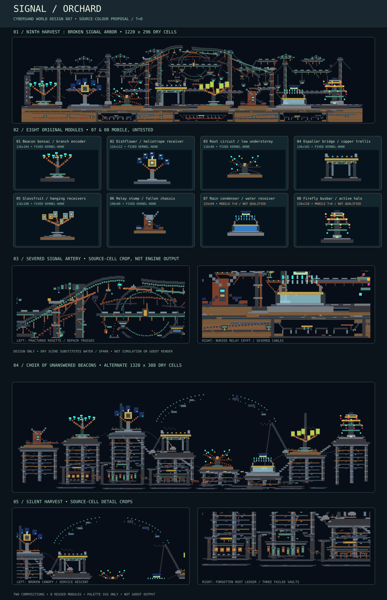

# SIGNAL ORCHARD — World-feature collection 007

**DRAFT, design-only; do not merge.** A derelict above-ground artificial grove of pruned copper branches, solar dishflowers, cable undergrowth, glassfruit transponders, damaged relays and two separately staged mobile experiments. This is not an electrical simulation, working generator, playable map, or Godot render.

## Exact source and staging contract

Main `ba9cbc89029be88b812af59b19e5c59829bbcd90`, tree `3af18f50e6094776263119623b64a1b2f4ca0ab2`; native material enum blob `dcf05895da3015a2e999e3d1cbbae0fdc7fe32b3`; catalogue shadow blob `d7a47d60721598a16589daf177a6ff4401b84b43`; interaction-registry blob `b70fc9dc2599f648e5374f06e4cc0ae9cb868d79`. Material definitions/IDs and source colours were read from current main. The shadow catalogue does not supersede native behaviour. `pack.json` records 26 exact material IDs, RGBA, kernel, mobility, phase and initial state. No catalogue modifications.

Integer native cells; `[x,y,width,height,native_id]` rectangles; top-left origin, +x right/+y down, half-open bounds, later paints overwrite earlier. This matches the primitive rectangle arguments in `godot/scripts/demo_worlds.gd::_rect` but is a **provisional staging schema**, not a CYSD save, native GEN plan, engine layer or admitted map-editor format. Blank areas do not erase host cells. No mirroring/rotation/noninteger scale. Ground anchors at local bottom-centre; scene seam world y=248. Future importer must establish clearing authority, collision and source/owner checks.

## Visual style and assembly grammar

Dominant: BasaltColumns **100**, Slate **49**, WroughtIron **50**, CopperPipe **69**, VerdigrisCopper **54**, with CableBundle **74** branch traces. Reserve accent colour for NeonCyan **77**, NeonMagenta **78**, NeonAmber **79**, SolarPanel **129**, PhosphorPanel **127** and StainedGlass **55**. These are inert colour materials, **not evidence of illumination, electrical charge, power or photosynthesis**. Keep roughly 70% low-value structural mass, 20% oxidized copper/glass and 10% saturated signal markers. Alternate one tall canopy with one low/degraded shape, preserve arch portal and fruit separation, avoid random densely repeated stamps.

## Feature catalogue

| Module | Native cells | Original source classification | Dry scene variant |
|---|---:|---|---|
| `beacon-bonsai` — Beacon bonsai / branch encoder | 116×104 | Fixed, kernel-None candidate | `cold-buds` |
| `dishflower` — Dishflower / heliotrope receiver | 124×112 | Fixed, kernel-None candidate | `quiet-night` |
| `root-circuit` — Root circuit / low understorey | 118×90 | Fixed, kernel-None candidate | `rust-roots` |
| `espalier-bridge` — Espalier bridge / copper trellis | 136×102 | Fixed, kernel-None candidate | `amber-wires` |
| `glassfruit` — Glassfruit / hanging receivers | 116×108 | Fixed, kernel-None candidate | `jade-fruit` |
| `relay-stump` — Relay stump / fallen chassis | 108×86 | Fixed, kernel-None candidate | `oxide-scar` |
| `rain-condenser` — Rain condenser / water receiver | 124×94 | Dynamic, requires native tests | `dry-mirror` |
| `firefly-busbar` — Firefly busbar / active halo | 110×118 | Dynamic, requires native tests | `cold-lantern` |

Eight modular arrangements, 366 ordered material-cell rectangle operations, 16 ID-substitution variants, three repeatable patterns and a 1220×296-cell combined dry composition. Each feature carries exact dimensions, local coordinates, ground anchor, source IDs, neighbor exclusions, orientation limit and clearance hypothesis. `scanned-colonnade` joins encoder/dish/coppice; `bridge-to-orchard` joins arch/glassfruit/stump; `receipts-of-light` joins receiver/coppice/halo. Repeat with rest gaps, not a monotonous stamp line.

## Physics, interactions and validation boundaries

**Six fixed scenery candidates:** beacon-bonsai, dishflower, root-circuit, espalier-bridge, glassfruit and relay-stump use only native movable=false/kernel=None materials. Visual connection is not actor-clearance, contact or structural-robustness acceptance. Avoid assumed thermal immunity at active neighbors.

**Active test-only arrangements:** rain-condenser uses mobile native Water **3** / FreeMass; do not assume its basin retains water. The gallery `dry-mirror` substitutes fixed GlassBlock **120** for every Water cell. firefly-busbar uses mobile Spark **34** / agent kernel; persistence, ignition, byproducts and render visibility are not demonstrated. The gallery `cold-lantern` substitutes fixed NeonAmber **79** for every Spark cell. Test originals separately with 0/60/600 ticks, type/state and quantity receipts, boundary leakage, neighbouring heat/combustibles and measured update costs. No native ticks were run.

**Performance/render:** 366 rectangle operations are not a CPU/GPU benchmark. The SVG uses source RGBA only, not Godot shaders, glow, collision or shadowing. Validate actual camera-scale readability and render/physics cost before incorporating into maps.

## Prospective integration

Admit schema and host clearing/ordering ownership; map local 1× rectangles into a bounded placement slot; qualify passage and Rapier actors; separately execute Water/Spark dynamics; measure native/Godot performance; only then consider a versioned map-authoring resource. No production maps, material catalogue, solver, worldgen, SOL, PLAY, MAT-AUTH or IN-TOOLS files changed.

## Verification record

Connector-read pinned main; 26 source material definitions matched, 366 rectangles in bounds, 16 variants structurally checked, eight gallery placements found fully fixed, and 10/10 negative mutations rejected by the authoring-side validator. Source-colour SVG generated. Checked-in validator, native simulation, Godot screenshot, CI and performance **not run**.
