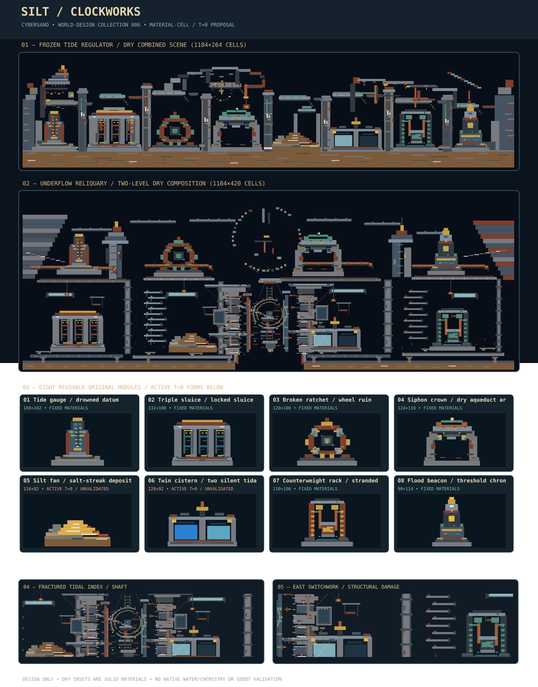

# SILT CLOCKWORKS — World feature collection 006

**Design-only, DRAFT**. An abandoned tidal calculation station made from real CyberSand source materials: standing gauges, three-slot sluice, broken fixed ratchet, dry siphon arch, salt-streak silt fan, twin Water/Brine troughs, fixed hanging counterweight, end-of-channel light-colour beacon. This is NOT a playable map, importer, admitted GEN recipe, CYSD save or moving-machine simulation.



## Materials and source custody

Source `main` [`ba9cbc89029be88b812af59b19e5c59829bbcd90`](https://github.com/techrote/cybersand/commit/ba9cbc89029be88b812af59b19e5c59829bbcd90), tree `3af18f50e6094776263119623b64a1b2f4ca0ab2`. Native enum blob `dcf05895da3015a2e999e3d1cbbae0fdc7fe32b3`; shadow catalogue blob `d7a47d60721598a16589daf177a6ff4401b84b43`; interaction header blob `b70fc9dc2599f648e5374f06e4cc0ae9cb868d79`. Shadow entries are inspection facts, not a production-material authority cutover. `pack.json` contains 30 exact source IDs, their RGBA/state/kernel/mobility/flow metadata and the frozen source paths. Production physics remains native.

**Eight modules / 206 ordered rectangles / sixteen ID-swap variants / three assembly patterns / 1184×264 combined dry scene.**

| Module | Dimensions | Source physical category | Combined-scene variant |
|---|---:|---|---|
| `tide-gauge` (Tide gauge / drowned datum) | 108×102 | Fixed kernel-None material | `low-tide` |
| `triple-sluice` (Triple sluice / locked sluice teeth) | 132×108 | Fixed kernel-None material | `quiet-lock` |
| `ratchet-wheel` (Broken ratchet / wheel ruin) | 120×100 | Fixed kernel-None material | `patina-teeth` |
| `siphon-crown` (Siphon crown / dry aqueduct arches) | 124×110 | Fixed kernel-None material | `green-crown` |
| `silt-fan` (Silt fan / salt-streak depositional apron) | 116×82 | Active t=0; unsettled | `dried-fan` |
| `twin-cistern` (Twin cistern / two silent tidal mirrors) | 128×92 | Active t=0; unsettled | `glass-mirrors` |
| `counterweight` (Counterweight rack / stranded lift) | 110×106 | Fixed kernel-None material | `patinated-load` |
| `flood-beacon` (Flood beacon / threshold chronometer) | 90×114 | Fixed kernel-None material | `dark-beacon` |

## Style and composition rules

Use cool ReinforcedConcrete `58`, Slate `49`, SteelPlate `62`, WetCobblestone `61`; interrupt them with oxidized RustedSteel `65`, VerdigrisCopper `54`, BrassPanel `119` and thin inert NeonAmber `79` highlights. The amber and LED-like pixels **do not implement lighting**. Keep silhouettes distinct: tall gauge → wide gate → huge broken ring → overhead copper conduit → sediment apron → twin mirrors → counterweight → beacon. Keep voids beneath the siphon, through the sluice and inside the ring. Repeat only after neutral terrain, not as a monotonous stamp line. Module-specific neighbour rules and clearances appear in `pack.json`; the three `repeatable_patterns` give later generators exact allowed adjacency themes.

Coordinates are **integer native cells**, +x right, +y down, rectangles `[x,y,w,h,material_id]` matching `godot/scripts/demo_worlds.gd::_rect`. Overlaps are drawn in listed order (later writes win). The bottom-centre ground anchor is at local y=height; combined-scene seam y=226. Only 0° orientation and 1× scale have been authored. No layers, parallax, mirroring or runtime transforms are provided. A missing cell **does not erase host terrain**. Future integration must separately define host-area clearing, paint priority, collision, material readback and owner custody before installing any module.

## Physical classification and risk

- **Six fixed-scene candidates:** `tide-gauge`, `triple-sluice`, `ratchet-wheel`, `siphon-crown`, `counterweight`, `flood-beacon`. Their original geometry uses only kernel-None immovable cells. This is a source-based t=0 classification, not player-clearance or stability acceptance.
- **Dynamic deposition:** `silt-fan` has mobile powders Sand `2`, Salt `23`, Rust `29`. Gravity and neighbor exchange may move them instantly. Static gallery variant `dried-fan` substitutes fixed PackedEarth `56`, RockSaltBlock `106`, RustedSteel `65`.
- **Dynamic liquids:** `twin-cistern` uses Water `3` and Brine `24` in two compartments. Water follows native Water kernel; Brine is a mobile yielding liquid. Flow, numerical state, containment, spill, contact, retention and wall interactions are **not validated**. Static gallery `glass-mirrors` replaces both liquids with solid GlassBlock `120` and DarkGlass `72`, which are collision solids, not real water.
- **Nonfunctional machines:** wheels do not rotate, sluices do not gate, pipes do not route pressure, counters do not lift; no electric clocks, emissive lighting, tidal timing, gameplay triggers or temperature systems are implemented.

## Preview and qualification

The `preview.svg` is generated deterministically from `pack.json`, using exact source RGBA. The top gallery applies inert swaps; the eight thumbnails depict each original t=0 form. No real native/Godot screenshot. Reproduce on a pinned source checkout:

```sh
node docs/world-design/silt-clockworks/validate_pack.mjs --source-check --self-test
node docs/world-design/silt-clockworks/render_pack.mjs --check
```

During this authoring session a separate JS source-check and geometry validator passed (206 rectangles, 16 variants, 30 exact catalogue entries, 13/13 expected invalid cases rejected), and source-colour SVG was generated. **Not run**: checked-in Node on a checkout, actual native simulation, Water and Brine fill conservation, rust and salt settling, Godot/Windows rendering, Rapier clearance, host erasure, chunk borders, 60/600-tick behavior, CI or runtime performance. Static classification does not mean those checks passed.

## Future integration gate

Keep this contribution isolated and Draft. Independent format/ownership review first; then material-cell installation/clearance test of the dry scene; then separate original active feature fixtures with t=0/60/600 tick quantities, leaks, contacts, state hashes, active chunks and performance comparison. Do not modify or merge into PLAY, SOL, MAT-AUTH, IN-TOOLS or solver tasks.

Next unrelated themes: **Signal Orchard**, **Dust Meridian**, **Cathedral of Capacitors**.

## Worker B B1 — Broken Tide Ledger flagship (5 November 2026)

This *source-colour panorama* now depicts the eight motifs as parts of one severed tidal calculation station rather than isolated catalogue pieces: seven jointed piers, an eight-section broken inspection bridge, collapsed clock-house clerestory and inert dial, ruined left datum office, torn eastern crane, interrupted culverts, eroded shore cheeks and a stratified dry foundation. Blank skyline and interrupted beam ends are deliberate; bright brass and oxidized copper concentrate at joints and measuring equipment, not across the whole scene.

Six fixed reusable originals gain **119** source-faithful, inert workmanship rectangles for scale marks, rust-creased sluice faces, bearing fasteners, pipe joints, counterweight abrasions and cracked beacon details. The terrain scene has a net **+435** rectangle change, including removing an implausible flat top ceiling. Original eight modules / sixteen variants / three patterns / eight fixed-order placements and their anchors remain. Scene remains 1184×264 dry source-colour t=0; no real clock, light, water, brine, bridge, clearance, contact or physical behavior has been established.

**Before/after ordered-cell evidence:** versus original consolidation `3d97d7d5a3f061bb74863ccdc23e5fe07c447005`, **77,247 / 312,576** material cells change in the composite; **46,225** are above y=125 and **12,055** lie in x=300–739 / y=20–129. **50.8%** remains unwritten air. These are raster-geometry measurements, not reference-art superiority or human visual scores. A fundamentally different lower-basin placement remains the next artistic pass.

**Checks and caveats:** executed the *actual checked-in* `validate_pack.mjs` core validation and self-test functions against the revised JSON and unmodified source catalogue: PASS (8 features, 16 variants, 325 feature rectangles, 450 scene rectangles, 13/13 mutation refusals). Native enum names and pinned source Git blobs were also checked against the live branch. The checked-in `render_pack.mjs` renderer reproduced the original SVG byte-exactly and generated this revision deterministically. **No Node CLI process/exit code was obtained**, since local repository checkout is unavailable to the executor; do not mislabel these as CLI runs. Real Godot/native render/tick/clearance/performance and five-gallery human comparison remain untested.
