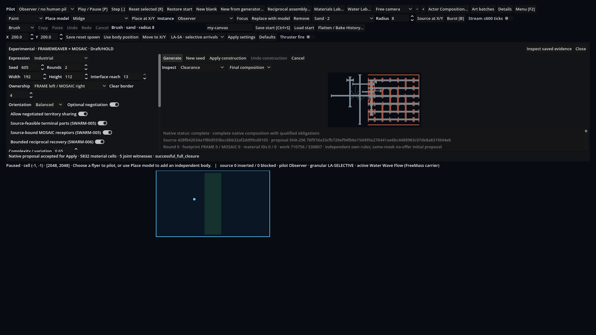
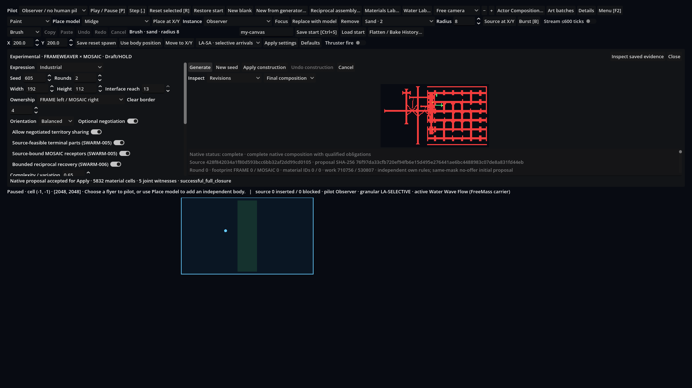
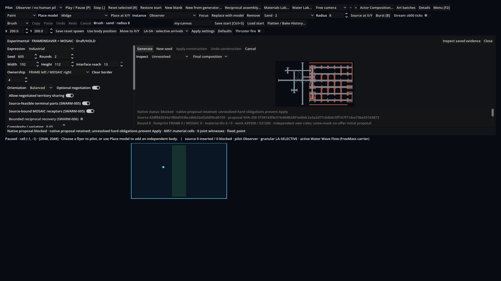
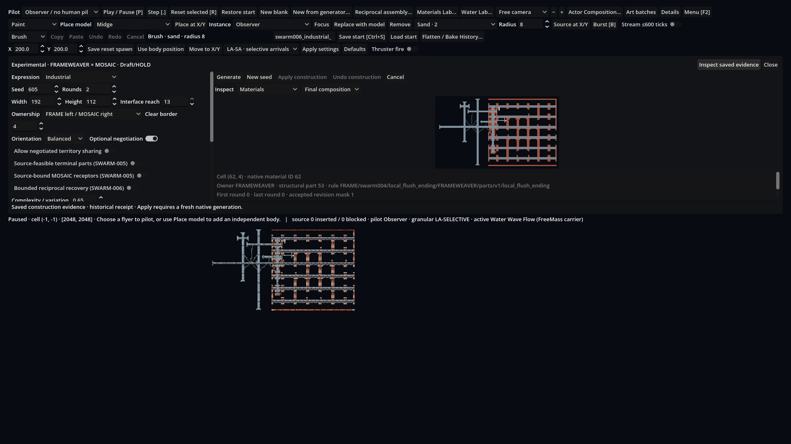
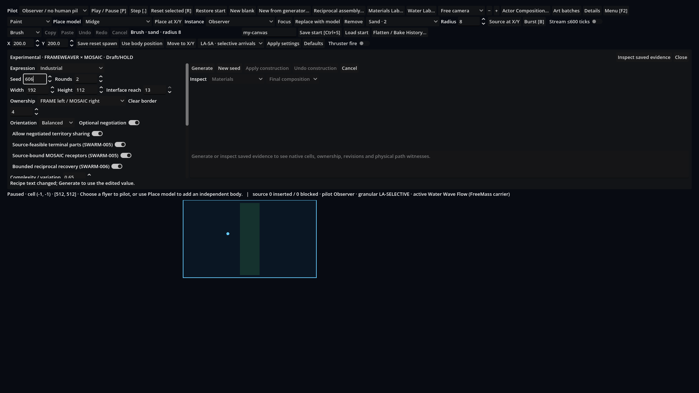

# Exact-source Windows evidence gallery

Source `428f842034a1f80d593bcc6bb32af2dd99cd0105`, hosted run [44959721570](https://github.com/techrote/cybersand/actions/runs/44959721570), Windows artifact `14731542453`. These are original, unedited captures from the actual qualified source and pristine evaluator. All seven were visually inspected; the full campaign retains its other PNGs and raw native records in the evidence archive.

Actual hosted Windows source/pristine-package captures; synthetic Worlds; no physical NVIDIA or private owner-World acceptance.

Industrial ON starts with zero original foreign-required obligations, while its OFF control starts with two. These pictures do not establish closure of the same original sockets. Qualified witness and closure claims come from raw native proofs, not imagery alone.

## Final Joints: native-authorized Industrial605 Recovery ON; five qualified joint witnesses.

SHA-256 `eefa2c4109cb49e4e9fcd606e1b06d407c04abc7eac3d963e8245a6425c6843d`.

## Final Unresolved: the complete composed result has zero unresolved obligations.

SHA-256 `ed2157735c2b27f270235bb29db0469a607c49e1bb25baeeea80a5a654d0372a`.

## Final Clearance layer selected and enabled.

SHA-256 `bd963a9dd456b4dd1147c90b3e17fe970ccd61d624f71ac69889725a800d6e5f`.

## Final Revisions layer selected and enabled; actual native revision overlay.

SHA-256 `c930e630e8a5704de54774288c5fc777a119fc4bd251a1aabb1f144379319924`.

## Recovery OFF: Blocked with two unresolved original obligations; Apply is disabled and World remains unchanged.

SHA-256 `56d6143a0e74e8631403c290f312eb46b69d66d9ea1d505e8c0bc57e4c2d835e`.

## Fresh process after Save/exit: restored native materials and read-only saved evidence; Apply requires fresh generation.

SHA-256 `cd47c239bffa394224d4fb0facb880b24febd532a759fcecc9f7f0d03af2d8dc`.

## Actual uncommitted seed605 to606: prior preview and Apply authority retire before the field is committed.

SHA-256 `bdab16cde5d74f55875d1688528260c8ca42471dc76ccff5d46b7e1cec3a31aa`.

