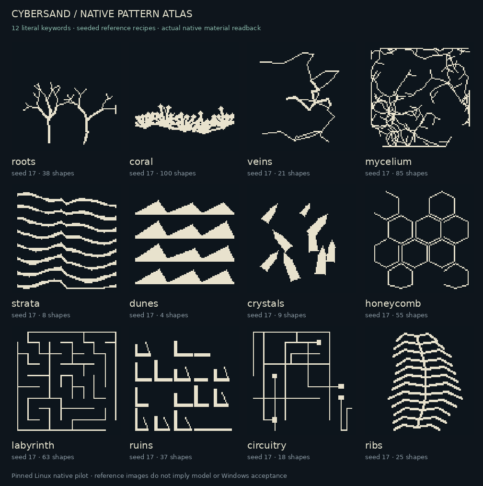

# Qualified native pattern gallery

Open **[native_atlas.html](native_atlas.html)** after downloading it. This one
HTML file embeds the original native PNGs and supports theme, source, layout and
seed filters without a server or network. Click an image to obtain its original
96×96 PNG. Every tile exposes the exact program and native receipt identities.



The initial atlas contains **192 reference renders**: twelve themes × eight
structural templates × two seeds. They were selected from the **864/864 passing
native teacher cases**. All 192 native readbacks differ, and the repeated
32-case pilot reproduced its operation hashes, raw material bytes and PNGs
exactly. Those numbers measure execution and reproducibility; image uniqueness
does not establish artistic merit.

## What "qualified" means here

Every gallery case was drawn through the existing mounted Art planner/executor
into an actual paused native CyberSand World. Independent reconstruction from
the native before/after receipts matches the separate native capture, cropped
material file and PNG pixels. Full-world scans observed zero writes outside the
requested focus and zero unexpected materials. Global source/input/runtime
custody, protection and Stop checks passed. Exact Undo/Redo/save/reopen was
checked on one representative per theme in the full campaign and on all 32
cases in the initial pilot.

Source: `90719c72b9fcf90593fb7878354051ad601b47fd`. Engine:
`4.7.stable.official.5b4e0cb0f`. Native library SHA-256:
`3a8b0b2cd04f09054426842f978e2421aad4016aae03dec91ed527ff50b953cd`.
This is a **pinned Linux headless native-material pilot**, not current-main,
Windows, graphical framebuffer or human aesthetic acceptance.

The images show native material IDs through a fixed dark/ivory display palette,
using Godot `Image`. The source PNGs are preserved unchanged. Contact sheets use
nearest-neighbor enlargement only; no generated illustration substitutes for a
native result. Any later model-generated section must be labeled separately
and retain all rejected requests in its reported success denominator.

## Visual review and known weaknesses

The assistant viewed all 192 images in three complete contact sheets. Family
motifs and layout changes are visible, but this is provisional inspection rather
than a blind recognition score. Coral defaults crowd the bottom of the canvas.
Narrow border strips compress several motifs, especially crystals, dunes and
ribs. Companion layers sometimes remain decorative framing instead of an
integrated composition. These observations are recorded in
[`corpus/visual_review.json`](../corpus/visual_review.json) as explicit next work;
they have not been converted into a fabricated human acceptance rate.

## Rebuild from archived native evidence

`build_gallery.py` only assembles verified native PNGs. It rejects a failed
packet, mixed runtime identities, invalid cases, changed operation digests and
changed image bytes. It never paints compiler geometry itself.

```bash
python experiments/wb-art-slm-001/gallery/build_gallery.py \
  --config /absolute/path/gallery-build-config.json \
  --out /absolute/path/gallery
```

The configuration contains a `batches` array. Each item names `kind`, `cases`
(the exact native input JSON), `artifacts` (native output directory), `receipts`
(globally verified receipt JSON), and optional `select` case IDs and `model`.
The builder emits the multi-file atlas, the self-contained atlas and a manifest.
The source repository keeps the self-contained atlas, compact manifest and
contact sheet; the evidence archive preserves original files and raw native
materials.
